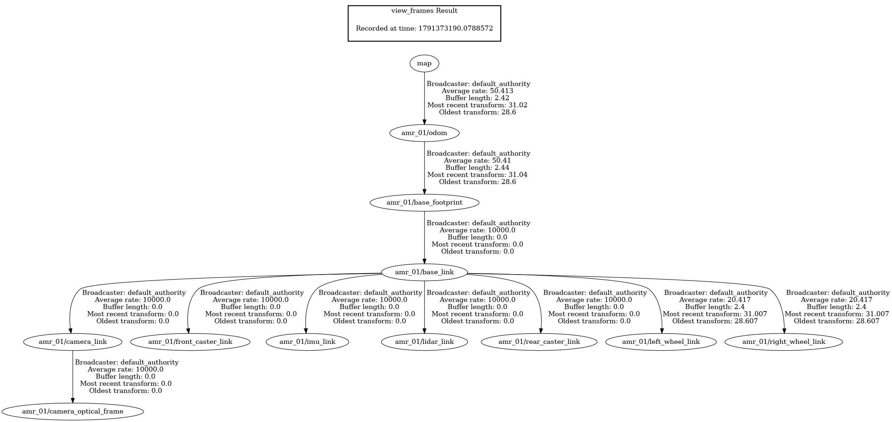

# 노드 API 명세

> 원 명세서 요구사항: 각 노드의 토픽·서비스·액션 인터페이스를 명세한다. 인터페이스가 바뀌는 PR은 이 문서를 같은 PR에서 갱신한다.

## 1. 이름 규칙

| 대상 | 규칙 | 예 |
| --- | --- | --- |
| 로봇 네임스페이스 | `amr_<2자리 번호>` | `amr_01` |
| 로봇 토픽 | 노드는 상대 이름을 쓰고, 네임스페이스는 bringup이 부여 | `/amr_01/scan`, `/amr_01/odom` |
| 도메인 토픽 | `<도메인>/<이름>` | `/amr_01/perception/objects` |
| Fleet 전역 토픽 | `/fleet/<이름>` | `/fleet/task_assignments` |
| TF 프레임 | `<네임스페이스>/<프레임>` | `amr_01/base_link` |
| 메시지 타입 | PascalCase, `amr_msgs` | `amr_msgs/msg/DetectedObject3DArray` |

표준 토픽(`scan`, `odom`, `cmd_vel`, `tf`, `map`)은 ROS 관례 이름을 그대로 쓴다.

## 2. TF 트리 (로봇별)

```
map
└── amr_0N/odom            (map→odom: ekf_global, 민지)
    └── amr_0N/base_footprint   (odom→base_footprint: ekf_local, 품질은 지수 책임)
        └── amr_0N/base_link              (0, 0, 0.18)  몸체 중심
            ├── amr_0N/lidar_link         (0.15, 0, 0.2)
            ├── amr_0N/camera_link        (0.18, 0, 0.25)
            │   └── amr_0N/camera_optical_frame  rpy (-π/2, 0, -π/2)
            ├── amr_0N/imu_link           (0, 0, 0.1)
            ├── amr_0N/left_wheel_link    (0,  0.17, -0.08)
            ├── amr_0N/right_wheel_link   (0, -0.17, -0.08)
            ├── amr_0N/front_caster_link  ( 0.22, 0, -0.15)
            └── amr_0N/rear_caster_link   (-0.22, 0, -0.15)
```

좌표는 부모 프레임 기준 (x, y, z) [m]. 센서 위치는 원 명세서 TF 예시값이며, 1주차 URDF 골격에서 `view_frames`로 위 구조를 확인했다. 위치추정까지 띄운 전체 트리 확인은 [2-2절](#2-2-전체-tf-트리-확인-view_frames-107).
센서 위치(extrinsic)는 2주차 센서 플러그인에서 위 값 그대로 확정했다. 센서 메시지의 `frame_id`는 위 링크 이름과 같다 (`lidar_link`, `imu_link`, `camera_optical_frame`, sim에서 확인).

### 2-1. TF 발행 주체 (D4, A안: EKF 두 개)

`map→odom`과 `odom→base_footprint`는 각각 한 노드만 발행한다. 근거와 비교안은 [localization.md 1절](algorithms/localization.md#tf-발행-구성-d4-a안-확정)을 따른다.

| TF | 발행 노드 | 입력 | 끄는 설정 |
| --- | --- | --- | --- |
| `world → map` | `amr_bringup system.launch.py` (`static_transform_publisher`, 10/13) | `map_origin_in_world` | `localization:=false`면 안 띄움 |
| `map → odom` | `ekf_global` (민지) | `odom`, `imu/data`, `amcl_pose` | AMCL `tf_broadcast: false` |
| `odom → base_footprint` | `ekf_local` (민지) | `odom`, `imu/data` (전역 입력 없음) | `amr_odometry` `publish_tf: false`, Gazebo DiffDrive `publish_odom_tf:=false` |

- EKF의 `base_link_frame`은 `base_footprint`로 둔다 (위 TF 트리 기준).
- `world → map`은 지도 원점(Gazebo world에서 본 `map` 원점)을 TF 하나로 내는 것이다. world 좌표로 적은 설정(`zones.yaml`
  등)을 쓰는 노드는 원점 값을 복사하지 말고 이 TF를 조회한다 (구역 클라이언트 `zones_frame:=world`). `world`는 TF 트리의 새
  뿌리가 되고, Gazebo 정답 토픽(`ground_truth/odom`)의 `frame_id`와 같은 이름이다.
- `amr_odometry`의 `publish_tf`는 기본 `false`다. EKF 없이 오도메트리만 단독으로 시험할 때만 `true`로 켠다.
- EKF 없이 sim만 띄우면 Gazebo DiffDrive가 `odom → base_footprint`를 발행한다 (`publish_odom_tf` 기본 `true`). EKF를 띄울 때는 `sim.launch.py publish_odom_tf:=false`로 끈다.

### 2-2. 전체 TF 트리 확인 (`view_frames`, 10/7)

위치추정 스택 전체를 띄우고 `ros2 run tf2_tools view_frames`로 뽑았다 (`amr_01`, 지도 v0, sim 시간 기준).



원본: [reports/tf_tree.gv](reports/tf_tree.gv) (graphviz). ROS 2 Humble tf2는 발행 노드 이름을 기록하지 않아 그림의 Broadcaster는 전부 `default_authority`로 나온다. 발행 주체는 아래 표처럼 노드 목록과 설정으로 확인했다.

| TF | 발행 | 토픽 | 주기 (측정) |
| --- | --- | --- | --- |
| `map → amr_01/odom` | `ekf_global` | `/tf` | 50.4 Hz (`frequency: 50`) |
| `amr_01/odom → amr_01/base_footprint` | `ekf_local` | `/tf` | 50.4 Hz (`frequency: 50`) |
| `base_link → left/right_wheel_link` | `robot_state_publisher` (`joint_states`) | `/tf` | 20.4 Hz |
| `base_footprint → base_link`, `base_link → 센서·캐스터`, `camera_link → camera_optical_frame` | `robot_state_publisher` | `/tf_static` | 한 번 (transient local) |

확인한 것:

- **프레임마다 부모가 하나다.** `map → odom → base_footprint`가 끊김 없이 이어지고 로봇 링크 9개(몸체·바퀴 2·캐스터 2·센서 4)가 모두 `base_footprint` 아래에 있다.
- **`map→odom`·`odom→base_footprint`를 EKF만 낸다 (2-1절).** AMCL은 `/tf` 발행자로 잡히지만(브로드캐스터를 만들어 둠) `tf_broadcast: false`라 내지 않는다. 두 TF 주기가 EKF `frequency`(50 Hz)와 같다. DiffDrive TF는 `publish_odom_tf:=false`면 브리지를 만들지 않는다 (`spawn_robot.launch.py`).
- **`/tf_static` 값이 위 2절 트리와 같다.** `base_link` (0, 0, 0.18), `lidar_link` (0.15, 0, 0.2), `camera_link` (0.18, 0, 0.25), `imu_link` (0, 0, 0.1), 캐스터 (±0.22, 0, −0.15), `camera_optical_frame` 회전 쿼터니언 (0.5, −0.5, 0.5, −0.5) = rpy (−π/2, 0, −π/2).
- **센서 `frame_id`가 링크 이름과 같다.** `/amr_01/scan` → `amr_01/lidar_link`, `/amr_01/imu/data` → `amr_01/imu_link`.
- **`map`에서 센서까지 변환이 된다.** 로봇을 조금 돌린 뒤 `tf2_echo map amr_01/base_footprint` = (0.504, 0.147, 0), yaw 29.9°일 때 `tf2_echo map amr_01/lidar_link` = (0.634, 0.222, 0.380). (0.15, 0)을 29.9° 돌려 더한 값, 높이 0.18 + 0.2와 같다.

다시 뽑는 법 (컨테이너 안, 각각 다른 터미널):

```bash
ros2 launch amr_gazebo sim.launch.py gui:=false rviz:=false publish_odom_tf:=false
ros2 launch amr_odometry odometry.launch.py
ros2 launch amr_odometry sensor_filters.launch.py
ros2 launch amr_localization localization.launch.py
ros2 run tf2_tools view_frames            # frames_<시각>.pdf / .gv
dot -Tpng frames_*.gv -o tf_tree.png
```

카메라는 꺼도(`enable_camera:=false`) `camera_link`·`camera_optical_frame` TF는 URDF에서 그대로 나온다.

## 3. 합의가 필요한 경계 (P0 확정 대상)

| 경계 | 담당 | 결정할 것 |
| --- | --- | --- |
| 인식 결과 메시지 | 연우 ↔ 이진·지수 | 3D 객체 메시지(class, confidence, PoseWithCovariance) — Costmap·BT가 소비. 초안: [4절](#4-amr_msgs-인터페이스-초안) |
| 중앙 ↔ 분산 Fleet | 하연 ↔ 이진 | 작업 할당·확인, 구역 허가, 경매 메시지, 서버 heartbeat. 초안: [4절](#4-amr_msgs-인터페이스-초안) |
| 하네스 지표 | 민지 ↔ 하연 | 수집 지표와 로그 포맷 (명세서 1-4절 측정 절차 표 기준, 합의: [tools/harness/README.md](../tools/harness/README.md#로그-포맷)) |
| 매핑 → 위치추정 인계 | 지수 → 민지 | 지도 파일, `/odom`·`/scan`·`/imu/data` 합격 조건, 센서 노이즈 파라미터 변경 통보 ([명세서 8-2절](project-spec.md#8-2-매핑위치추정-분업-지수--민지)) |

## 4. amr_msgs 인터페이스 (초안)

> 상태: 9/28 회의 결과 반영. 대주제별 검토자 승인 후 "초안" 표시를 뗀다. 필드 정의와 주석은 [src/interfaces/amr_msgs/](../src/interfaces/amr_msgs/)의 `.msg`·`.action` 파일이 기준이다.

### 4-1. 대주제와 검토자

변경 절차는 [CONTRIBUTING 5절](../.github/CONTRIBUTING.md#5-인터페이스-변경-절차-amr_msgs)을 따른다. 발행·구독 담당자 전원의 승인이 필요하다.

| 대주제 | 인터페이스 | 한 줄 설명 | 필수 검토 | 참고 검토 |
| --- | --- | --- | --- | --- |
| 공통 | `ErrorInfo` | 오류 코드 + 설명. 할당 거부, 작업 실패에 쓴다 | 전원 | — |
| 인식 | `DetectedObject3D`, `DetectedObject3DArray` | 카메라로 본 것 (한 장면, ID 없음) | 연우, 이진, 지수 | — |
| 추적 | `TrackedObstacle`, `TrackedObstacleArray` | 시간에 걸쳐 따라가는 장애물 (ID, 속도, 크기) | 연우, 이진 | — |
| 추적 | `CollisionRisk`, `CollisionRiskArray` | 장애물과 이 로봇의 충돌 위험 (TTC) | 연우 | 이진 |
| 안전 | `SafetyStatus` | 감속·정지 여부와 원인 | 연우, 이진, 지수 | — |
| Fleet 서버 → 로봇 | `Task`, `TaskAssignment`, `FleetHeartbeat`, `ZoneGrant`, `FleetTaskTable`, `TaskRecord` | 작업 할당, 서버 생존 신호, 구역 허가, 전체 작업 현황 | 지수, 이진 | 민지 |
| Fleet 로봇 → 서버 | `TaskAssignmentAck`, `TaskStatus`, `RobotState`, `ZoneRequest` | 할당 확인, 작업 진행 보고, 로봇 상태, 구역 진입 요청 | 지수 | 민지 |
| Fleet 분산 | `TaskAuction`, `TaskBid` | 서버 장애 시 로봇끼리 경매 | 이진 | 민지 |
| 로봇 내부 | `Dock` (action) | 도킹 | 지수 | — |

9/28 회의에서 `TrafficCommand`는 `ZoneRequest`·`ZoneGrant`로 대체했다. 서버가 WAIT를 밀어 보내는 방식은 WAIT가 유실되면 로봇이 그대로 교차로에 들어가기 때문에, "허가 없으면 진입 금지"로 기본값을 뒤집었다 (VDA 5050 v3 zone, RMF MutexGroup).

### 4-2. 토픽·액션 목록

로봇 토픽은 상대 이름으로 쓰고 네임스페이스는 bringup이 붙인다(예: `perception/objects` → `/amr_01/perception/objects`). Fleet 토픽은 `/fleet/`로 시작하는 절대 이름이라 로봇 네임스페이스 안의 노드도 같은 토픽을 쓴다.

| 대주제 | 이름 | 종류 | 타입 | 발행 (서버) | 구독 (클라이언트) | 발행 시점 |
| --- | --- | --- | --- | --- | --- | --- |
| 인식 | `perception/objects` | 토픽 | `amr_msgs/msg/DetectedObject3DArray` | `amr_detection` | `amr_tracking`, Costmap, `amr_bt` | 카메라 프레임마다 |
| 추적 | `perception/obstacles` | 토픽 | `amr_msgs/msg/TrackedObstacleArray` | `amr_tracking` | `amr_safety`, DWA | 추적 주기마다 |
| 추적 | `perception/collision_risks` | 토픽 | `amr_msgs/msg/CollisionRiskArray` | `amr_tracking` | `amr_safety`, DWA(`amr_nav2_plugins`, 회피 모드 예정) | 추적 주기마다 |
| 안전 | `safety/status` | 토픽 | `amr_msgs/msg/SafetyStatus` | `amr_safety` | `amr_control`, `amr_bt`, `amr_fleet_manager`, 대시보드 | 바뀌면 즉시, 그 외 10 Hz |
| 안전 | `safety/estop` | 서비스 | `std_srvs/srv/SetBool` | `amr_safety` | 대시보드, 운영자, RViz2 E-Stop 버튼(`amr_safety` `estop_button`) | 요청 시 |
| Fleet | `/fleet/task_requests` | 토픽 | `amr_msgs/msg/Task` | 작업 생성기(`amr_fleet_manager` `task_generator`), 대시보드 | `amr_fleet_manager` | 요청 시 |
| Fleet | `/fleet/task_assignments` | 토픽 | `amr_msgs/msg/TaskAssignment` | `amr_fleet_manager` | `amr_bt` | 할당·취소 시, Ack 없으면 재전송 |
| Fleet | `/fleet/heartbeat` | 토픽 | `amr_msgs/msg/FleetHeartbeat` | `amr_fleet_manager` | 각 로봇, `amr_fleet_decentralized` | 고정 주기 |
| Fleet | `/fleet/zone_grants` | 토픽 | `amr_msgs/msg/ZoneGrant` | `amr_fleet_manager` | `amr_zone_client`. 네임스페이스 안 `fleet/zone_grants`(장애 주입기 중계본) | 요청에 대한 응답, 차례가 오면 |
| Fleet | `/fleet/task_table` | 토픽 | `amr_msgs/msg/FleetTaskTable` | `amr_fleet_manager` | `amr_fleet_decentralized`, 대시보드 | 고정 주기 |
| 로봇 | `/fleet/task_assignment_acks` | 토픽 | `amr_msgs/msg/TaskAssignmentAck` | `amr_bt` | `amr_fleet_manager`, 하네스 | 할당·취소를 받을 때마다 |
| 로봇 | `/fleet/robot_states` | 토픽 | `amr_msgs/msg/RobotState` | 각 로봇 (`amr_bt`, 안) | `amr_fleet_manager`, `amr_fleet_decentralized`, 대시보드, `amr_metrics_exporter` | 1~5Hz |
| 로봇 | `/fleet/task_status` | 토픽 | `amr_msgs/msg/TaskStatus` | `amr_bt` | `amr_fleet_manager`, 대시보드, 하네스 | 상태·단계가 바뀔 때 |
| 로봇 | `/fleet/zone_requests` | 토픽 | `amr_msgs/msg/ZoneRequest` | `amr_zone_client` (이진, D6) | `amr_fleet_manager` | 경로 기준 구역 경계 3 m 앞, 대기·통과 중 1초마다 (연장), 나올 때 |
| 분산 | `/fleet/task_auctions` | 토픽 | `amr_msgs/msg/TaskAuction` | `amr_fleet_decentralized` (경매인 로봇) | `amr_fleet_decentralized` (장애 주입 실험에서는 네임스페이스 안 `fleet/task_auctions` 중계본) | 서버 장애 중 미할당 작업이 있을 때 |
| 분산 | `/fleet/task_bids` | 토픽 | `amr_msgs/msg/TaskBid` | `amr_fleet_decentralized` | `amr_fleet_decentralized` (장애 주입 실험에서는 네임스페이스 안 `fleet/task_bids` 중계본) | 경매 진행 중 |
| 로봇 | `docking/dock` | 액션 | `amr_msgs/action/Dock` | `amr_docking` | `amr_bt` | BT가 요청할 때 |

서버 → 로봇 토픽(`/fleet/task_assignments`, `/fleet/heartbeat`, `/fleet/zone_grants`, `/fleet/task_table`)은 장애 주입기(`amr_fault_injector`)가 중계하며 지연·손실을 건다.

### 4-3. 공통 규칙

| 항목 | 규칙 |
| --- | --- |
| `robot_id` | 로봇 네임스페이스 이름과 같다 (예: `"amr_01"`) |
| `task_id` | 시스템 전체에서 유일. UUID 권장 (서버 장애 뒤 로봇이 만든 ID가 겹치지 않도록) |
| 좌표계 | 위치는 `header.frame_id` 기준이며 기본 `"map"`. 예외: `perception/obstacles`는 `odom` (DWA 입력, 위치 보정 점프 회피) |
| 방향을 모를 때 | `PoseWithCovariance`의 orientation은 (0, 0, 0, 1), 공분산의 회전 성분 대각은 `1e6`. 소비 측은 위치 3×3 블록만 쓴다 |
| 특수 값 | `inf`: 해당 없음 (예: 충돌 경로가 아님, 장애물 없음) / `NaN`: 계산하지 않음 / `-1`: 관련 트랙 없음 (`related_track_id`) |
| 빈 결과 | 검출·장애물이 없어도 빈 배열로 발행한다. 발행이 끊기면 노드 이상으로 본다 |
| 시각 | 인식 결과의 `header.stamp`는 처리 완료 시각이 아니라 **센서 촬영 시각**이다. 시각 필드는 모두 `builtin_interfaces/Time` |
| 장애 주입기 | 중계할 때 `header.stamp`와 번호 필드(`assignment_id`, `request_id`, `epoch`, `seq`)를 바꾸지 않는다 |
| 명령 번호와 확인 | 서버 명령(`assignment_id`)과 로봇 요청(`request_id`)은 보낸 쪽이 1씩 늘리고, 재전송할 때는 같은 번호를 쓴다. 받는 쪽은 번호를 그대로 되돌려 보낸다(echo). 이미 처리한 번호는 다시 처리하지 않고 확인만 다시 보낸다 |
| 명령 번호 출처 | 번호는 출처마다 따로 늘어나므로 로봇은 **같은 출처끼리만** 크기를 비교한다(작은 번호 무시·중복 확인). 출처는 번호대로 가린다: 1,000,000 미만 = Fleet 서버, `1,000,000 + k × 100,000 + 순번` = 분산 경매로 작업을 수락한 로봇 k가 자기에게 보낸 명령(`amr_fleet_decentralized`, #211). 하이브리드에서 서버·경매 명령이 섞여도 서로를 "작은 번호"로 버리지 않는다. 서버가 큰 번호대를 쓰는 방식은 중앙 → 분산 → 중앙을 되풀이하면 어느 쪽이든 다시 작아져서 쓰지 않는다(10/16 결정). 참고 구현: `amr_fleet_manager` `robot_sim.AssignmentFilter`, `amr_bt` `assignment_filter.hpp` |
| 서버 재시작 | `FleetHeartbeat.epoch`가 바뀌면 로봇은 **서버 출처의** 명령 번호 기준을 초기화한다. 경매 번호는 서버 재시작과 무관하게 이어진다 |
| 응답 시간 KPI | 실제 시간으로 잰다. 노드의 `header.stamp`는 시뮬레이션 시간이라 쓰지 않고, 하네스 기록기가 메시지를 받은 시각을 쓴다. `cmd_time`은 `TaskAssignment` 수신 시각, 확인 왕복 시간은 `TaskAssignment` → `TaskAssignmentAck` 수신 시각 차이. 둘 다 같은 `assignment_id`의 첫 수신 기준이라 재전송 시간이 들어간다 ([하네스 로그 포맷](../tools/harness/README.md#지표-csv)) |
| 작업 로그 | `TaskStatus`의 마지막 이벤트(COMPLETED·FAILED)가 로그 한 줄이 된다. 소요 시간은 `end_time - start_time` |
| 오류 코드 | `ErrorInfo.code` 대역: 100 할당 / 200 주행 / 300 교통 / 400 통신 / 500 작업 수행 / 900 도킹 (`Dock` 결과의 `error_code`, Nav2 DockRobot과 같은 값). 오류가 없으면 `NONE`(0) |

**`class_name` 허용 값**

| 값 | 뜻 | 구분 |
| --- | --- | --- |
| `cargo` | 화물 | 필수 |
| `person` | 사람 (작업자 포함) | 필수 |
| `sign` | 표지판 | 필수 |
| `forklift` | 지게차 | 선택 (연우 확정) |
| `robot` | 다른 AMR | 선택 (연우 확정) |
| `unknown` | 짝지어진 카메라 검출 근거가 모자람 (`TrackedObstacle` 전용) | 고정 |

### 4-4. 쟁점 정리

**9/28 회의에서 정한 것**

| 대주제 | 쟁점 | 결정 |
| --- | --- | --- |
| 추적 | TTC를 `TrackedObstacle`에 둘지 | 분리. `CollisionRisk`로 뺀다 (장애물의 성질이 아니라 이 로봇과의 관계). DWA는 TTC를 쓰지 않는다 → **10/11 변경**: DWA는 TTC를 계산하지 않고 `collision_risks`의 TTC를 회피 모드 트리거(3 s 미만)로만 쓴다 ([명세서 8장](project-spec.md) 역할 분담) |
| 추적 | 장애물 크기를 원으로 할지 사각형으로 할지 | 원(`radius`)으로 시작, 필요하면 확장 |
| 안전 | 감속·정지를 누가 실행하나 | 안전 노드가 `cmd_vel`을 직접 막는다. 제어는 `speed_limit`을 참고해 부드럽게 감속한다 |
| 안전 | `speed_limit`의 "제한 없음" 값과 제어 쪽 적용 | 제한 없음은 `inf`, WARNING은 `0.6`, 정지는 `0.0`, 음수 없음. WARNING 0.6 m/s는 반응 지연 0.2 s + 감속 1.0 m/s²로 긴급정지 거리 0.3 m 안에 서는 최대 속도다 (0.6×0.2 + 0.6²/2 = 0.30 m). 제어(`amr_control`)는 마지막 단계에서 명령 선속도를 `min(v, speed_limit)`으로 자른다 (DWA·Pure Pursuit 공통, 10/6 이진·연우) |
| 안전 | E-Stop 걸기·해제 | 표준 서비스 `std_srvs/SetBool` (`safety/estop`). `amr_msgs`에 추가 없음 |
| Fleet | 작업 전달을 토픽으로 할지 액션으로 할지 | 토픽. 확인은 `TaskAssignmentAck`로 받는다 (RMF DispatchAck, VDA orderUpdateId) |
| Fleet | 할당 토픽을 하나로 모을지 로봇별로 나눌지 | 하나로 모으고 `robot_id`로 구분 |
| Fleet | heartbeat 주기·타임아웃 | 메시지에 넣지 않고 파라미터. 연구 1 실험 변수 |
| Fleet | 교통 제어 방식 | `TrafficCommand`(서비스 안)를 `ZoneRequest`·`ZoneGrant` 토픽 쌍으로 대체 |
| Fleet | 분산 경매 확정 절차 | BID → AWARD → ACCEPT. 비용은 한계비용 (10/7 변경: 시작점까지 거리, 아래 "분산 할당 규칙") |

**남은 것**

| 대주제 | 쟁점 | 결정 | 초안 |
| --- | --- | --- | --- |
| 추적 | `ttc_p5`, `collision_probability`를 `CollisionRisk`에 둘지 (회의 문서에서 빠졌지만 `SafetyStatus` 원인과 연구 2에서 씀) | 연우 | **결정: 뺀다** (10/6). 연구 2 주제 변경(D7)으로 `safety_margin`과 함께 삭제. 원 명세의 "충돌 가능성"은 `ttc`가 유한한지로 표현 |
| 로봇 | `RobotState` 발행 주체와 가상 배터리 모델 담당 | 지수 | `amr_bt` |
| 로봇 | 도킹 3회 재시도를 `Dock` 액션 안에서 할지 BT에서 할지 | 지수 | BT (에러 자동 복구 요구와 맞음) |
| 공통 | `ErrorInfo` 코드 목록 확정 (지금은 대역별 예시만) | 전원 | 구현하면서 대역 안에 추가 |
| Fleet | 로봇 → 서버 토픽(`zone_requests`, `task_assignment_acks`)에도 장애 주입을 걸지 | 하연, 민지 | **결정: 서버 → 로봇만** (D8). 양방향은 연구 1 After 실험 때 검토. 보완(10/7): 분산·하이브리드 비교군 실험에서는 경매 토픽(로봇 → 로봇)에도 같은 지연·손실을 건다(장애 주입기 `relay_auction`). 기록은 [하네스 로그 포맷](../tools/harness/README.md#합의-기록) |
| Fleet | 분산 모드 배터리 하한 | 하연, 이진 | **결정: 중앙집중과 같은 20%** (10/7). 비교군 조건을 같게 둔다 |
| Fleet | 낙찰 포기(`TYPE_WITHDRAW`) 범위 | 하연, 이진 | **결정: ACCEPT 전까지만** (10/7). 수락 뒤 못 하게 되면 `TaskStatus` FAILED로 보고하고 다시 경매한다 |
| Fleet | 실패(`TaskStatus` FAILED) 작업 재시도 | 하연, 이진 | **결정: 중앙·분산 모두 최대 1회** (10/8). FAILED는 수행 로봇의 BT가 보낸다. 중앙은 서버가 큐로 되돌려 다시 할당(`assignment.failed_retries`), 분산은 경매인이 새 `auction_id`로 다시 경매. 두 비교군의 재시도 규칙이 같아야 비교가 공정하다. 서버 취소(`ACTION_CANCEL`)로 멈춘 작업은 FAILED + `ErrorInfo.ASSIGN_CANCELED`로 보고하고 재시도하지 않는다(#107 리뷰) |
| Fleet | 낙찰 통보(`TYPE_AWARD`) 재전송 | 하연, 이진 | **결정: 중앙 Ack 재전송과 같게 1초 간격 × 5회** (10/7), 그래도 ACCEPT가 없으면 다시 경매한다. 재전송 정책이 같아야 지연 내성 비교가 공정하다 |
| Fleet | 분산 할당 규칙 (연구 1 공정성) | 하연, 이진 | **결정** (#91 리뷰 반영, #106): 명세 3장 "가장 가까운 로봇 선점"에 맞춰 IDLE 로봇만 입찰, 비용은 시작점까지 거리(중앙 `nearest`와 같은 규칙). 입찰 마감은 경매인이 받은 시각으로 판정. `TaskBid.cost` 주석도 이 정의로 바꿨다 |
| 공통 | 응답 시간을 시뮬레이션 시간으로 잴지 실제 시간으로 잴지 | 민지, 하연 | **결정: 실제 시간** (하연, #5). 측정 방법은 [하네스 로그 포맷](../tools/harness/README.md#합의-기록) |

## 5. 패키지별 인터페이스

각 패키지 README의 표를 여기에 모은다.

### amr_detection

| 종류 | 이름 | 타입 | 설명 |
| --- | --- | --- | --- |
| Subscribe | `camera/color/image_raw` | `sensor_msgs/msg/Image` | RGB (rgb8). Depth와 촬영 시각이 같은 짝만 쓴다 |
| Subscribe | `camera/depth/image_raw` | `sensor_msgs/msg/Image` | Depth (32FC1, m) |
| Subscribe | `camera/camera_info` | `sensor_msgs/msg/CameraInfo` | 내부 파라미터 K (처음 받은 값) |
| Publish | `perception/objects` | `amr_msgs/msg/DetectedObject3DArray` | 카메라 프레임별 인식 결과와 3D 위치·공분산 ([perception.md 4절](algorithms/perception.md#4-yolo-인식과-3d-변환)) |
| Publish | `perception/markers` | `visualization_msgs/msg/MarkerArray` | 인식 결과 RViz 마커 (상자·글자) |

### amr_gazebo (로봇별, `<ns>` = `amr_01` …)

| 종류 | 이름 | 타입 | 설명 |
| --- | --- | --- | --- |
| Publish | `/<ns>/scan_raw` | `sensor_msgs/msg/LaserScan` | LiDAR 원본 (σ 0.03 m), 10 Hz, frame `<ns>/lidar_link` |
| Publish | `/<ns>/imu/data_raw` | `sensor_msgs/msg/Imu` | IMU 원본 (노이즈·바이어스, 공분산 비어 있음), 100 Hz, frame `<ns>/imu_link` |
| Publish | `/<ns>/camera/color/image_raw` | `sensor_msgs/msg/Image` | RGB `rgb8` 640×480, 30 Hz, frame `<ns>/camera_optical_frame` |
| Publish | `/<ns>/camera/depth/image_raw` | `sensor_msgs/msg/Image` | Depth `32FC1` (m, 0.3~10 m), 30 Hz, RGB와 픽셀 1:1 |
| Publish | `/<ns>/camera/camera_info` | `sensor_msgs/msg/CameraInfo` | RGB·Depth 공통 내부 파라미터. `camera/*` 3개는 `enable_camera:=false`면 나오지 않는다 |
| Publish | `/<ns>/diff_drive/odom` | `nav_msgs/msg/Odometry` | DiffDrive 이상적 odom (노이즈·공분산 없음). 로봇 판단에는 `/<ns>/odom`을 쓴다 |
| Publish | `/<ns>/ground_truth/odom` | `nav_msgs/msg/Odometry` | GT, frame `world`. 평가 전용 |
| Subscribe | `/<ns>/cmd_vel` | `geometry_msgs/msg/Twist` | 속도 명령 |

동적 장애물 (`sim.launch.py dynamic_obstacles:=true`, `<id>` = `config/dynamic_obstacles.yaml`의 id: `worker_1` 등 5개):

| 종류 | 이름 | 타입 | 설명 |
| --- | --- | --- | --- |
| Publish | `/dynamic_obstacles/<id>/ground_truth/odom` | `nav_msgs/msg/Odometry` | 장애물 GT, 50 Hz, frame `world`. 평가 전용 (추적 정확도 등) |
| Subscribe | `/dynamic_obstacles/<id>/cmd_vel` | `geometry_msgs/msg/Twist` | 장애물 속도 명령 (sim 내부용) |

### amr_odometry (로봇별)

| 종류 | 이름 | 타입 | 설명 |
| --- | --- | --- | --- |
| Publish | `/<ns>/odom` | `nav_msgs/msg/Odometry` | 휠 오도메트리 (엔코더 모델), 50 Hz, 위치·속도 공분산 |
| Publish | `/<ns>/scan` | `sensor_msgs/msg/LaserScan` | 필터 스캔 (거리·각도·아웃라이어), 10 Hz |
| Publish | `/<ns>/imu/data` | `sensor_msgs/msg/Imu` | 바이어스 보정·저역통과, 100 Hz, 공분산 채움. 시작 2초 정지 보정 뒤 발행 |

### amr_tracking

| 종류 | 이름 | 타입 | 설명 |
| --- | --- | --- | --- |
| Subscribe | `scan` | `sensor_msgs/msg/LaserScan` | 필터된 LiDAR 스캔 (`amr_odometry`). 노드 안에서 군집화한다 (`measurement_source: scan`, 기본) |
| Subscribe | `perception/obstacle_measurements` | `geometry_msgs/msg/PoseArray` | 시험용 장애물 위치 측정, `odom` 좌표계 (`measurement_source: poses`) |
| Subscribe | `perception/objects` | `amr_msgs/msg/DetectedObject3DArray` | YOLO 3D 검출 (`amr_detection`). 트랙에 짝지어 `class_name`·`confidence`·`source`를 채운다 ([perception.md 1-6절](algorithms/perception.md#1-6-카메라-연관-lidar-트랙--yolo-검출-1010)) |
| Subscribe | `odom` | `nav_msgs/msg/Odometry` | 로봇 선속도 (TTC 계산) |
| Subscribe | `/map` | `nav_msgs/msg/OccupancyGrid` | R2 정적 지도 대조 (`use_static_map`). 지도·`map` TF가 없으면 대조 없이 추적한다 |
| Publish | `perception/obstacles` | `amr_msgs/msg/TrackedObstacleArray` | 확정 트랙의 위치·속도·공분산·반경, `odom` 좌표계 (DWA 입력). `header.stamp`는 스캔 촬영 시각. `is_dynamic`은 추적 속력 + 빈 공간 침입 증거로 정한다 ([perception.md 1-2절](algorithms/perception.md#1-2-정적동적-구분-규칙)) |
| Publish | `perception/collision_risks` | `amr_msgs/msg/CollisionRiskArray` | 트랙마다 이 로봇 차체(0.6 × 0.4 m 사각형)에 닿기까지 TTC. 로봇 위치는 스캔 촬영 시각 TF, 속도는 `odom`. 5 s 안에 닿지 않거나 멀어지면 `inf`. 로봇 위치를 모르면 내지 않는다 |
| Publish | `perception/obstacle_markers` | `visualization_msgs/msg/MarkerArray` | 트랙 원기둥(동적 빨강·정적 회색)·속도 화살표·ID (RViz 확인용) |

### amr_safety (로봇별)

로봇의 **최종 `cmd_vel`** 을 낸다(4-4절). 판정 규칙은 [perception.md 2절](algorithms/perception.md#2-안전-노드), 파라미터는 [amr_safety README](../src/perception/amr_safety/README.md).

| 종류 | 이름 | 타입 | 설명 |
| --- | --- | --- | --- |
| Subscribe | `scan` | `sensor_msgs/msg/LaserScan` | 진행 경로 긴급정지 판정 (원본 점) |
| Subscribe | `perception/obstacles` | `amr_msgs/msg/TrackedObstacleArray` | 움직이는 장애물 근접 |
| Subscribe | `perception/collision_risks` | `amr_msgs/msg/CollisionRiskArray` | TTC (움직이는 트랙만 쓴다) |
| Subscribe | `odom` | `nav_msgs/msg/Odometry` | 끊김 감시 |
| Subscribe | `cmd_vel_zone_limited` | `geometry_msgs/msg/Twist` | 게이트 입력 (`amr_zone_client`). 파라미터 `cmd_vel_in_topic` |
| Publish | `cmd_vel` | `geometry_msgs/msg/Twist` | 최종 속도 명령. 정지 중에는 입력이 없어도 10 Hz로 0 |
| Publish | `safety/status` | `amr_msgs/msg/SafetyStatus` | 바뀌면 즉시, 그 외 10 Hz |
| Publish | `safety/markers` | `visualization_msgs/msg/MarkerArray` | 차체·0.3 m 경계(단계 색)·1.5 m 경계·상태 글자 (RViz 확인용) |
| Service | `safety/estop` | `std_srvs/srv/SetBool` | `true` 걸기, `false` 해제 요청 (해제 뒤 0.5 s 지나 단계 재판정) |

같은 패키지의 `estop_button` 노드는 RViz2 E-Stop 버튼이다. interactive marker 서버 `estop_button`(`estop_button/update` 등)을 열고, 클릭하면 `safety/status`의 ESTOP 여부에 따라 `safety/estop`에 `true`/`false`를 보낸다.

### amr_fleet_manager

| 종류 | 이름 | 타입 | 설명 |
| --- | --- | --- | --- |
| Subscribe | `/fleet/task_requests` | `amr_msgs/msg/Task` | 새 작업 |
| Subscribe | `/fleet/robot_states` | `amr_msgs/msg/RobotState` | 할당 후보 판단, Ack 유실 확인 (`current_task_id`) |
| Subscribe | `/fleet/task_assignment_acks` | `amr_msgs/msg/TaskAssignmentAck` | 재전송 중지, 거부 시 재할당 |
| Subscribe | `/fleet/task_status` | `amr_msgs/msg/TaskStatus` | 작업 상태, 완료·실패 시 다음 할당 |
| Subscribe | `/fleet/zone_requests` | `amr_msgs/msg/ZoneRequest` | 구역 진입 요청·연장·반납 |
| Publish | `/fleet/task_assignments` | `amr_msgs/msg/TaskAssignment` | 할당. Ack 없으면 같은 번호로 재전송 |
| Publish | `/fleet/heartbeat` | `amr_msgs/msg/FleetHeartbeat` | 고정 주기 |
| Publish | `/fleet/task_table` | `amr_msgs/msg/FleetTaskTable` | 고정 주기 |
| Publish | `/fleet/zone_grants` | `amr_msgs/msg/ZoneGrant` | 요청에 대한 답, 대기 로봇 차례가 오면. `lease_expiry`는 노드 시계 기준 |

가짜 로봇(`fake_robot`)과 동작 규칙은 [amr_fleet_manager README](../src/fleet/amr_fleet_manager/README.md)에 있다.

### amr_zone_client (로봇별)

구역 허가의 로봇 쪽 절반. 서버(`amr_fleet_manager`, 위 절)와 짝이다.

| 종류 | 이름 | 타입 | 설명 |
| --- | --- | --- | --- |
| Subscribe | `fleet/zone_grants` | `amr_msgs/msg/ZoneGrant` | 네임스페이스 안 상대 이름 → `amr_fault_injector`가 중계한 `/<ns>/fleet/zone_grants`. `robot_id`·`request_id`가 안 맞으면 버린다 |
| Subscribe | `plan` | `nav_msgs/msg/Path` | Nav2 전역 경로. 구역 경계까지 남은 거리를 이 경로를 따라 계산한다 |
| Subscribe | `cmd_vel_nav` | `geometry_msgs/msg/Twist` | 게이팅 전 속도 명령 (Nav2 controller_server, 향후 velocity_smoother의 출력) |
| Publish | `/fleet/zone_requests` | `amr_msgs/msg/ZoneRequest` | 경계 3 m 앞 요청, 대기·통과 중 1초마다 연장, 벗어나면 반납 |
| Publish | `cmd_vel_zone_limited` | `geometry_msgs/msg/Twist` | 게이팅 후 속도 명령. 허가 전엔 선속도 상한만 건다(각속도는 그대로). **로봇의 최종 `cmd_vel`이 아니다** — 아래 참고 |

상태 흐름(구역마다 독립): `IDLE`(트리거 거리 밖) → `APPROACHING`(요청 보냄, 유효한 `GRANTED`(lease
안 지남) 전엔 경계 0.5 m 앞에 감속 정지, 허가 없이 넘어가도 상한 0 유지) → `INSIDE`(위치가 구역 안
**and** 유효한 허가일 때만 전환, 안에서는 lease가 지나도 안 멈춘다) → `IDLE`(벗어나며 반납). `REJECTED`면
`BLOCKED`로 가 경고를 남기고, 경로에 구역이 남아 있으면 `retry_period_s` 뒤 새 번호로 재시도한다. 경로가
바뀌어 아직 안 들어간 구역이 빠져도 로봇이 그 구역 trigger 거리 안이면 `drop_grace_s`(3 s) 동안은 같은 번호로
요청·정지 상한을 유지하고, 그 뒤에도 빠져 있거나 멀어지면 반납하고 `IDLE`로 돌아간다(10/15, #66 규칙 변경). 자세한
흐름·파라미터는 [amr_zone_client README](../src/navigation/amr_zone_client/README.md).

cmd_vel 체인: 최종 `cmd_vel`을 가로채는 건 안전 노드(`amr_safety`)의 몫으로 합의했으므로(4-4절
"감속·정지를 누가 실행하나"), `amr_zone_client`는 `cmd_vel_zone_limited`까지만 내고 그 뒤
`amr_safety`(아직 미구현)가 최종 `cmd_vel`을 낸다. `amr_bringup`의 실제 조립(`velocity_smoother`
포함 여부)도 아직 없어 이 체인은 설계만 돼 있고 끝까지 연결해 보지는 않았다.
### amr_control (로봇별)

`path_tracker_node`. Pure Pursuit 또는 Stanley(`controller` 파라미터). 자세한 식·파라미터는 [docs/algorithms/navigation.md](algorithms/navigation.md) 5절.

| 종류 | 이름 | 타입 | 설명 |
| --- | --- | --- | --- |
| Subscribe | `plan` | `nav_msgs/msg/Path` | 따라갈 경로. 새로 받으면 진행 상태를 초기화한다 |
| Subscribe | `odom` | `nav_msgs/msg/Odometry` | 선속도, 경로 프레임이 odom 프레임과 같으면 자세도. 다르면 자세는 TF(경로 프레임 ← `base_frame`) |
| Publish | `cmd_vel_nav` | `geometry_msgs/msg/Twist` | 게이팅 전 속도 명령 (→ `amr_zone_client`). Nav2 `controller_server`와 같은 토픽이라 둘을 같이 띄우지 않는다. 경로 끝·경로 없음·odom 끊김이면 0을 한 번 내고 멈춘다 |

### amr_docking (로봇별)

| 종류 | 이름 | 타입 | 설명 |
| --- | --- | --- | --- |
| Action | `docking/dock` | `amr_msgs/action/Dock` | 스테이션(`config/dock_stations.yaml`)의 ArUco 마커판을 보고 도킹. 한 번 호출에 한 번 시도 |
| Subscribe | `camera/color/image_raw`, `camera/camera_info` | `sensor_msgs/msg/Image`, `CameraInfo` | 도킹 중에만 처리 |
| Publish | `cmd_vel_nav` | `geometry_msgs/msg/Twist` | Nav2 컨트롤러와 같은 자리 (도킹 중에는 Nav2 목표가 없다) |

### amr_bt (로봇별)

`<prefix>` = `server_topic_prefix`: `/fleet`(서버 원본, 기본), 장애 주입기 중계본이면 `fleet`(→ `/<ns>/fleet/...`).

| 종류 | 이름 | 타입 | 설명 |
| --- | --- | --- | --- |
| Subscribe | `<prefix>/task_assignments` | `amr_msgs/msg/TaskAssignment` | 자기 `robot_id`만. 수신 규칙은 `TaskAssignment.msg` 주석 |
| Subscribe | `<prefix>/heartbeat` | `amr_msgs/msg/FleetHeartbeat` | `epoch`가 바뀌면 서버 출처의 명령 번호 기준 초기화 (4-3절 "명령 번호 출처") |
| Publish | `/fleet/task_assignment_acks` | `amr_msgs/msg/TaskAssignmentAck` | 할당·취소마다. 재전송이면 같은 Ack |
| Publish | `/fleet/task_status` | `amr_msgs/msg/TaskStatus` | PENDING → IN_PROGRESS(단계마다) → COMPLETED / FAILED |
| Publish | `/fleet/robot_states` | `amr_msgs/msg/RobotState` | 2 Hz. 수락 즉시 `current_task_id`를 채운다. 가상 배터리, 충전 중 `MODE_CHARGING`, zone_client `failed`면 `MODE_ERROR` |
| Subscribe | `zone_client/state` | `std_msgs/msg/String` | `waiting`·`blocked`·`backing`이면 Nav2 목표를 멈추고, `failed`면 작업 FAILED(`TRAFFIC_REVOKED`) |
| Subscribe | `kidnap_recovery/state` | `std_msgs/msg/String` | `tracking`이 아니면 Nav2 목표를 멈춘다 |
| Action client | `navigate_to_pose` | `nav2_msgs/action/NavigateToPose` | `use_nav2:=true`일 때. 실패하면 2번 다시 보낸다 |
| Action client | `docking/dock` | `amr_msgs/action/Dock` | `use_docking:=true`일 때. BT가 3번까지 시도 |

<!-- TODO: 나머지 패키지 섹션을 같은 형식으로 추가 -->

## 6. QoS 기본값

TODO(하연): 센서 스트림(best effort), 명령·작업 상태(reliable), 맵(transient local) 등 기본 프로파일 확정.
