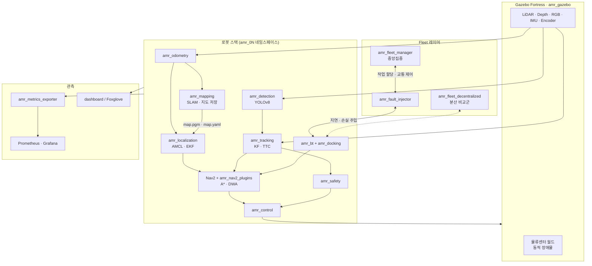
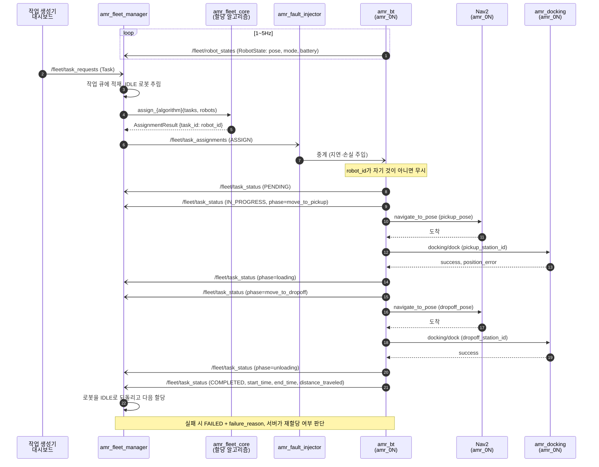

# 시스템 아키텍처

> 상태: 골격 단계. 컴포넌트 구성과 협업 규칙은 확정이고, 시퀀스 다이어그램과 토픽 상세는 구현하면서 채운다.

## 1. 아키텍처 전략

### 1-1. 결정: ROS2 패키지 단위 모노레포

정식 MSA(서비스별 레포, REST/gRPC 통신)는 쓰지 않는다. ROS2 자체가 노드들이 DDS로 통신하는 분산 구조라서 MSA의 장점(독립 개발·배포, 느슨한 결합)은 기본으로 따라온다. 대신 MSA의 원칙을 ROS2에 맞게 적용한다.

| MSA 원칙            | 이 프로젝트에서의 대응                                        |
| ------------------- | ------------------------------------------------------------- |
| 서비스 단위 소유    | 패키지마다 담당자 1명(README에 명시), 담당자 리뷰를 거쳐 머지 |
| API 계약 우선       | `amr_msgs`에 msg/srv/action을 먼저 정의하고 동결              |
| 서비스 간 결합 금지 | 다른 도메인과는 토픽·서비스·액션으로만 통신, 코드 import 금지 |
| 독립 테스트         | 알고리즘은 ROS 비의존 `*_core`에 두고 단위 테스트             |
| 독립 배포           | docker-compose 서비스로 역할별 컨테이너 분리                 |

MSA를 채택하지 않은 이유:

- 원 명세서가 "`src` 안에 패키지 단위로, `colcon build` 경고 0"을 요구한다. 단일 colcon 워크스페이스가 전제다.
- 서비스 사이에 REST 계층을 두면 DDS 위에 지연이 한 겹 더 붙어 200ms 응답 예산과 연구 1의 지연 측정을 흐린다.

### 1-2. 병렬 작업 원칙

1. **인터페이스 먼저**: P0(~10/11)에 `amr_msgs`와 [api.md](api.md)의 토픽 규칙을 확정한다.
2. **소유권**: 남의 패키지는 PR로만 수정한다.
3. **코어 분리**: `*_core`는 시뮬레이터 없이 개발·테스트한다.
4. **Mock 우선**: 각자 자기 출력 토픽의 mock 노드를 먼저 제공해 서로 기다리지 않는다.
5. **조립 분리**: 패키지별 launch·config를 두고 `amr_bringup`은 include만 한다.

세부 규칙은 [CONTRIBUTING.md](../.github/CONTRIBUTING.md)에 있다.

## 2. 레포 구조

```
amr-fleet-system/
├── src/                  ROS2 패키지 (도메인/패키지)
├── docker/               Dockerfile, Grafana 대시보드
├── docker-compose.yml    역할별 profile (dev, sim, robots, fleet, perception)
├── tools/harness/        회귀 테스트 하네스 (N회 반복, 신뢰구간)
├── experiments/          research1/, research2/ 실험 설정과 분석
├── dashboard/            웹 프론트엔드 대시보드 (선택, ROS 패키지 아님)
├── docs/                 명세, 아키텍처, API, 알고리즘, 리포트
└── .github/              CI, 템플릿, 기여 가이드
```

## 3. 패키지 구성

| 도메인        | 패키지                    | 빌드           | 담당             | 책임                                                       |
| ------------- | ------------------------- | -------------- | ---------------- | ---------------------------------------------------------- |
| interfaces    | `amr_msgs`                | cmake (rosidl) | 하연 (전원 리뷰) | 커스텀 msg/srv/action                                      |
| simulation    | `amr_description`         | cmake          | 지수             | URDF/xacro, 센서 extrinsic, TF                             |
| simulation    | `amr_gazebo`              | cmake          | 이진, 지수       | 물류센터 정적 월드(이진), 동적 장애물·센서 노이즈·GT(지수) |
| localization  | `amr_odometry`            | python         | 지수             | 순기구학, 휠 오도메트리, 센서 전처리 필터                  |
| localization  | `amr_mapping`             | python         | 지수             | slam_toolbox 설정, 지도 저장, 맵 품질 평가                 |
| localization  | `amr_localization`        | python         | 민지             | AMCL·EKF 설정, Kidnapped 복구, GT 대비 RMSE 측정           |
| navigation    | `amr_planning_core`       | cmake          | 이진             | A\*, 평활화, DWA (ROS 비의존)                              |
| navigation    | `amr_nav2_plugins`        | cmake          | 이진             | Nav2 Planner/Controller 플러그인 래퍼                      |
| navigation    | `amr_control`             | cmake          | 이진             | Pure Pursuit/Stanley, PID, 속도 프로파일                   |
| navigation    | `amr_zone_client`         | python         | 이진             | 구역 진입 처리 (ZoneRequest/ZoneGrant 클라이언트, #57 서버와 연동) |
| perception    | `amr_detection`           | python         | 연우             | YOLOv8 인식, RViz2 마커                                    |
| perception    | `amr_perception_core`     | python         | 연우             | Pinhole 3D, KF, TTC, ORCA (ROS 비의존)                     |
| perception    | `amr_tracking`            | python         | 연우             | 동적 장애물 분류·추적, 카메라 연관, 충돌 예측              |
| perception    | `amr_safety`              | python         | 연우             | 긴급정지, Safety Zone, E-Stop, 센서 고장 감지              |
| task          | `amr_bt`                  | cmake          | 지수             | BehaviorTree.CPP 작업 수행, 작업 관리                      |
| task          | `amr_docking`             | python         | 지수             | ArUco 정밀 도킹                                            |
| fleet         | `amr_fleet_core`          | python         | 하연             | 할당, 경로 충돌 예측, 교착 탐지 (ROS 비의존)               |
| fleet         | `amr_fleet_manager`       | python         | 하연             | 중앙집중 Fleet 서버, Traffic Management                    |
| fleet         | `amr_fleet_decentralized` | python         | 하연, 이진       | 분산 협상, 서버 장애 폴백 (연구 1 비교군)                  |
| fleet         | `amr_fault_injector`      | python         | 하연             | 지연·손실·서버 강제종료 주입                               |
| observability | `amr_metrics_exporter`    | python         | 지수             | Prometheus exporter, 사고 전후 rosbag 스냅샷               |
| bringup       | `amr_bringup`             | python         | 공동             | 전체 launch 조립, 다중 로봇 스폰                           |

빌드 타입 기준: Nav2 플러그인과 BehaviorTree.CPP 노드는 C++이 필수라 navigation·task(`amr_bt`)는 C++로 둔다. `amr_zone_client`는 Fleet 쪽(`amr_msgs`) 토픽만 주고받는 독립 노드라 예외로 Python이다. 나머지는 개발 속도를 위해 Python으로 시작한다. 구현 착수 전이라면 담당자가 PR로 변경할 수 있다.

## 4. 컴포넌트 다이어그램

로봇 1대의 스택(×5, 네임스페이스 `amr_01`~`amr_05`)과 Fleet 레이어.



## 5. 시퀀스 다이어그램

### 5-1. 작업 요청 → 할당 → 이동 → 완료 보고 (중앙집중 모드)

메시지 필드는 [api.md 4절](api.md#4-amr_msgs-인터페이스-초안) 초안을 따른다. 서버 ↔ 로봇은 모두 `/fleet/` 토픽으로 주고받고, 로봇 안에서 이동·도킹은 액션을 쓴다.



- 비동기 화살표(`-)`)는 토픽, 동기 화살표(`->>`)는 액션·함수 호출이다.
- 작업 전달을 토픽으로 한 이유: 장애 주입기가 중간에서 중계할 수 있고, 서버가 죽어도 분산 모드가 같은 토픽을 이어받을 수 있다. 액션은 서버-로봇 1:1 연결이라 둘 다 어렵다 ([api.md 4-4절](api.md#4-4-쟁점-정리) Fleet 쟁점).
- 응답 시간 KPI는 명령 발행부터 로봇이 처음 움직일 때까지를 **실제 시간**으로 잰다(#5). 노드의 `header.stamp`(시뮬레이션 시간)가 아니라 하네스 기록기가 `/fleet/task_assignments`를 받은 시각이 시작점이다(#27). 자세한 방법은 [하네스 로그 포맷](../tools/harness/README.md#지표-csv)의 `response_time.csv`를 따른다.

### 5-2. 하이브리드 폴백 (연구 1 비교군, 10/16 하연 설계)

평시에는 중앙집중으로 돌고, 서버와 연결이 끊긴 로봇만 분산 경매로 넘어갔다가 연결이 돌아오면 다시 중앙으로 온다. 전환은 **로봇마다 스스로** 판단한다(B안). 서버가 지시하는 방식(C안)은 2차로 남기되, 메시지는 지금부터 C안이 들어올 자리를 둔다.

**전환 규칙**

| 항목 | 규칙 |
| --- | --- |
| 분산으로 | 자기 중계본 `/<robot_id>/fleet/heartbeat`가 **2초**(`fallback_timeout_s`) 동안 안 오면. heartbeat 주기 0.2초의 10배다 |
| 중앙으로 복귀 | heartbeat가 다시 오기 시작한 뒤 **5초**(`return_stable_s`) 동안 2초 넘게 끊기지 않으면. 짧게 붙었다 끊기기를 되풀이할 때 모드가 흔들리지 않게 한다 |
| 분산 모드에서 할 일 | 새 작업 방송(`/fleet/task_requests`)과 마지막으로 받은 작업표(`FleetTaskTable`)의 미할당 작업(PENDING, 맡은 로봇 없음)을 분산 모드 로봇끼리 경매한다 ([api.md 4-4절](api.md#4-4-쟁점-정리) 분산 할당 규칙 그대로) |
| 중앙 모드에서 할 일 | 경매를 열지도, 입찰하지도 않는다. 서버 명령만 받는다. 서버는 `/fleet/robot_modes`로 분산 모드 로봇을 알고 그 로봇에게는 맡기지 않는다 |
| 복귀할 때 하던 작업 | 끝까지 한다. 서버는 그 로봇의 `TaskStatus`를 보고 장부에 맡은 로봇으로 올린다 (아래 "먼저 수락한 쪽이 주인") |
| C안 자리 | `FleetHeartbeat.mode`가 `MODE_DECENTRALIZED`로 오면 시간을 재지 않고 바로 분산으로, `MODE_CENTRALIZED`로 돌아오면 위 복귀 규칙을 따른다. B안 서버는 늘 `MODE_CENTRALIZED`를 보낸다 |

**먼저 수락한 쪽이 주인 (중복 실행 정리)**

서버와 분산 로봇이 같은 작업을 서로 다른 로봇에게 맡길 수 있다. 서버는 살아 있는데 한 로봇만 끊기면 흔히 생긴다. 끊긴 로봇은 서버 명령(취소 포함)을 못 받으므로, 서버가 거두는 방식으로는 풀 수 없다. 그래서 모든 로봇과 서버가 같이 보는 `/fleet/task_status`(로봇 → 서버 방향이라 장애를 주입하지 않는다, D8)로 정한다.

- 작업의 주인은 그 작업에 PENDING·IN_PROGRESS·COMPLETED를 보고한 로봇 중 `TaskStatus.start_time`(수락 시각, 시뮬레이션 시간)이 가장 이른 로봇이다. 같으면 `robot_id`가 작은 쪽이다.
- **로봇**: 다른 로봇이 이미 주인인 작업을 배정받으면 거부한다(`TaskAssignmentAck` REJECTED + `ErrorInfo.ASSIGN_TASK_TAKEN`). 하던 작업에 더 이른 주인이 보이면 멈추고 `TaskStatus` FAILED + `ASSIGN_TASK_TAKEN`을 보낸다. 출처(서버·경매)와 상관없이 같다.
- **서버**: 맡기지 않은 로봇의 보고라도 그 로봇이 주인이면 장부의 맡은 로봇을 바꾸고, 원래 로봇에게 보내던 재전송은 그만둔다. `ASSIGN_TASK_TAKEN` FAILED는 재시도(`failed_retries`)로 세지 않는다.
- **경매(분산)**: 자기 로봇이 `ASSIGN_TASK_TAKEN`으로 멈추거나 거부하면 다시 경매하지 않는다 (PR-2, 이진 확인).
- 이 규칙은 중앙 모드에도 걸린다. 끊김(`blackout_mode=delay`) 동안 붙잡혀 있던 서버 명령이 연결이 돌아온 뒤 한꺼번에 오면, 서버가 이미 다른 로봇에게 다시 맡긴 작업을 옛 로봇이 또 하는 일이 중앙에서도 생기기 때문이다. 세 비교군이 같은 규칙을 써야 비교가 공정하다.

**기록할 값**

| 값 | 어디서 | 뜻 |
| --- | --- | --- |
| 중복 실행 작업 수 | `task_outcomes.csv`의 `runners` (IN_PROGRESS를 보고한 로봇이 둘 이상) | 정리 규칙이 늦게 먹은 정도 |
| 전환 횟수, 분산 모드 시간 | `fleet_modes.csv` (`/fleet/robot_modes`), 요약 `fleet.fallbacks`·`fleet.decentral_s` | 흔들림(flapping), 폴백이 얼마나 오래 걸렸나 |

**위험과 한계**

- 손실률이 높으면(70%) heartbeat 10개가 연달아 사라질 확률이 커서(0.7¹⁰ ≈ 3%, heartbeat마다) 연결이 살아 있어도 분산으로 넘어갔다 돌아오기를 되풀이한다. 전환 횟수를 기록해 결과에서 따로 본다. C안(서버가 Ack 왕복시간 P95로 판단)이 이 경우를 풀 수 있다.
- 로봇 → 서버 토픽에도 장애를 거는 실험(양방향, 10/21~)에서는 `TaskStatus`가 늦거나 빠져 정리가 늦어진다.
- 서버가 재시작하면 장부가 비어 이 규칙과 상관없이 작업을 잃는다 (amr_fleet_manager README 미결).
- 작업 방송(`/fleet/task_requests`)도 장애 주입기를 거치지 않아, 끊긴 로봇이 끊긴 동안 들어온 새 작업까지 듣고 맡는다. 실제로는 주문이 서버를 거쳐 오므로 끊긴 로봇은 작업표에서 이어받은 일만 할 수 있다. 그래서 지금 하이브리드 결과는 **상한**이다 (10/17 하연 확인).
- 모드 알림(`/fleet/robot_modes`)은 로봇 → 모두 방향이라 장애를 거치지 않는다(D8). 서버와 다른 로봇은 끊긴 로봇이 분산으로 넘어간 것을 바로 안다. 실제 망에서는 이 알림도 늦거나 빠질 수 있어, 연구 1 하이브리드 결과는 이 점에서 낙관적이다 (#215 리뷰 4).
- 이번 범위는 가짜 로봇(`fake_robot_node`)이다. `amr_bt`가 같은 규칙을 따르는 일은 따로 맞춘다.

**구현** (PR-1 #214, PR-2): 모드 전환은 경매 노드(`amr_fleet_decentralized` `fleet_mode:=hybrid`)가 하고 `/fleet/robot_modes`(`RobotFleetMode`, 로봇 → 모두)로 알린다. 서버는 분산 모드 로봇에게 작업을 맡기지 않고 확인 전 명령을 거둔다. 주인 규칙은 `amr_fleet_core.claims`를 서버·가짜 로봇·경매 노드가 같이 쓴다. 기록은 `fleet_modes.csv`와 요약 `fleet.fallbacks`(분산 전환 횟수)·`fleet.decentral_s`(분산 모드 시간 합), `fleet.duplicate_tasks`.

### 5-3. 이후 추가할 시나리오

TODO: 구현 진행에 맞춰 아래 시나리오를 추가한다 (원 명세서 문서화 요구사항).

- 도킹 실패 → 재시도 → 복귀
- 동적 장애물 감지 → 추적 → TTC 경보 → 회피 → 경로 복귀
- 교착 탐지 → 해소
- 중앙 서버 장애 → 분산 폴백

## 6. 배포 구성

`docker compose up`은 시스템 서비스만 띄우고, 개발 도구는 profile로 켠다. 실행 방법은 [runbook.md](runbook.md)에 있다.

| 서비스 | 실행 | 내용 |
| --- | --- | --- |
| `sim` | 기본 | Gazebo 월드 |
| `robots` | 기본 | 로봇 5대 스택 (`amr_bringup`) |
| `fleet` | 기본 | Fleet 서버, 장애 주입기 |
| `perception` | 기본 | YOLO 추론. GPU는 `docker-compose.gpu.yml`을 겹쳐 쓴다 |
| `dev` | `--profile dev` 또는 `run dev` | 개발 셸 컨테이너 |
| `gui`, `gui-proxy` | `--profile gui` | 브라우저 GUI (Xvfb + noVNC, RViz2). `gui-proxy`가 6080 포트를 호스트에 중계 |
| (예정) `monitoring` | — | Prometheus, Grafana |
| (예정) `dashboard` | — | 웹 대시보드 |
