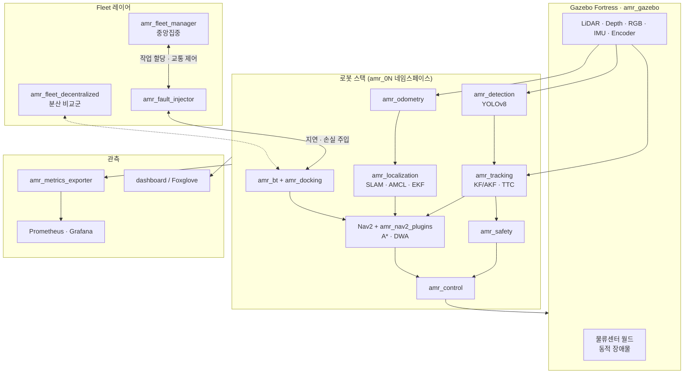

# 시스템 아키텍처

> 상태: 골격 단계. 컴포넌트 구성과 협업 규칙은 확정이고, 시퀀스 다이어그램과 토픽 상세는 구현하면서 채운다.

## 1. 아키텍처 전략

### 1-1. 결정: ROS2 패키지 단위 모노레포

정식 MSA(서비스별 레포, REST/gRPC 통신)는 쓰지 않는다. ROS2 자체가 노드들이 DDS로 통신하는 분산 구조라서 MSA의 장점(독립 개발·배포, 느슨한 결합)은 기본으로 따라온다. 대신 MSA의 원칙을 ROS2에 맞게 적용한다.

| MSA 원칙 | 이 프로젝트에서의 대응 |
| --- | --- |
| 서비스 단위 소유 | 패키지마다 담당자 1명(README에 명시), 담당자 리뷰를 거쳐 머지 |
| API 계약 우선 | `amr_msgs`에 msg/srv/action을 먼저 정의하고 동결 |
| 서비스 간 결합 금지 | 다른 도메인과는 토픽·서비스·액션으로만 통신, 코드 import 금지 |
| 독립 테스트 | 알고리즘은 ROS 비의존 `*_core`에 두고 단위 테스트 |
| 독립 배포 | docker-compose profile로 역할별 컨테이너 기동 |

MSA를 채택하지 않은 이유:

- 원 명세서가 "`src` 안에 패키지 단위로, `colcon build` 경고 0"을 요구한다. 단일 colcon 워크스페이스가 전제다.
- 서비스 사이에 REST 계층을 두면 DDS 위에 지연이 한 겹 더 붙어 200ms 응답 예산과 연구 1의 지연 측정을 흐린다.

### 1-2. 병렬 작업 원칙

1. **인터페이스 먼저**: P0(~10/11)에 `amr_msgs`와 [api.md](api.md)의 토픽 규칙을 확정한다.
2. **소유권**: 남의 패키지는 PR로만 수정한다.
3. **코어 분리**: `*_core`는 시뮬레이터 없이 개발·테스트한다.
4. **Mock 우선**: 각자 자기 출력 토픽의 mock 노드를 먼저 제공해 서로 기다리지 않는다.
5. **조립 분리**: 패키지별 launch·config를 두고 `amr_bringup`은 include만 한다.

세부 규칙은 [CONTRIBUTING.md](../.github/CONTRIBUTING.md)에 있다.

## 2. 레포 구조

```
amr-fleet-system/
├── src/                  ROS2 패키지 (도메인/패키지)
├── docker/               Dockerfile, Grafana 대시보드
├── docker-compose.yml    역할별 profile (dev, sim, robots, fleet, perception)
├── tools/harness/        회귀 테스트 하네스 (N회 반복, 신뢰구간)
├── experiments/          research1/, research2/ 실험 설정과 분석
├── dashboard/            웹 프론트엔드 대시보드 (선택, ROS 패키지 아님)
├── docs/                 명세, 아키텍처, API, 알고리즘, 리포트
└── .github/              CI, 템플릿, 기여 가이드
```

## 3. 패키지 구성

| 도메인 | 패키지 | 빌드 | 담당 | 책임 |
| --- | --- | --- | --- | --- |
| interfaces | `amr_msgs` | cmake (rosidl) | 하연 (전원 리뷰) | 커스텀 msg/srv/action |
| simulation | `amr_description` | cmake | 지수 | URDF/xacro, 센서 extrinsic, TF |
| simulation | `amr_gazebo` | cmake | 지수 | 물류센터 월드, 동적 장애물, 센서 노이즈 |
| localization | `amr_odometry` | python | 민지 | 순기구학, 휠 오도메트리, 센서 전처리 필터 |
| localization | `amr_localization` | python | 민지 (SLAM 지수 공동) | SLAM·AMCL·EKF 설정, Kidnapped 복구 |
| navigation | `amr_planning_core` | cmake | 이진 | A*, 평활화, DWA (ROS 비의존) |
| navigation | `amr_nav2_plugins` | cmake | 이진 | Nav2 Planner/Controller 플러그인 래퍼 |
| navigation | `amr_control` | cmake | 이진 | Pure Pursuit/Stanley, PID, 속도 프로파일 |
| perception | `amr_detection` | python | 연우 | YOLOv8 인식, RViz2 마커 |
| perception | `amr_perception_core` | python | 연우 | Pinhole 3D, KF/AKF, PTTC, ORCA (ROS 비의존) |
| perception | `amr_tracking` | python | 연우 | 동적 장애물 분류·추적, 카메라 연관, 충돌 예측 |
| perception | `amr_safety` | python | 연우 | 긴급정지, Safety Zone, E-Stop, 센서 고장 감지 |
| task | `amr_bt` | cmake | 지수 | BehaviorTree.CPP 작업 수행, 작업 관리 |
| task | `amr_docking` | python | 지수 | ArUco 정밀 도킹 |
| fleet | `amr_fleet_core` | python | 하연 | 할당, 경로 충돌 예측, 교착 탐지 (ROS 비의존) |
| fleet | `amr_fleet_manager` | python | 하연 | 중앙집중 Fleet 서버, Traffic Management |
| fleet | `amr_fleet_decentralized` | python | 하연, 이진 | 분산 협상, 서버 장애 폴백 (연구 1 비교군) |
| fleet | `amr_fault_injector` | python | 하연 | 지연·손실·서버 강제종료 주입 |
| observability | `amr_metrics_exporter` | python | 지수 | Prometheus exporter, 사고 전후 rosbag 스냅샷 |
| bringup | `amr_bringup` | python | 공동 | 전체 launch 조립, 다중 로봇 스폰 |

빌드 타입 기준: Nav2 플러그인과 BehaviorTree.CPP 노드는 C++이 필수라 navigation·task(`amr_bt`)는 C++로 둔다. 나머지는 개발 속도를 위해 Python으로 시작한다. 구현 착수 전이라면 담당자가 PR로 변경할 수 있다.

## 4. 컴포넌트 다이어그램

로봇 1대의 스택(×5, 네임스페이스 `amr_01`~`amr_05`)과 Fleet 레이어.



## 5. 시퀀스 다이어그램

TODO: 구현 진행에 맞춰 아래 시나리오를 추가한다 (원 명세서 문서화 요구사항).

- 작업 요청 → 할당 → 이동 → 도킹 → 적재 → 복귀
- 동적 장애물 감지 → 추적 → TTC 경보 → 회피 → 경로 복귀
- 교착 탐지 → 해소
- 중앙 서버 장애 → 분산 폴백

## 6. 배포 구성

| compose profile | 내용 |
| --- | --- |
| `dev` | 개발 셸 컨테이너 |
| `sim` | Gazebo 월드 |
| `robots` | 로봇 5대 스택 (`amr_bringup`) |
| `fleet` | Fleet 서버, 장애 주입기 |
| `perception` | YOLO 추론 (GPU) |
| (예정) `monitoring` | Prometheus, Grafana |
| (예정) `dashboard` | 웹 대시보드 |
