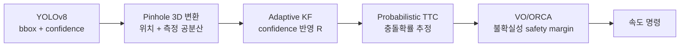

# 지능형 물류 AMR Fleet 프로젝트 명세서

> 이 문서는 원 명세서(31번 스펙, 지능형 물류 AMR 시스템)를 팀이 확장한 것이다. **원 명세서가 1순위**이며, 이 문서와 원 명세서가 충돌하면 원 명세서를 따른다. 원 명세서 대비 누락·위배 보완 사항은 [1-4절](#1-4-원-명세서-대조-누락위배-보완)에 정리했다.

## 1. 프로젝트 개요

31번 스펙(지능형 물류 AMR 시스템)의 필수 요구사항을 먼저 충족하고, 그 위에 **연구 2축 + 시스템 고도화 3종**을 얹는다. 필수 KPI 통과가 항상 최우선이며, 연구·고도화는 그 다음 순서로 진행한다.

| 구분 | 내용 | 출처 의견 |
| --- | --- | --- |
| 기반 | 31번 스펙 필수요건: 5대 동시운용, SLAM·경로계획·제어·AI인지·작업수행·Fleet Management, Docker·Git Flow·테스트자동화, 대시보드 | 개요서 |
| 연구 1 (메인) | 중앙집중 Fleet의 통신 지연 내성과 분산 전환 임계점 실측. ros2_tracing을 측정 도구로 사용 | 하연(방법론) + 민지(연구설계) |
| 연구 2 (AI/ML) | 인식·위치추정 불확실성을 추적→충돌예측→회피까지 전파했을 때의 안전성 향상 검증 | AI/ML 파트 제안 |
| 시스템 고도화 | 장애 주입기, 회귀 테스트 하네스, 관측 스택(Prometheus/Grafana + 사후 리플레이) | 민지 제안 |
| 선택 고도화 | RL 내비게이션, 궤적 예측, MARL, 실물 네트워크(라즈베리파이), Jetson 엣지 추론 | 팀원 추가 제안, 2차 회의 안건 |

두 연구는 서로 다른 레이어(Fleet 통신 / 로봇 인지·회피)를 다루므로 실험이 겹치지 않는다. 공통 인프라(장애 주입기, 회귀 하네스, 관측 스택)는 두 연구가 함께 쓴다.

### 1-1. 최종 결과물과 제출물 (원 명세서)

최종 제출물은 GitHub 레포지토리 URL 하나다. 4개 핵심 시스템이 시뮬레이션에서 정상 동작해야 한다.

| 핵심 시스템 | 입력 | 출력 | 팀 추가 산출물 |
| --- | --- | --- | --- |
| 1. 시뮬레이션 환경 및 로봇 시스템 | 물류센터 설계 파라미터, 로봇 스펙 | 물리 시뮬레이션 물류센터, 센서 노이즈 모델 AMR, Docker ROS2 스택 | 연구 2용 인식 품질 저하 시나리오(가림·조명·거리) |
| 2. 자율 매핑 및 정밀 위치 추정 | LiDAR, IMU, Wheel Encoder | 2D 맵, EKF 센서퓨전 위치 추정, 오차 분석 리포트 | 회귀 하네스 기반 신뢰구간 리포트 |
| 3. AI 인지 및 동적 환경 대응 | 목표 지점, 센서 데이터, 카메라 영상 | 객체 인식·3D 위치, 경로 생성·추종, 동적 장애물 예측·회피, 긴급 대응 | 연구 2: 불확실성 전파 파이프라인과 baseline 비교 |
| 4. 다중 AMR 협업 운용 | 다수 배송 요청 | 5대 이상 동시 운용, 작업 할당, 교착 방지, 대시보드 | 연구 1: 장애 주입, 중앙/분산/하이브리드 비교, 관측 스택 |

레포지토리에 반드시 포함할 것:

- 전체 소스 코드 및 설정 파일
- `docker-compose.yml` 등 Docker 환경 구성 파일
- 시스템 아키텍처 설계 문서(컴포넌트·시퀀스 다이어그램)
- 핵심 알고리즘 구현 설명 문서(DWA, EKF, SLAM 파라미터 등)
- 성능 측정 및 분석 리포트
- 설치/실행 가이드(README), 노드별 토픽·서비스·액션 API 문서
- (팀 추가) 연구 1·2 실험 스크립트와 재현 설정, 논문 원고

### 1-2. 필수 기능 요구사항과 팀 추가사항

원 명세서의 10개 영역은 모두 필수이며, 팀 추가사항은 이 위에 얹힌다. KPI 열은 동료 평가에서 직접 확인하는 수치다.

| 영역 | 필수 구현 | 필수 KPI | 담당 | 팀 추가·연구 연결 |
| --- | --- | --- | --- | --- |
| 1. 개발 환경·인프라 | `docker-compose up` 실행, ros:humble 베이스, nvidia-container-toolkit, Git Flow + conventional commits, 60×40m 물류센터(선반·입출고·충전 3개·통로), 동적 장애물 5개 이상(0.3~1.5m/s, 직선·곡선·무작위), xacro URDF(600×400×300mm, 2.0m/s, 1.0m/s², 1.5rad/s, 적재 질량 반영), 센서 노이즈(LiDAR σ=0.03m 등), extrinsic 파일 | 센서 사양 충족 | 지수 (Git Flow·Docker CI는 하연) | 회귀 하네스가 같은 Docker 이미지로 실행 |
| 2. 로봇 기초 | 순기구학 직접 구현, 휠 오도메트리 + 드리프트 실험, LiDAR·Depth·IMU 필터링, TF 트리(map→odom→base_link→센서) 문서화 | 드리프트 분석 리포트 | 지수 | 드리프트 기준값은 위치추정 인계 계약에 사용 (8-2절) |
| 3. 위치 추정 | slam_toolbox/cartographer 파라미터 문서화 또는 ICP/NDT 직접 구현, Loop Closure, 맵 품질 지표, AMCL 튜닝, Kidnapped 복구, EKF(Odom+IMU+AMCL) 공분산 근거 | 맵 0.05m 이하, 오차 정지 3cm·직선 5cm·회전 8cm, RMSE·Max(100개 시점 이상) | 지수(SLAM·지도) + 민지(AMCL·EKF·위치 오차 KPI), 8-2절 | 하네스로 N회 반복 신뢰구간 제시 |
| 4. 경로 계획 | A* 직접 구현 vs NavFn/Smac, 경로 평활화, DWA 직접 구현 vs TEB, Costmap 3레이어, 좁은 통로(로봇 폭+20cm) | 50쌍 성공률 98%, 재계획 500ms, 주행시간 예측 오차 15% | 이진 | 연구 2에서 DWA 비용함수·Costmap에 불확실성 반영 가능 |
| 5. 모션 제어 | Pure Pursuit/Stanley 직접 구현(적응형 look-ahead), PID 속도 제어, 사다리꼴/S-curve, 저크 제한 | CTE 직선 5cm·곡선 10cm | 이진 | 연구 2 효율성 지표(jerk)로 재사용 |
| 6. AI 인지 | YOLOv8 3종 이상(화물·사람·표지판), 커스텀 메시지 + RViz2 마커, Pinhole 2D→3D(map frame) | CPU 10 FPS 또는 GPU 30 FPS | 연우 | 연구 2 입력: confidence·측정 공분산. Jetson 고도화안 연결 |
| 7. 동적 환경 대응 | LiDAR 동적 장애물 분류, KF/EKF 추적(속도·방향·신뢰도), 미래 위치 예측·TTC, VO/ORCA, 긴급정지(0.3m), Safety Zone(Warning/Critical), E-Stop, 센서 고장 감지 → 안전 정지/저속 | 30회 충돌 0건, 경로 이탈 1m, 복귀 5초, 1.0m/s 장애물 재계획 회피 | 연우 | **연구 2 본체.** 명세의 "신뢰도 계산"을 AKF 공분산으로 확장 |
| 8. 작업 수행 | BehaviorTree.CPP, 대기-이동-인식-작업-복귀, 노드 15개 이상, 서브트리, 에러 3종 이상 자동 복구, Groot 시각화, ArUco 도킹(3회 실패 시 대체 작업), JSON Task, 상태 이벤트, 우선순위·마감 스케줄링, 작업 로그 | 도킹 2cm·1도, 단일 작업 성공률 97%, BT 확장 시 수정 3파일 이내 | 지수 | 작업 로그를 관측 스택으로 수집 |
| 9. Fleet Management | 5대 이상, 네임스페이스·TF 분리, 통신 지연 100ms 반영, 중앙 할당(최소거리/부하균형/Hungarian), 최적성 지표, 경로 충돌 예측, 교차로 우선순위, 교착 탐지 + 해소 전략 2가지 이상, 대시보드(위치·상태·배터리·작업, KPI, 이상 알림) | 5대 동시 운용 시 교착 없이 수행 | 하연 (분산 로직은 이진 공동) | **연구 1 본체.** 100ms 반영을 장애 주입기의 한 설정값으로 구현. 대시보드는 Prometheus/Grafana(지수) |
| 10. 통합·품질 | 성능 리포트, README·아키텍처·알고리즘·API 문서 | 평균 응답 200ms(50회 이상), 5대 CPU 80% 이하, 연속 4시간 운용, 커버리지 70%, 통합 테스트 10개 이상 자동화, `colcon build` 경고 0 | 민지(테스트) + 이진(문서) + 전원 | ros2_tracing으로 응답시간 분해, 하네스로 CI 자동 검증 |

원 명세의 구현 권장 순서(1 Docker → 13 테스트·문서화)는 9장 로드맵에 그대로 반영한다.

### 1-3. 원 명세서와의 정합성 점검

팀 추가 의견을 원 명세서와 대조한 결과, 충돌은 없지만 보완할 지점이 6개 있다. 아래 내용은 본문 각 장에 반영했다.

| 지점 | 원 명세서 | 팀 계획의 문제 | 조치 |
| --- | --- | --- | --- |
| KPI 검증 조건 | 로봇 간 통신 지연 최대 100ms를 시뮬레이션에 반영 | 연구 1이 baseline을 지연 0ms로 정의 | 필수 KPI(200ms, CPU 80%)는 **지연 100ms 조건**에서 검증. 0ms는 연구용 기준점으로만 사용 |
| 동적 장애물 추적 입력 | LiDAR 데이터에서 동적 장애물 분류 후 KF 추적 | 연구 2는 YOLO(카메라) 검출에서 출발 | LiDAR 트랙에 카메라 검출을 연관(association)해 confidence를 붙임. 카메라 FOV(87도) 밖은 LiDAR 단독 + 기본 R |
| 연속 운용 | 연속 4시간 운용 안정성 검증 | 로드맵에 없음 | P4에 4시간 soak 테스트 추가, 관측 스택으로 메모리·지연 추이 기록 |
| 안전 시스템 | 긴급정지 0.3m, Safety Zone, E-Stop, 센서 고장 감지 | 팀 문서에 언급 없음 | 연우 담당으로 명시. 연구 2의 충돌확률을 Warning 존 트리거로 활용 |
| RL 보너스 | Isaac Sim의 RL 환경 활용 | 시뮬레이터는 Gazebo 권장 | Gazebo를 쓰면 RL용 별도 경량 환경(gym 래퍼) 필요. 스트레치로 유지하고 시뮬레이터 결정 시 함께 판단 |
| 시뮬레이터 버전 | Gazebo Fortress 또는 Garden, ROS2 Humble | 둘 다 후보로 기재 | Humble 공식 페어링인 Fortress로 확정 권장 |

그 밖의 제약도 지킨다: 외부 상용 솔루션 미사용(Prometheus·Grafana·Foxglove는 오픈소스), 소스는 `src` 패키지 단위, LLM 자연어 명령과 로봇 팔 조작은 범위 외, 3D SLAM은 보너스로만.

### 1-4. 원 명세서 대조: 누락·위배 보완

원 명세서 전문과 대조해 1-2절 표에서 축약되거나 빠진 항목, 그리고 팀 계획이 원 명세서와 어긋난 지점을 정리한다. 아래 항목은 모두 **필수**다.

#### 위배 및 수정 사항

| 지점 | 원 명세서 | 기존 팀 계획 | 수정 |
| --- | --- | --- | --- |
| 인식 결과 메시지 타입 | 인식된 객체 정보를 **커스텀 메시지 타입**으로 발행 | 4-4절에서 표준 `vision_msgs/Detection3DArray`로 통일 | `src`에 인터페이스 패키지(예: `amr_msgs`)를 두고 커스텀 메시지를 정의한다. 필드는 class, confidence, bbox, 3D 위치 + 공분산(PoseWithCovariance), timestamp. 4-4절 반영 |
| LLM 자연어 명령 제외 근거 | LLM 명령 처리는 구현하지 않되 **보너스 과제는 예외** | 7장에서 "스펙 제약상 어떤 형태로도 구현 불가"로 기재 | 보너스 3은 허용 범위다. 제외 사유를 **팀 스코프 판단**(일정·연구 축과 무관)으로 정정. 7장 반영 |
| 대시보드 범위 | 실시간 위치·상태·배터리·현재 작업 시각화, KPI(작업 처리량·평균 작업 시간·**로봇 가동률**), 알림(**긴급 정지·작업 실패·교착**) | Prometheus/Grafana 중심, KPI·알림 항목 미명시 | 아래 표의 KPI 3종과 알림 3종을 필수 패널로 둔다. 지도 위 실시간 위치는 Grafana로 표현이 어려우므로 Foxglove Studio를 **병행 필수**로 한다 |

#### 1-2절에서 축약·누락된 필수 요구사항

| 영역 | 누락·축약 항목 | 담당 |
| --- | --- | --- |
| 1. 환경 | 바닥 마찰 계수·조명 조건 등 물리 파라미터를 현실적으로 설정 / 정적 장애물(선반·벽·**기둥**) / 동적 장애물 종류(**작업자·지게차·다른 로봇**) / URDF 모델 내 센서 위치와 TF 트리 정확히 일치 / 센서 캘리브레이션 절차 문서화 | 지수 |
| 1. 센서 | 아래 "센서 사양" 표의 전 항목(1-2절은 LiDAR σ만 기재) | 지수 |
| 2. 로봇 기초 | LiDAR 필터 3종(거리·각도·아웃라이어) / Depth 포인트클라우드 변환 + **다운샘플링** / IMU 저역통과 필터 + **바이어스 보정** / TF 트리 시각화 자료 | 지수 |
| 3. 위치 추정 | Loop Closure 탐지와 **그래프 최적화 과정** 설명 / 맵 품질 지표는 맵 일관성·구조물 정확도로 정의 | 지수 |
| 3. 위치 추정 | AMCL 파티클 수·리샘플링 파라미터 튜닝 근거 | 민지 |
| 4. 경로 계획 | A* vs NavFn/Smac 비교 지표: **경로 길이·계획 소요 시간·장애물 여유 거리** / DWA 4단계(속도 샘플링·궤적 시뮬레이션·비용 함수·최적 속도 선택) 모두 직접 구현 / TEB 대비 장단점 분석 / Inflation 반경·cost scaling 튜닝 / Costmap **센서 업데이트 주기·장애물 유지 시간** 설정 | 이진 |
| 5. 모션 제어 | PID **게인 튜닝 과정 문서화** | 이진 |
| 6. AI 인지 | 인식 객체의 3D 위치를 **지도상 마커**로 표시(텍스트: class·confidence·거리) | 연우 |
| 7. 동적 환경 | TTC 임계값 이하 시 회피 기동 / Safety Zone 단계별 대응 로직 | 연우 |
| 8. 작업 수행 | 가상 물품 3종과 적재 이벤트(아래 표), 적재 시 **질량 변화를 동역학에 반영** / 작업 상태 4종 **Pending·InProgress·Completed·Failed** 관리 및 이벤트 발행 / 작업 로그 필드(시작·종료 시각, 이동 거리, 소요 시간, 결과)를 분석 가능한 형태로 저장 / 물품 픽업·배송은 도킹 완료 후 가상 적재·하역 이벤트로 대체 | 지수 |
| 9. Fleet | 작업 할당 최적성 지표(총 이동 거리·작업 완료 시간) 측정·분석 / 교착 해소 전략 예: 우선순위 기반 양보, 대체 경로 탐색 | 하연 |
| 10. 품질 | 아래 "성능 지표 측정 절차" 표의 산출 방법·로그 포맷 준수 / 커버리지는 **주요 모듈별 분리 보고** / 응답 시간은 평균과 **최대**를 함께 보고 | 민지 + 전원 |

#### 개발 환경 (원 명세서 6장)

- Ubuntu 22.04 LTS, ROS2 Humble Hawksbill
- Python 3.10 이상 또는 C++17 이상
- 시뮬레이터: Gazebo Fortress(팀 확정 권장) 또는 Isaac Sim 2023.1 이상
- Navigation은 Nav2 기반. 단, A* Global Planner와 DWA Local Planner 핵심 로직은 직접 구현

#### 센서 사양

| 센서 | 사양 | 노이즈 |
| --- | --- | --- |
| 2D LiDAR | 360도, 최대 25m, 해상도 0.5도, 10Hz 이상 | 가우시안 σ=0.03m |
| Depth Camera | 640×480 이상, FOV 87도, 최대 10m, 15Hz 이상 | 깊이 측정 노이즈 |
| RGB Camera | 640×480 이상, 30Hz (객체 인식용) | — |
| IMU | 가속도계 + 자이로, 100Hz 이상 | 바이어스 + 노이즈 |
| Wheel Encoder | 틱 분해능 4096 이상 | 슬립 노이즈 |

#### 가상 물품 및 적재·하역 이벤트

| 물품 유형 | 질량 | 크기(cm) | 적재 시간 | 비고 |
| --- | --- | --- | --- | --- |
| 소형 박스 | 2kg | 30×20×15 | 5초 | 전자부품, 소형 패키지 |
| 중형 박스 | 10kg | 50×40×30 | 10초 | 의류, 생활용품 |
| 대형 박스 | 25kg | 60×50×40 | 15초 | 가전, 산업자재(적재 시 질량 변화 반영) |

#### 성능 지표 측정 절차

연구용 지표(P95/P99, 신뢰구간)는 이 표준 위에 추가로 산출한다. 동료 평가용 KPI는 이 표의 정의를 따른다.

| 지표 | 산출 방법 | 로그 포맷 | 비고 |
| --- | --- | --- | --- |
| 위치 추정 RMSE | Ground Truth 좌표 − EKF 추정 좌표의 RMSE | `[timestamp, gt_x, gt_y, est_x, est_y, error]` | 최소 100개 시점 샘플링 |
| 경로 추종 CTE | 계획 경로와 실제 궤적 간 수직 거리 평균 | `[timestamp, planned_x/y, actual_x/y, cte]` | 직선/곡선 구간 분리 측정 |
| 응답 시간 | 로봇 첫 움직임 timestamp − 작업 명령 발행 timestamp | `[cmd_time, response_time, latency_ms]` | 50회 이상, 평균·최대 |
| 테스트 커버리지 | `pytest --cov` 또는 `colcon test --coverage` | coverage 텍스트/HTML | 주요 모듈별 분리 보고 |

#### 코드 구조 원칙 (동료 평가 항목)

- ROS2 패키지는 기능별로 분리하고 패키지마다 책임을 하나로 둔다.
- 핵심 알고리즘(A*, DWA, EKF, KF 추적 등)은 ROS 노드와 분리된 독립 모듈로 구현해 단위 테스트가 가능하게 한다.
- 설정값은 YAML로 외부화해 파라미터 변경 시 재빌드가 필요 없게 한다.
- TF 트리는 `ros2 run tf2_tools view_frames` 결과와 함께 문서화한다.
- BT 노드 추가로 작업을 확장할 때 기존 코드 수정은 3개 파일 이내로 한다.

#### 학습 목표 대응 문서 (원 명세서 3장)

원 명세서는 아래 내용을 팀원이 스스로 설명할 수 있기를 요구한다. 알고리즘 문서에 각 항목의 설명 절을 둔다.

| 학습 목표 | 문서 위치 | 담당 |
| --- | --- | --- |
| 차동 구동 순기구학 수식, 오도메트리 누적 오차 원인과 보완 | 로봇 기초 / 드리프트 리포트 | 지수 |
| EKF 예측-업데이트 단계, 센서별 공분산 설정 근거 | 위치 추정 | 민지 |
| A*·DWA 동작 원리, 환경별 파라미터 튜닝 | 경로 계획 | 이진 |
| Pinhole Camera Model 기반 2D→3D 변환 원리 | AI 인지 | 연우 |
| **Behavior Tree vs FSM 비교(장단점)** | 작업 수행 | 지수 |
| 다중 로봇 교착 유형과 해결 전략 | Fleet Management | 하연 |

#### 참고: 미션 소개의 권장 역량

원 명세서 미션 소개는 Domain Randomization, Sim-to-Real Gap 분석을 시뮬레이션 기반 개발 역량으로 언급한다. 기능 요구사항은 아니므로 필수로 두지 않고, 센서 노이즈 모델링(필수)과 RL 스트레치(6장)에서 다룬다. 성능 리포트에 Sim-to-Real Gap 고려사항 절을 짧게 둔다.

## 2. 핵심 용어

| 용어 | 설명 |
| --- | --- |
| DDS | ROS2 노드 간 메시지를 발행/구독 방식으로 전달하는 통신 미들웨어 |
| ros2_tracing | ROS2 공식 트레이싱 프레임워크. LTTng 기반으로 발행, 콜백 시작/종료, DDS 전송 시점을 마이크로초 단위로 기록 |
| E2E 응답시간 | 명령 수신부터 로봇 반응까지 전체 처리 시간. 스펙 기준 200ms 이내 |
| QoS 프로파일 | DDS 전달 방식 설정값(reliability, history depth 등) |
| P95 / P99 | 상위 5%/1% 지연시간. 안전 관련 시스템에서 평균보다 중요 |
| 장애 주입 | 지연·패킷손실·서버 장애를 인위적으로 발생시켜 한계를 실측하는 기법 |
| 신뢰구간 / 노이즈 바닥 | 같은 조건 N회 반복으로 결과가 우연인지 실제 개선인지 구분하는 기준 |
| Adaptive KF (AKF) | 측정 신뢰도에 따라 측정잡음 공분산 R을 실시간 조정하는 칼만필터 |
| TTC | Time-To-Collision. 현재 상대속도 유지 시 충돌까지 남은 시간 |
| Probabilistic TTC | 위치·속도 추정의 공분산을 반영해 충돌 확률 또는 TTC 분포로 표현한 위험도 |
| VO / ORCA | Velocity Obstacle / Optimal Reciprocal Collision Avoidance. 충돌을 일으키는 속도 집합을 피해 속도를 선택하는 회피 기법 |

## 3. 연구 1 (메인): 중앙집중 Fleet의 통신 지연 내성과 분산 전환 임계점

**연구질문**: 중앙집중식 작업 할당은 통신 지연·손실이 커질수록 성능이 무너진다. 어느 지점부터 분산 협상 방식이 더 나은가?

ros2_tracing은 **측정 도구**, 중앙집중 vs 분산 비교실험은 **그 도구로 검증할 연구질문**이다.

### 3-1. 측정 레이어

- **레이어 1 — 로봇 내부**: 센서→SLAM→경로계획→모션제어 파이프라인의 노드 간 DDS 지연
- **레이어 2 — Fleet 간**: 로봇 ↔ 중앙 Fleet 서버. 작업할당, Traffic Management 조율, 대시보드 스트림이 동시에 몰릴 때의 병목 위치

### 3-2. 실험 설계

| 항목 | 내용 |
| --- | --- |
| 독립변수 | 통신 지연 0/50/100/200/500ms, 패킷 손실률 0~10%, 로봇 대수 3/5/7/10 |
| 비교군 | 중앙집중 / 분산 협상 / 하이브리드(평시 중앙, 임계 초과 시 분산 폴백) |
| 보조 튜닝 | QoS 프로파일 조정, DDS 벤더 비교(Cyclone vs Fast DDS) |
| 종속변수 | 작업 처리량, 평균 완료 시간, 교착 발생률, 충돌 건수, 총 이동거리(할당 최적성), 두 레이어의 P95/P99 지연 |
| 통과 기준 | 스펙 조건(지연 100ms, 중앙집중, 5대)에서 KPI 충족: 평균 응답시간 200ms 이내, CPU 80% 이하. 지연 0ms는 연구용 기준점 |
| 기여 | 중앙→분산 폴백 전환 임계점을 실측으로 제시. 스케일 한계(몇 대까지 버티는가)와 병목 위치(DDS / 중앙 할당기 / Costmap 갱신) 함께 보고 |

### 3-3. 실행 순서

1. 장애 주입기 구축(5장)
2. Before 측정: 지연 0ms(기준점)와 100ms(스펙 조건)에서 중앙집중 방식의 두 레이어 P95/P99
3. 비교 실험: 지연·손실률을 단계적으로 높이며 3개 비교군의 성능 곡선 측정(조건당 N회 반복)
4. 분석: 처리량이 급락하는 지점을 하이브리드 폴백 트리거 기준으로 제시
5. After 측정: QoS·벤더 튜닝 후 동일 시나리오 재측정, 개선폭을 신뢰구간과 함께 제시

### 3-4. 스코프 제한

- 분산 협상은 **대조군 역할만** 한다. "가장 가까운 로봇이 먼저 선점" 같은 단순 규칙 기반으로 충분하다.
- 목표는 완벽한 분산 시스템이 아니라 중앙집중 대비 상대적 강건성 비교다.
- 보너스 과제 4번(분산 Fleet Management, 중앙 서버 장애 시 폴백)은 이 실험으로 함께 검증된다.

## 4. 연구 2 (AI/ML): 불확실성 전파 기반 동적 장애물 회피

**연구질문**: 객체 인식 및 위치 추정의 불확실성을 충돌예측과 회피까지 전파하면 동적 장애물 환경에서 로봇의 안전성이 향상되는가?

스펙이 요구하는 파이프라인(YOLO → 3D 위치 → KF → TTC → ORCA)을 그대로 두고, 각 단계가 점 추정값 대신 **평균 + 공분산**을 다음 단계로 넘기도록 바꾼다.



각 화살표는 추정값과 공분산을 함께 전달한다. baseline은 같은 구조에서 공분산을 버리고 고정값을 쓴다.

### 4-1. 단계별 설계

1. **Pinhole 3D 좌표변환**: bbox 내부 depth의 중앙값을 Z로 사용하고 카메라 내부 파라미터로 X, Y를 계산한다. bbox 픽셀 오차와 depth 잡음을 Jacobian으로 전파해 3D 측정 공분산을 만든다.
2. **Adaptive Kalman Filter**: YOLO confidence가 낮을수록 측정잡음 공분산 R을 키워 측정을 덜 신뢰한다. 미검출 프레임은 예측만 수행해 공분산이 자연스럽게 커진다. Mahalanobis 게이팅으로 오매칭을 거른다.
3. **Probabilistic TTC**: 상대 위치·속도의 공분산에서 샘플링(Monte Carlo)해 예측 구간 T 안에서 안전거리 이내로 접근할 확률을 계산한다. 출력은 충돌확률과 TTC 분포(예: 하위 5% TTC)다.
4. **불확실성 기반 VO/ORCA**: 장애물 반경을 위치 공분산의 최대 고유값만큼 팽창시킨다. 충돌확률이 임계값을 넘을 때만 확장된 margin을 적용해 과도한 보수성을 피한다.

```math
R_k = \frac{\Sigma_{3D,k}}{c_k^{\alpha}}, \qquad r_{\text{safe}} = r_{\text{robot}} + r_{\text{obs}} + \kappa \sqrt{\lambda_{\max}(\Sigma_{\text{pos}})}
```

c는 YOLO confidence, α는 조정 계수, κ는 신뢰수준(예: 95%)에 해당하는 계수다.

### 4-2. 비교군과 가설

| 비교군 | 추적 | 충돌예측 | 회피 margin |
| --- | --- | --- | --- |
| B1 기본 baseline | KF(고정 R) | 결정적 TTC | 고정 소형 margin |
| B2 보수적 baseline | KF(고정 R) | 결정적 TTC | 고정 대형 margin |
| A1 | AKF | 결정적 TTC | 고정 소형 margin |
| A2 | AKF | Probabilistic TTC | 고정 소형 margin |
| 제안 | AKF | Probabilistic TTC | 불확실성 기반 margin |

A1·A2는 단계별 기여를 분리하는 ablation이다. B2가 핵심 대조군이다. 제안 방식은 **B1보다 안전하고 B2보다 효율적**이어야 "그냥 더 조심해서 안전해진 것"이 아님을 보일 수 있다.

- **H1**: AKF는 고정 R KF보다 인식 잡음이 큰 조건에서 추적 오차와 NEES(공분산 일관성)가 개선된다.
- **H2**: 제안 방식은 B1 대비 충돌·근접(near-miss)이 줄어든다.
- **H3**: 제안 방식은 B2 대비 경로 길이·완료 시간·정지 횟수가 적다.

### 4-3. 실험 조건과 지표

| 항목 | 내용 |
| --- | --- |
| 독립변수 | 인식 품질(거리, 가림, 조명, 인위적 confidence 저하), 장애물 속도 0.3~1.5m/s, 이동 패턴(직선/곡선/무작위), 장애물 밀도 |
| 안전성 지표 | 충돌 건수(스펙: 30회 중 0건), 최소 이격거리, near-miss 비율 |
| 추정 품질 지표 | 위치 RMSE, NEES, TTC 예측 오차, 충돌 경보 오탐·미탐률 |
| 효율성 지표 | 경로 길이, 목표 도달 시간, 정지 횟수, jerk |
| 실시간성 | 파이프라인 지연(ros2_tracing), CPU. 스펙 200ms 예산 안에 들어와야 함 |
| 반복 | 조건당 N회 반복, 회귀 테스트 하네스로 신뢰구간 산출 |

### 4-4. 인터페이스와 스코프

- YOLO와 3D 변환을 모두 연우가 맡으므로 2D 검출(bbox, class, confidence, 타임스탬프)은 인지 도메인 내부 경계로 두고, 외부(Costmap·BT)로 내보내는 3D 결과는 공분산 포함 메시지로 통일한다. 원 명세서가 **커스텀 메시지 타입**을 요구하므로 인터페이스 패키지 `amr_msgs`에 직접 정의하고, 3D 위치는 PoseWithCovariance 필드로 담는다. 착수 첫 주에 확정한다.
- 시뮬레이터 ground truth가 있어 추적 오차·NEES를 정확히 계산할 수 있다는 점이 시뮬레이션 연구의 강점이다.
- 정교한 궤적 예측 모델(6장)은 넣지 않는다. 등속 모델 + 공분산으로 먼저 가설을 검증한다.
- 원 명세는 동적 장애물을 **LiDAR로 분류·추적**하도록 요구한다. 따라서 추적의 뼈대는 LiDAR 트랙이고, 카메라 FOV 안에서는 YOLO 검출을 연관(association)해 confidence를 R 조정에 쓴다. FOV 밖이나 미검출 시에는 기본 R을 쓴다. 이 구조 자체가 "카메라 가시성에 따른 불확실성 변화"라는 실험 조건이 된다.

## 5. 시스템 고도화 (공통 인프라)

세 요소 모두 스펙 필수요건(통신지연 100ms 반영, 테스트 자동화, 대시보드)을 확장한 것이고, 연구 1·2가 함께 쓰는 실험 장치다.

### 5-1. 장애 주입기

- 통신 지연 0/50/100/200/500ms 단계 조절, 패킷 손실률 0~10%, 중앙 서버 임의 시점 강제종료
- 스펙의 "통신지연 100ms 반영"을 하나의 설정값으로 포함한다.
- 보너스 4번(중앙 서버 장애 시 폴백)을 말이 아니라 검증된 기능으로 만든다.

### 5-2. 회귀 테스트 하네스 (CI/CD 심화)

시뮬레이터는 같은 조건에서도 결과가 매번 달라, "30회 충돌 0건", "작업 성공률 97%" 같은 KPI가 실력인지 우연인지 구분할 장치가 필요하다.

1. PR에 `run-fleet-test` 라벨 또는 매일 1회 스케줄로 트리거
2. GitHub Actions가 학교 GPU 서버(또는 AWS Spot) self-hosted 러너를 깨움
3. Docker 컨테이너에서 Fleet 시나리오 N회 반복 → ros2_tracing 데이터 + 장애 조건별 결과 수집
4. `colcon test --coverage`로 단위·통합 테스트(통합 10개 이상) 실행, 커버리지 리포트 생성
5. P95/P99 지연, 신뢰구간, 커버리지를 PR 코멘트로 게시
6. baseline 대비 유의미한 성능 저하 또는 커버리지 70% 미달 시 빌드 실패
7. 작업 종료 후 러너 자동 종료

### 5-3. 관측 스택 + 사후 리플레이 (대시보드 심화)

- Prometheus로 지연·처리량·배터리 시계열 저장, Grafana로 시각화
- 스펙 필수 대시보드(실시간 위치·상태·배터리·현재 작업, KPI: 작업 처리량·평균 작업 시간·로봇 가동률, 알림: 긴급 정지·작업 실패·교착)를 이 스택으로 구현. 지도 위 실시간 위치는 Foxglove Studio로 병행
- 교착·충돌 발생 시 전후 상태를 자동 스냅샷(rosbag 구간 저장)해 원인을 재현
- 연구 2의 near-miss, 충돌확률 경보도 같은 알림 경로로 표시

## 6. 선택 고도화 (스트레치 목표)

아래 항목은 필수 KPI와 연구 1·2의 핵심 실험이 끝난 뒤 여유에 따라 착수한다. 모두 "규칙 기반 버전을 먼저 완성해 안전망으로 두고, 그 위에 얹어 비교"하는 순서를 따른다.

| 항목 | 내용 | 기존 계획과의 관계 | 권장 |
| --- | --- | --- | --- |
| RL 기반 내비게이션 (보너스 1) | 단일 로봇 PPO/SAC 정책, 소규모 Domain Randomization, 직접구현 DWA와 정량 비교 | 연구 2 착수로 연우 부담 증가 → 확정 과제에서 스트레치로 조정, 지수 지원 | 연구 2 초안 이후 |
| 궤적 예측 기반 사회적 내비게이션 | KF 추적 히스토리 → Social-STGCNN/Trajectron++ → Predictive Costmap 레이어 → DWA 비용함수 확장 | 연구 2의 자연스러운 후속. Trajectron++의 GMM 출력은 공분산 전파 구조에 그대로 연결됨 | 후속 연구로 보류 |
| MARL 기반 Fleet 할당 | 계층 구조(상위 MAPPO 할당 / 하위 Nav2 유지), PettingZoo 추상 환경 학습 → Gazebo 검증 | 연구 1의 분산 비교군을 학습 기반으로 교체하는 확장 | 후속 연구로 보류 |
| 실물 네트워크 (고도화안 1) | 로봇 대리 노드를 라즈베리파이로 분리, `tc netem`으로 실제 지연·손실 발생, 각 노드 ros2_tracing 실측 | 연구 1 결과의 실측 검증 + 발표 데모. 통계 실험은 시뮬레이션 유지 | 최소구성(3+1대)만, 2차 회의 결정 — **이진 주도** |
| Jetson 엣지 추론 (고도화안 2) | YOLOv8 → TensorRT FP16/INT8, 시뮬레이터 카메라 토픽을 Jetson으로 전달해 추론, FPS·지연·전력 측정 | 연구 2의 인식 품질 조건(양자화에 따른 confidence 변화)으로 활용 가능 | 2차 회의 결정 |
| 충전 스케줄링 | 충전소 3개 × 로봇 5대 경합, 임계값/예측/기회주의 정책 | 스펙의 빈 구멍. 연구 축에서는 제외, 시스템 기능으로만 | 여유 시 기능 추가 |

궤적 예측과 MARL은 한 학기 안에 연구 1·2와 동시에 하면 일정이 터질 가능성이 높다. 논문 "향후 연구" 절의 근거로 남기는 것을 기본안으로 한다.

## 7. 제외 항목

- **자연어 명령(STT+LLM) → Task JSON (보너스 3)**: 원 명세서는 LLM 명령 처리를 필수 범위에서 제외하되 보너스 과제로는 허용한다. 팀은 일정과 연구 축(Fleet 통신·인지 불확실성)과의 무관함을 이유로 구현하지 않기로 한다.
- **할당 × 충전 정책 교차 실험**: 4×3=12개 조합에 N회 반복까지 더하면 실행 시간이 과도하다. 메인 논문 범위에서 제외한다.
- **저수준 이동 제어의 RL 대체(Fleet 차원)**: 한 학기 내 수렴 리스크가 커서 하지 않는다. RL은 6장의 단일 로봇 비교 실험으로 한정한다.
- **diffusion 기반 궤적 예측**: 추론 속도가 느려 200ms 예산과 충돌한다.
- **3D LiDAR SLAM (보너스 2)**: 원 명세상 보너스로만 다루며, 팀 연구 축과 연결되지 않아 계획하지 않는다.

## 8. 팀 역할

역할 비중은 5명 모두 20%로 맞춘다. 연구 1은 하연·이진·민지, 연구 2는 연우가 주도한다.

| 담당자 | 관심사 | 담당 모듈(31번 스펙 기준) | 연구·고도화 역할 |
| --- | --- | --- | --- |
| 하연 | 인프라, 실시간 데이터 | Fleet Management 총괄(작업할당·Traffic Management·교착탐지해소), `amr_msgs` 인터페이스 확정 | 연구 1 주저자, 장애 주입기, ros2_tracing, CI/CD 총괄 |
| 민지 | 백엔드, 파이프라인 | 위치추정(AMCL 튜닝, EKF 센서퓨전, Kidnapped Robot 복구, GT 대비 RMSE 측정), TF `map→odom` | 회귀 테스트 하네스(N회 반복·신뢰구간·baseline 비교), 연구 1 통계 분석 |
| 지수 | 첫 프로젝트, 학습 목적 | 시뮬레이션 환경/로봇모델링/센서, 오도메트리·센서 전처리, SLAM 매핑(지도 생성), 작업수행(BT, 도킹) | 관측 스택(Prometheus/Grafana, 스냅샷, 여유 시 착수), RL 지원 |
| 이진 (팀장) | 시스템 | 경로계획/모션제어(A*·DWA 직접구현, Pure Pursuit/Stanley, PID) | 분산 협상 로직(하연과 공동), 논문 구조·투고 일정 조율, **실물 네트워크 고도화 주도** |
| 연우 | ML/AI | AI인지/동적장애물(YOLOv8, 3D 변환, KF 추적, TTC, ORCA) | 연구 2 주저자(AKF·Probabilistic TTC·불확실성 ORCA), RL 내비게이션(스트레치) |

### 8-1. 세부 작업

| 담당자 | 세부 작업 |
| --- | --- |
| 하연 | 중앙집중 작업할당(최소거리/부하균형/Hungarian), Traffic Management(경로충돌 예측·해소, 교차로 우선순위), 교착탐지·해소 2가지 이상 / 장애 주입기(지연 0~500ms, 손실 0~10%, 서버 강제종료) / ros2_tracing 셋업, QoS·DDS 벤더 튜닝 / GitHub Actions·Docker·Git Flow |
| 민지 | AMCL 튜닝(파티클 수, alpha1~5, 리샘플링) / EKF 센서퓨전(Wheel Odom+IMU+AMCL, config 매트릭스, 50Hz 이상) + 공분산 근거 문서화 / Kidnapped Robot 복구(전역 재초기화 + 제자리 회전) / GT 대비 RMSE·Max Error 측정 파이프라인(100개 시점, 지정 로그 포맷) / 목표: 정지 3cm·직선 5cm·회전 8cm 이내 / 하네스 설계: 반복 횟수 N, 신뢰구간, 통계 검정 |
| 지수 | 물류센터 환경(60×40m), 정적·동적 장애물 배치, Docker 개발환경 / URDF·xacro, TF 트리(`base_link` 하위, `odom→base_link`) 문서화, 센서 노이즈 모델링 / 차동구동 순기구학·휠 오도메트리, 드리프트 측정 실험 / LiDAR·Depth·IMU 전처리 필터 / 2D SLAM 매핑(slam_toolbox 튜닝, Loop Closure, 지도 저장, 맵 품질 지표) / Behavior Tree(15개 이상 노드), ArUco 도킹(2cm/1도) / (여유 시) Prometheus+Grafana, 교착·충돌 스냅샷 |
| 이진 | A* 직접구현 및 NavFn/Smac 비교, 경로평활화 / DWA 직접구현 및 TEB 비교 / Costmap(Static/Obstacle/Inflation) / Pure Pursuit·Stanley, PID, 속도 프로파일링 / 분산 협상 로직(단순 규칙 기반) / 논문 구조·KCSE·MOST 일정 관리 / (채택 시) 실물 네트워크: 라즈베리파이 셋업, tc netem 지연 주입, 발표 데모 리허설 |
| 연우 | YOLOv8 ROS2 노드(화물·사람·표지판 3종 이상), RViz2 마커 / 인식 품질 저하 시나리오(가림·조명·거리) / Pinhole 3D 변환 + 측정 공분산 전파 / KF 추적(baseline) → confidence 기반 AKF / 결정적 TTC(baseline) → Probabilistic TTC / VO·ORCA(baseline) → 불확실성 margin ORCA / ablation 실험 설계 / (스트레치) PPO·SAC 내비게이션 vs DWA |

- 논문은 전원 공동 작성. 각자 담당 모듈 파트는 본인이, 서론·관련연구·결론은 분담, 전체 구조는 이진이 조율한다.
- 초반 인터페이스 합의가 필요한 경계: 하연↔이진(분산 협상), 연우↔이진·지수(인식 결과 3D 메시지: Costmap·BT가 소비), 민지↔하연(하네스가 수집할 지표 형식), 지수→민지(지도·오도메트리·센서 토픽 인계 계약, 8-2절).

### 8-2. 매핑·위치추정 분업 (지수 ↔ 민지)

원 명세서 2·3번 영역은 **지도를 만드는 쪽(Mapping)** 과 **만들어진 지도 위에서 위치를 찾는 쪽(Localization)** 으로 나눈다. SLAM 품질은 센서 노이즈 모델과 LiDAR의 TF 위치가 결정하므로, URDF·센서를 맡은 지수가 매핑까지 맡는다.

```
[지수]  센서 → 오도메트리 → SLAM → 지도 파일 저장
                                     ↓ 인계
[민지]  지도 + 센서 → AMCL → EKF → 최종 위치 추정 → RMSE 검증
```

#### 역할 분배

| 미션 항목 | 세부 작업 | 담당 | 산출물 / 기준 |
| --- | --- | --- | --- |
| 2-1 키네마틱스·오도메트리 | 차동구동 순기구학 구현 | 지수 | `/odom` 발행 (공분산 채움) |
| | 휠 엔코더 오도메트리 | 지수 | 틱 분해능 4096 |
| | 드리프트 측정 실험·분석 | 지수 | 10m 사각형 복귀 오차 리포트 |
| 2-2 센서 데이터 처리 | LiDAR 필터링 (거리·각도·아웃라이어) | 지수 | `/scan` (필터 완료) |
| | Depth 포인트클라우드 변환·다운샘플링 | 지수 | — |
| | IMU 저역통과 필터·바이어스 보정 | 지수 | `/imu/data` (보정 완료) |
| 2-3 TF 시스템 | `base_link` → 센서 프레임 전부 | 지수 | URDF 실측 일치 |
| | `odom` → `base_link` | 지수 | 연속적, 점프 없음 |
| | `map` → `odom` | 민지 | AMCL 발행 |
| | TF 트리 문서화·시각화 | 지수 | `view_frames` 출력 |
| 3-1 SLAM (지도 생성) | slam_toolbox 파라미터 튜닝·근거 문서화 | 지수 | — |
| | Loop Closure 탐지·그래프 최적화 | 지수 | 벽 겹침 없음 |
| | Occupancy Grid 저장 | 지수 | `map.pgm`+`map.yaml`, 해상도 0.05m 이하 |
| | 맵 품질 평가 지표 정의·측정 | 지수 | 맵 일관성·구조물 정확도 |
| 3-2 위치 추정 | AMCL 튜닝 (파티클 수, alpha1~5, 리샘플링) | 민지 | 수렴 확인 |
| | EKF 센서 퓨전 (config 매트릭스) | 민지 | 50Hz 이상 발행 |
| | 공분산 행렬 설정·근거 문서화 | 민지 | 문서 |
| | Kidnapped Robot 복구 | 민지 | 전역 재초기화 + 제자리 회전 |
| | GT 대비 RMSE·Max Error 측정 파이프라인 | 민지 | 100개 시점 샘플링, 1-4절 로그 포맷 |
| | 위치 오차 KPI 달성 | 민지 | 정지 3cm · 직선 5cm · 회전 8cm |
| 공동 | 센서 노이즈 파라미터 (LiDAR σ, IMU 바이어스) | 지수 주도 + 민지 합의 | **변경 시 상호 통보 필수** |

센서 노이즈 파라미터는 SLAM과 AMCL 튜닝에 모두 영향을 준다. 한쪽이 임의로 바꾸면 다른 쪽 튜닝이 무효가 되므로, 값을 바꾸는 PR은 두 사람 모두의 승인을 받는다.

#### 인계 계약 (지수 → 민지)

| 인도물 | 형태 | 합격 조건 |
| --- | --- | --- |
| 지도 | `map.pgm` + `map.yaml` | 해상도 0.05m 이하, 육안상 벽 겹침·접힘 없음 |
| 오도메트리 | `/odom` (nav_msgs/Odometry) | 공분산 필드 채움, 10m 사각형 복귀 드리프트 **TBD cm** 이내 |
| 스캔 | `/scan` (sensor_msgs/LaserScan) | 거리·각도·아웃라이어 필터 적용 |
| IMU | `/imu/data` (sensor_msgs/Imu) | 바이어스 보정, 100Hz 이상 |
| TF | `base_link` 하위 전부 | URDF 실측과 일치, 끊김 없음 |

- 드리프트 기준값(TBD)은 지수의 드리프트 측정 실험 결과를 보고 두 사람이 합의해 채운다(9-1절 일정). 오도메트리가 나쁘면 EKF로도 보완할 수 없다.
- `odom → base_link`의 품질(연속성·점프 없음)은 지수 책임이다. EKF가 이 TF를 발행하도록 구성할 경우 오도메트리 노드의 TF 발행은 파라미터로 끄고, 발행 주체를 두 사람이 [api.md](api.md) TF 트리에 기록한다.

#### 책임 판별 기준

위치가 안 맞을 때 지도 탓인지 추정 탓인지 아래 기준으로 가른다.

| 증상 | 원인 | 담당 | 조치 |
| --- | --- | --- | --- |
| 스캔과 지도가 **구조적으로** 안 맞음 (벽 두 겹, 각도 틀어짐) | 지도 품질 | 지수 | 재매핑 |
| 지도는 맞는데 추정값이 튀거나 수렴 안 함 | 파티클·공분산 | 민지 | 파라미터 |
| 회전 시에만 오차 급증 | 바퀴 간격 L / 회전 슬립 | 지수 먼저 → 민지 | L 재확인 후 `alpha1/2` |
| 직선 거리가 일정 비율로 틀어짐 | 바퀴 반지름 | 지수 | 캘리브레이션 |
| TF 끊김 | 끊긴 지점으로 판별 | `base_link` 하위=지수 / `map→odom`=민지 | — |
| EKF가 AMCL 보정을 무시 | 과신 (config 중복) | 민지 | config 매트릭스 |
| 시간 뒤죽박죽 | `use_sim_time` | 발견자 | 전 노드 `true` |

#### 귀속 관리

| 항목 | 지수 | 민지 |
| --- | --- | --- |
| 패키지 | `src/localization/amr_odometry/`, `src/localization/amr_mapping/` | `src/localization/amr_localization/` |
| 커밋 스코프 | `feat(amr_odometry):`, `feat(amr_mapping):` | `feat(amr_localization):` |
| 문서 | 맵 품질 평가 기준, TF 트리 문서, 드리프트 리포트 | EKF 공분산 근거, 복구 전략, RMSE 측정 절차 |
| 담당 KPI | 맵 해상도·일관성, 오도메트리 드리프트 | 정지 3cm · 직선 5cm · 회전 8cm · EKF 50Hz |

일정은 9-1절 주간 점검표에 반영했다. 요약하면 민지는 지도 인계(10/11) 전까지 SLAM 매핑을 옆에서 지원하면서 mock·임시 지도로 EKF·AMCL 설정과 RMSE 파이프라인을 먼저 만들고, 인계 후 10/12주에 AMCL·EKF 튜닝과 Kidnapped 복구를 진행하고 10/19까지 위치 오차 KPI를 확정한다.

## 9. 일정 및 우선순위

IEEE MOST 마감(2026년 12월 1일)까지 약 10주가 남았다. 이 일정에서는 필수 KPI → 연구 baseline → 비교 실험 순서를 지키지 않으면 원고에 넣을 데이터가 나오지 않는다.

캡스톤디자인 논문(국문, 학교연계 KSC 지원) 작성은 **10/20 시작**이 목표라, 10/19까지 핵심 KPI와 연구 baseline 데이터를 확보해야 한다.

| 단계 | 기간 | 필수 스펙 | 연구·고도화 |
| --- | --- | --- | --- |
| P0 셋업 | 9/28~10/11 (2주) | Gazebo 환경, URDF, Docker, Git Flow, 오도메트리·센서 필터, SLAM 지도 v1 인계(10/11) | ros2_tracing 설치 검증, self-hosted 러너 테스트, 모듈 간 인터페이스 확정 |
| P1 핵심 구현 | 10/12~10/19 (1주, 압축) | SLAM·EKF, A*·DWA, YOLO 연동, 중앙집중 할당, BT — 필수 KPI 확정 | 장애 주입기, 하네스 v1, Before 데이터 1세트 |
| **P1.5 논문(국문) 작성** | **10/20~10/26** | 10/19까지 미완료분 최소 보완 | 전원 공동 작성(KSC 투고), 이진 취합·조율 |
| P2 실험 심화 | 10/27~11/22 (약 3.5주) | KPI 최종 안정화 | 연구 1 비교 실험 전체, 연구 2 AKF·PTTC·불확실성 ORCA 및 ablation |
| P3 MOST 원고 | 11/23~12/1 (1.5주) | 통합 테스트 10개 이상 | 연구 1 영문 원고 제출 |
| P4 마무리 | 12월 | 커버리지 70%, 연속 4시간 운용 테스트 | 스트레치(실물 네트워크·RL 등) |

스펙 구현지침의 권장 순서도 따른다. EKF 완료 직후 연구 2 데이터 수집을 병행하고, 동적 장애물 추적 단계에서 AKF를 붙이며, Fleet Management 단계에서 중앙집중을 먼저 완성한 뒤 분산 비교군을 얹는다.

P2 종료 시점에 데이터가 부족하면 MOST를 포기하고 KCSE에 집중하는 결정을 11/22에 내린다.

### 9-1. 주간 회의/중간점검 (매주 월요일, 인원별)

| 담당자 | 9/28(1차) | 10/5(2차) | 10/12(3차) | 10/19(P1 마감) | 10/20~26(논문) |
| --- | --- | --- | --- | --- | --- |
| 하연 | Fleet 아키텍처 설계 + `amr_msgs` 인터페이스 확정 + Docker 기본 세팅 | 중앙집중 작업할당 기본로직 + ros2_tracing 설치검증 + 장애주입기 착수 | Traffic Management·교착탐지 + 장애주입기 완성 + Fleet 통합 시작 | **Before 데이터 수집 완료, Fleet KPI 확정** | 논문 전체 구조·실험/결과 섹션 작성 주도 + 시스템 최종 폴리싱 |
| 민지 | Docker/ROS2 세팅, slam_toolbox·AMCL·robot_localization 동작 검증, `amr_msgs` 리뷰, 지수와 인계 계약 확정(8-2절), GT 대비 RMSE 계산기 스텁 | SLAM 매핑 페어 지원(Loop Closure 디버깅), EKF config 초안(mock·초기 `/odom`·`/imu/data`), RMSE 파이프라인을 Gazebo GT에 연결, 하연과 하네스 지표 형식 합의 | **지도 v1 인계(10/11)** 후 AMCL 튜닝 + EKF 공분산 튜닝 + Kidnapped Robot 복구, 100개 시점 정확도 테스트 | **위치추정 필수 KPI 확정**(정지 3cm·직선 5cm·회전 8cm, EKF 50Hz) | 논문(Localization 파트) 작성 + 버그수정 |
| 지수 | 물류센터 환경 기본구성, Docker 세팅, URDF 착수, 센서 노이즈 초안(민지 합의) | URDF·xacro 완성, TF(`base_link` 하위) 검증, 순기구학·휠 오도메트리(`/odom` 공분산), LiDAR·IMU 필터, slam_toolbox 매핑(민지 페어) | **지도 v1 인계(10/11)**, 드리프트 실험 → 기준값 합의(10/14), TF 트리 문서화, Behavior Tree 착수 | **지도 KPI 확정**(0.05m·벽 겹침 없음) + 드리프트·맵 품질 리포트, **BT+도킹 KPI 확정**, 통합테스트 | 논문(시스템구축·매핑 파트) 작성 + 여유되면 관측스택 착수 |
| 이진 | Nav2 기본셋업, Costmap 착수 | A* 직접구현 | DWA 직접구현 + Pure Pursuit/Stanley | **PID+CTE KPI 확정** + 분산 협상로직 초안 | 논문 전체 조율·투고원고 취합 |
| 연우 | Pinhole Camera Model 설계, YOLO 착수 | YOLO 통합 + 3D좌표변환 | 칼만필터 추적 구현 | **탐지율/FPS/회피 KPI 확정**(TTC+ORCA 포함) | 논문(Perception 파트) 작성 |

## 10. 관련 선행연구

### 10-1. 연구 1: ROS2 지연 분석

| 논문 | 저자/소속 | 발표처 | 연도 |
| --- | --- | --- | --- |
| Uncovering underexplored runtime behaviors in ROS2 AD systems | Fan 외 | ACM Trans. IoT | 2026 |
| A Containerized Microservice Architecture for ROS2 AD: E2E Latency Evaluation | Betz 외 (TUM) | RTCSA | 2024 |
| End-to-end latency optimization of thread chains under DDS | Sciangula 외 | DATE | 2024 |
| Trace-enabled timing model synthesis for ROS2 autonomous apps | Abaza 외 | DATE | 2024 |
| How Fast is My Software? Latency Evaluation for a ROS 2 AD Software | Betz 외 (TUM) | IEEE IV | 2023 |
| Latency Measurement for AD Software Using Data Flow Extraction | Betz 외 (TUM) | IEEE IV | 2023 |
| Timing-aware ROS 2 architecture and system optimization | Teper 외 | RTCSA | 2023 |
| Message flow analysis with complex causal links | Bédard 외 | Robotics and Autonomous Systems | 2023 |
| CARET: Chain-Aware ROS 2 Evaluation Tool | Kuboichi 외 (Tier IV) | IEEE EUC | 2022 |
| Autoware_Perf: 트레이싱·성능분석 프레임워크 | Li, Hasegawa, Azumi | J. Syst. Architecture | 2022 |

**차별점**: 위 논문은 모두 단일 로봇/차량 내부 지연을 다룬다. 이 프로젝트는 다중 로봇 Fleet 통신 레이어 + 중앙집중/분산 아키텍처 비교 + 장애 주입 기반 임계점 분석으로 확장한다. 분산 Fleet 아키텍처 문헌은 추가 조사가 필요하다.

### 10-2. 연구 2: 불확실성 기반 충돌 회피 (조사 후보)

아래는 출발점 후보이며 서지 정보는 투고 전 원문으로 확인해야 한다.

- ORCA 원논문(van den Berg 외, 2011) — baseline 정의
- 위치추정 불확실성을 반영한 다중로봇 충돌회피(Hennes 외, 2012 전후)
- PRVO: Probabilistic Reciprocal Velocity Obstacle(Gopalakrishnan 외, IROS 2017 전후)
- Chance-constrained 동적 환경 충돌회피(Zhu & Alonso-Mora, RA-L 2019 전후)
- 검출 confidence 기반 적응형 칼만필터 / 다중객체추적 계열

**차별점 후보**: 기존 연구는 주로 위치추정 또는 회피 단계 한 곳의 불확실성만 다룬다. 이 연구는 **YOLO confidence에서 시작해 3D 변환·추적·TTC·ORCA까지 끝까지 전파**하고, 단계별 ablation으로 각 단계의 기여를 분리한다는 점을 주장한다. 조사 결과에 따라 문장을 조정한다.

## 11. 비용 및 하드웨어

기본안(시뮬레이션 + 학교 서버)은 월 4~5만원 수준이다. 하드웨어 고도화를 모두 채택하면 최대 약 200만원까지 늘어나므로 2차 회의에서 채택 여부를 정한다.

### 11-1. 시뮬레이터: Gazebo 권장

- Isaac Sim 최소 사양은 RTX 3070/VRAM 8GB지만, RTX 4080급에서도 15~16 FPS로 제한되는 성능 이슈가 보고됐다.
- Gazebo Fortress/Garden이 가볍고 안정적이며, N회 반복 실험에 유리하다.

### 11-2. 비용 요약

| 항목 | 용도 | 추정 비용 | 채택 |
| --- | --- | --- | --- |
| 학교 GPU 서버 | 개인 실험 | 0원 | 기본 |
| AWS g5.2xlarge Spot (서울, 시간당 약 600원) | CI 자동화·백업 | 월 4~5만원 (N회 반복 반영) | 기본 |
| AWS Spot 전면 사용 | 학교 서버 불발 시 | 학기 약 10~15만원 | 대안 |
| 라즈베리파이5 최소구성(4대 + 스위치 + 소모품) | 실물 네트워크 | 약 86.5만원 | 2차 회의(이진 주도) |
| 라즈베리파이5 전체구성(6대) | 스펙 5대 재현 | 약 128.5만원 | 2차 회의(이진 주도) |
| Jetson Orin Nano Super Dev Kit | 엣지 추론 | 약 55~70만원 (해외 399달러, 국내가 재확인 필요) | 2차 회의 |

가격은 모두 추정치다. 보유 장비를 재사용하면 라즈베리파이 비용은 줄어든다. 학교 실습비 지원·장비 대여 여부는 학과 사무실·산학협력단에 별도 확인 필요.

## 12. 학회 투고 전략

연구 두 축을 한 논문에 넣으면 "시스템 보고서"가 되므로, 논문 두 편으로 나누는 것을 기본안으로 한다.

| 논문 | 주제 | 투고처 | 형태 | 일정 | 학교 지원 |
| --- | --- | --- | --- | --- | --- |
| 논문 A | 다중 로봇 Fleet에서 중앙집중 작업할당의 통신 지연 내성 분석 및 분산 전환 임계점 실측 | IEEE MOST 2027 (Autonomous vehicles/robots 트랙) | 영문 시스템 논문 6~11쪽 | 마감 2026.12.1 | 미확인 — 등록비 자체가 높고 트래블 그랜트는 미국 대학 재학생 한정, 팀 자체부담 가능성 대비 |
| 논문 B | 객체 인식 불확실성의 추적·충돌예측·회피 전파를 통한 동적 장애물 환경 안전성 향상 | KSC(한국소프트웨어종합학술대회) | 국문 | 통상 12월경 개최 | **캡스톤 학교연계로 1인 참가비 지원 확정** — 발표자 1인 기준 재확인 필요 |

- 논문 A 데이터가 MOST 마감에 부족하면 논문 A도 KSC/국내학회로 돌린다(9장의 11/22 결정).
- 두 논문 모두 전원 공저. 제1저자는 논문 A 하연, 논문 B 연우를 기본안으로 한다.
- KSC 학교지원 1인 발표자는 논문 구조를 조율하는 이진(팀장)을 우선 고려하되, 논문 B 제1저자(연우)가 발표하는 안도 병행 검토.

## 13. 리스크 및 현실성 평가

가장 큰 리스크는 일정이다. 스코프는 이전 계획보다 커졌고, 논문(국문) 작성 시작일(10/20)까지 P1을 마쳐야 해서 개발 마감이 원래보다 앞당겨졌다.

| 항목 | 평가 | 대응 |
| --- | --- | --- |
| 전체 스코프 | 큼. 단일 로봇 풀스택 + 중앙/분산 Fleet + 장애 주입 + 하네스 + 연구 2 | 필수 KPI 우선, 스트레치는 P4 이후 |
| P1 압축 일정 (10/19 마감) | **높음** — 원래 4.5주였던 1차 개발이 사실상 3주로 압축됨 | 10/19까지 KPI 미완료분은 10/20~26 사이 병행 보완, 논문은 확정된 데이터로 먼저 작성 |
| MOST 전체 일정 | 높음 | 11/22 MOST 진행 여부 결정 게이트 |
| 분산 모드 구현 부담 | 중간~높음 | 단순 규칙 기반 대조군으로 제한, 팀 합의 |
| 연구 2 결과가 "보수성 증가"로만 해석될 위험 | 중간 | 대형 고정 margin 대조군(B2)과 효율성 지표로 반박 |
| 연구 2 연산량 | 중간. Monte Carlo TTC가 200ms 예산을 넘을 수 있음 | 샘플 수 제한 또는 해석적 근사, ros2_tracing으로 지연 측정 |
| 지도 인계 지연 (10/11) | 중간~높음 — 지수가 P0에 URDF·오도메트리·필터·매핑을 모두 진행 | 민지가 10/5주 매핑 페어 지원, 인계 전에는 mock·임시 지도로 AMCL·EKF 설정을 먼저 구성. 일정은 미루지 않고 9-1절 날짜를 유지 |
| 연우 업무량 | 높음. YOLO 인식 + 스펙 난이도 최상위 모듈 + 연구 2 | RL은 스트레치로 하향, 지수 지원 |
| 인터페이스 충돌 | 중간 | P0에 메시지 타입 3개 경계 확정 |
| self-hosted 러너 구성 | 중간 | P0에 테스트, N값을 통계적 최소치로 |
| 하드웨어(기본) | 낮음 | Gazebo + 학교 서버 |
| 하드웨어(실물 네트워크 채택 시) | 중간 — 이진이 P1과 병행 부담 | 2차 회의에서 최소구성만 채택, 이진의 P1 KPI(경로계획/제어) 완료 이후 착수 |
| 연구 신규성 | 높음 | 연구 1 임계점 실측, 연구 2 전 단계 전파 + ablation |

## 14. 다음에 확인할 것

- Isaac Sim vs Gazebo 최종 결정 (팀 하드웨어 재확인)
- 학교 GPU 서버가 N회 반복 + 5대 동시 시뮬레이션 부하를 감당하는지 확인
- ros2_tracing을 Gazebo + Nav2 스택에 붙여 설치 검증
- GitHub Actions self-hosted 러너 테스트
- 장애 주입기 구현 방법 조사 (ROS2 레이어 주입 vs `tc netem`)
- 분산 협상 로직 최소 스코프 팀 합의
- 하네스 반복 횟수 N과 통계 검정 방법 설계
- 인식 결과 3D 메시지 타입(confidence·공분산 포함) 확정: 연우 작성, 소비 측(이진·지수) 리뷰
- 연구 2 선행연구 서지 확인 및 차별점 문장 확정
- 2차 회의: 실물 네트워크(이진 주도)·Jetson 채택 여부, 논문 2편 분리안 확정
- Jetson·라즈베리파이 국내 판매가 재확인
- KSC 학교지원 발표자 1인 기준(저자 순서 vs 팀 지정) 확인
