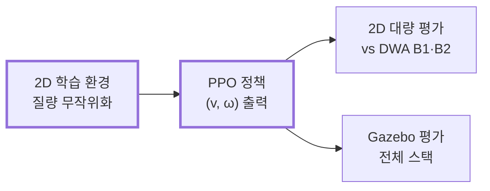

# 지능형 물류 AMR Fleet 프로젝트 명세서

> 이 문서는 원 명세서(31번 스펙, 지능형 물류 AMR 시스템)를 팀이 확장한 것이다. **원 명세서가 1순위**이며, 이 문서와 원 명세서가 충돌하면 원 명세서를 따른다. 원 명세서 대비 누락·위배 보완 사항은 [1-4절](#1-4-원-명세서-대조-누락위배-보완)에 정리했다.

## 1. 프로젝트 개요

31번 스펙(지능형 물류 AMR 시스템)의 필수 요구사항을 먼저 충족하고, 그 위에 **연구 2축 + 시스템 고도화 3종**을 얹는다. 필수 KPI 통과가 항상 최우선이며, 연구·고도화는 그 다음 순서로 진행한다.

| 구분 | 내용 | 출처 의견 |
| --- | --- | --- |
| 기반 | 31번 스펙 필수요건: 5대 동시운용, SLAM·경로계획·제어·AI인지·작업수행·Fleet Management, Docker·Git Flow·테스트자동화, 대시보드 | 개요서 |
| 연구 1 (메인) | 중앙집중 Fleet의 통신 지연 내성과 분산 전환 임계점 실측. ros2_tracing을 측정 도구로 사용 | 하연(방법론) + 민지(연구설계) |
| 연구 2 (AI/ML) | 적재 질량 변화에 강건한 PPO 로컬 플래너와 고정·질량 맞춤 한계 DWA의 안전성·효율성 비교 | AI/ML 파트 제안 (10/5 회의 확정) |
| 시스템 고도화 | 장애 주입기, 회귀 테스트 하네스, 관측 스택(Prometheus/Grafana + 사후 리플레이) | 민지 제안 |
| 선택 고도화 | 궤적 예측, MARL, 실물 네트워크(라즈베리파이), Jetson 엣지 추론 | 팀원 추가 제안, 2차 회의 안건 |

두 연구는 서로 다른 레이어(Fleet 통신 / 로봇 로컬 플래닝)를 다루므로 실험이 겹치지 않는다. 공통 인프라(장애 주입기, 회귀 하네스, 관측 스택)는 두 연구가 함께 쓴다.

### 1-1. 최종 결과물과 제출물 (원 명세서)

최종 제출물은 GitHub 레포지토리 URL 하나다. 4개 핵심 시스템이 시뮬레이션에서 정상 동작해야 한다.

| 핵심 시스템 | 입력 | 출력 | 팀 추가 산출물 |
| --- | --- | --- | --- |
| 1. 시뮬레이션 환경 및 로봇 시스템 | 물류센터 설계 파라미터, 로봇 스펙 | 물리 시뮬레이션 물류센터, 센서 노이즈 모델 AMR, Docker ROS2 스택 | 연구 2용 적재 질량 스폰(`payload_mass`)과 급정지 시나리오 |
| 2. 자율 매핑 및 정밀 위치 추정 | LiDAR, IMU, Wheel Encoder | 2D 맵, EKF 센서퓨전 위치 추정, 오차 분석 리포트 | 회귀 하네스 기반 신뢰구간 리포트 |
| 3. AI 인지 및 동적 환경 대응 | 목표 지점, 센서 데이터, 카메라 영상 | 객체 인식·3D 위치, 경로 생성·추종, 동적 장애물 예측·회피, 긴급 대응 | 연구 2: 적재 질량 RL 로컬 플래너와 DWA 비교 |
| 4. 다중 AMR 협업 운용 | 다수 배송 요청 | 5대 이상 동시 운용, 작업 할당, 교착 방지, 대시보드 | 연구 1: 장애 주입, 중앙/분산/하이브리드 비교, 관측 스택 |

레포지토리에 반드시 포함할 것:

- 전체 소스 코드 및 설정 파일
- `docker-compose.yml` 등 Docker 환경 구성 파일
- 시스템 아키텍처 설계 문서(컴포넌트·시퀀스 다이어그램)
- 핵심 알고리즘 구현 설명 문서(DWA, EKF, SLAM 파라미터 등)
- 성능 측정 및 분석 리포트
- 설치/실행 가이드(README), 노드별 토픽·서비스·액션 API 문서
- (팀 추가) 연구 1·2 실험 스크립트와 재현 설정, 논문 원고

### 1-2. 필수 기능 요구사항과 팀 추가사항

원 명세서의 10개 영역은 모두 필수이며, 팀 추가사항은 이 위에 얹힌다. KPI 열은 동료 평가에서 직접 확인하는 수치다.

| 영역 | 필수 구현 | 필수 KPI | 담당 | 팀 추가·연구 연결 |
| --- | --- | --- | --- | --- |
| 1. 개발 환경·인프라 | `docker-compose up` 실행, ros:humble 베이스, nvidia-container-toolkit, Git Flow + conventional commits, 60×40m 물류센터(선반·입출고·충전 3개·통로), 동적 장애물 5개 이상(0.3~1.5m/s, 직선·곡선·무작위), xacro URDF(600×400×300mm, 2.0m/s, 1.0m/s², 1.5rad/s, 적재 질량 반영), 센서 노이즈(LiDAR σ=0.03m 등), extrinsic 파일 | 센서 사양 충족 | 지수 (물류센터 정적 환경은 이진, Docker·Git Flow·CI는 하연) | 회귀 하네스가 같은 Docker 이미지로 실행 |
| 2. 로봇 기초 | 순기구학 직접 구현, 휠 오도메트리 + 드리프트 실험, LiDAR·Depth·IMU 필터링, TF 트리(map→odom→base_link→센서) 문서화 | 드리프트 분석 리포트 | 지수 | 드리프트 기준값은 위치추정 인계 계약에 사용 (8-2절) |
| 3. 위치 추정 | slam_toolbox/cartographer 파라미터 문서화 또는 ICP/NDT 직접 구현, Loop Closure, 맵 품질 지표, AMCL 튜닝, Kidnapped 복구, EKF(Odom+IMU+AMCL) 공분산 근거 | 맵 0.05m 이하, 오차 정지 3cm·직선 5cm·회전 8cm, RMSE·Max(100개 시점 이상) | 지수(SLAM·지도) + 민지(AMCL·EKF·위치 오차 KPI), 8-2절 | 하네스로 N회 반복 신뢰구간 제시 |
| 4. 경로 계획 | A* 직접 구현 vs NavFn/Smac, 경로 평활화, DWA 직접 구현 vs TEB, Costmap 3레이어, 좁은 통로(로봇 폭+20cm) | 50쌍 성공률 98%, 재계획 500ms, 주행시간 예측 오차 15% | 이진 | 연구 2 baseline(B1·B2)으로 DWA 사용 |
| 5. 모션 제어 | Pure Pursuit/Stanley 직접 구현(적응형 look-ahead), PID 속도 제어, 사다리꼴/S-curve, 저크 제한 | CTE 직선 5cm·곡선 10cm | 이진 | 연구 2 효율성 지표(jerk)로 재사용 |
| 6. AI 인지 | YOLOv8 3종 이상(화물·사람·표지판), 커스텀 메시지 + RViz2 마커, Pinhole 2D→3D(map frame) | CPU 10 FPS 또는 GPU 30 FPS | 연우 | Jetson 고도화안 연결 |
| 7. 동적 환경 대응 | LiDAR 동적 장애물 분류, KF/EKF 추적(속도·방향·신뢰도), 미래 위치 예측·TTC, VO 개념 반응형 회피(DWA 동적 필터, 8장), 긴급정지(0.3m), Safety Zone(Warning/Critical), E-Stop, 센서 고장 감지 → 안전 정지/저속 | 30회 충돌 0건, 경로 이탈 1m, 복귀 5초, 1.0m/s 장애물 재계획 회피 | 연우 | 필수 구현. 연구 2 관측에 `TrackedObstacleArray` 제공 |
| 8. 작업 수행 | BehaviorTree.CPP, 대기-이동-인식-작업-복귀, 노드 15개 이상, 서브트리, 에러 3종 이상 자동 복구, Groot 시각화, ArUco 도킹(3회 실패 시 대체 작업), JSON Task, 상태 이벤트, 우선순위·마감 스케줄링, 작업 로그 | 도킹 2cm·1도, 단일 작업 성공률 97%, BT 확장 시 수정 3파일 이내 | 지수 | 작업 로그를 관측 스택으로 수집 |
| 9. Fleet Management | 5대 이상, 네임스페이스·TF 분리, 통신 지연 100ms 반영, 중앙 할당(최소거리/부하균형/Hungarian), 최적성 지표, 경로 충돌 예측, 교차로 우선순위, 교착 탐지 + 해소 전략 2가지 이상, 대시보드(위치·상태·배터리·작업, KPI, 이상 알림) | 5대 동시 운용 시 교착 없이 수행 | 하연 (분산 로직은 이진 공동) | **연구 1 본체.** 100ms 반영을 장애 주입기의 한 설정값으로 구현. 대시보드는 Prometheus/Grafana(지수) |
| 10. 통합·품질 | 성능 리포트, README·아키텍처·알고리즘·API 문서 | 평균 응답 200ms(50회 이상), 5대 CPU 80% 이하, 연속 4시간 운용, 커버리지 70%, 통합 테스트 10개 이상 자동화, `colcon build` 경고 0 | 민지(테스트) + 이진(문서) + 전원 | ros2_tracing으로 응답시간 분해, 하네스로 CI 자동 검증 |

원 명세의 구현 권장 순서(1 Docker → 13 테스트·문서화)는 9장 로드맵에 그대로 반영한다.

### 1-3. 원 명세서와의 정합성 점검

팀 추가 의견을 원 명세서와 대조한 결과, 충돌은 없지만 보완할 지점이 5개 있다. 아래 내용은 본문 각 장에 반영했다.

| 지점 | 원 명세서 | 팀 계획의 문제 | 조치 |
| --- | --- | --- | --- |
| KPI 검증 조건 | 로봇 간 통신 지연 최대 100ms를 시뮬레이션에 반영 | 연구 1이 baseline을 지연 0ms로 정의 | 필수 KPI(200ms, CPU 80%)는 **지연 100ms 조건**에서 검증. 0ms는 연구용 기준점으로만 사용 |
| 연속 운용 | 연속 4시간 운용 안정성 검증 | 로드맵에 없음 | P4에 4시간 soak 테스트 추가, 관측 스택으로 메모리·지연 추이 기록 |
| 안전 시스템 | 긴급정지 0.3m, Safety Zone, E-Stop, 센서 고장 감지 | 팀 문서에 언급 없음 | 연우 담당으로 명시. TTC를 Warning 존 트리거로 활용 |
| RL 보너스 | Isaac Sim의 RL 환경 활용 | 시뮬레이터는 Gazebo 권장 | 2D gym 환경에서 학습하고 Gazebo로 평가해 연구 2(4장)에서 다룬다 |
| 시뮬레이터 버전 | Gazebo Fortress 또는 Garden, ROS2 Humble | 둘 다 후보로 기재 | Humble 공식 페어링인 Fortress로 확정 권장 |

그 밖의 제약도 지킨다: 외부 상용 솔루션 미사용(Prometheus·Grafana·Foxglove는 오픈소스), 소스는 `src` 패키지 단위, LLM 자연어 명령과 로봇 팔 조작은 범위 외, 3D SLAM은 보너스로만.

### 1-4. 원 명세서 대조: 누락·위배 보완

원 명세서 전문과 대조해 1-2절 표에서 축약되거나 빠진 항목, 그리고 팀 계획이 원 명세서와 어긋난 지점을 정리한다. 아래 항목은 모두 **필수**다.

#### 위배 및 수정 사항

| 지점 | 원 명세서 | 기존 팀 계획 | 수정 |
| --- | --- | --- | --- |
| 인식 결과 메시지 타입 | 인식된 객체 정보를 **커스텀 메시지 타입**으로 발행 | 표준 `vision_msgs/Detection3DArray`로 통일 | `src`에 인터페이스 패키지(예: `amr_msgs`)를 두고 커스텀 메시지를 정의한다. 필드는 class, confidence, bbox, 3D 위치 + 공분산(PoseWithCovariance), timestamp. 8장 인터페이스 경계 반영 |
| LLM 자연어 명령 제외 근거 | LLM 명령 처리는 구현하지 않되 **보너스 과제는 예외** | 7장에서 "스펙 제약상 어떤 형태로도 구현 불가"로 기재 | 보너스 3은 허용 범위다. 제외 사유를 **팀 스코프 판단**(일정·연구 축과 무관)으로 정정. 7장 반영 |
| 대시보드 범위 | 실시간 위치·상태·배터리·현재 작업 시각화, KPI(작업 처리량·평균 작업 시간·**로봇 가동률**), 알림(**긴급 정지·작업 실패·교착**) | Prometheus/Grafana 중심, KPI·알림 항목 미명시 | 아래 표의 KPI 3종과 알림 3종을 필수 패널로 둔다. 지도 위 실시간 위치는 Grafana로 표현이 어려우므로 Foxglove Studio를 **병행 필수**로 한다 |

#### 1-2절에서 축약·누락된 필수 요구사항

| 영역 | 누락·축약 항목 | 담당 |
| --- | --- | --- |
| 1. 환경 | 바닥 마찰 계수·조명 조건 등 물리 파라미터를 현실적으로 설정 / 정적 장애물(선반·벽·**기둥**) | 이진 |
| 1. 환경 | 동적 장애물 종류(**작업자·지게차·다른 로봇**) / URDF 모델 내 센서 위치와 TF 트리 정확히 일치 / 센서 캘리브레이션 절차 문서화 | 지수 |
| 1. 센서 | 아래 "센서 사양" 표의 전 항목(1-2절은 LiDAR σ만 기재) | 지수 |
| 2. 로봇 기초 | LiDAR 필터 3종(거리·각도·아웃라이어) / Depth 포인트클라우드 변환 + **다운샘플링** / IMU 저역통과 필터 + **바이어스 보정** / TF 트리 시각화 자료 | 지수 |
| 3. 위치 추정 | Loop Closure 탐지와 **그래프 최적화 과정** 설명 / 맵 품질 지표는 맵 일관성·구조물 정확도로 정의 | 지수 |
| 3. 위치 추정 | AMCL 파티클 수·리샘플링 파라미터 튜닝 근거 | 민지 |
| 4. 경로 계획 | A* vs NavFn/Smac 비교 지표: **경로 길이·계획 소요 시간·장애물 여유 거리** / DWA 4단계(속도 샘플링·궤적 시뮬레이션·비용 함수·최적 속도 선택) 모두 직접 구현 / TEB 대비 장단점 분석 / Inflation 반경·cost scaling 튜닝 / Costmap **센서 업데이트 주기·장애물 유지 시간** 설정 | 이진 |
| 5. 모션 제어 | PID **게인 튜닝 과정 문서화** | 이진 |
| 6. AI 인지 | 인식 객체의 3D 위치를 **지도상 마커**로 표시(텍스트: class·confidence·거리) | 연우 |
| 7. 동적 환경 | TTC 임계값 이하 시 회피 기동 / Safety Zone 단계별 대응 로직. TTC 3 s 미만 DWA 회피 모드, 2 s 미만 안전 노드 감속, 1 s 미만 정지 (8장 역할 분담) | 연우·이진 |
| 8. 작업 수행 | 가상 물품 3종과 적재 이벤트(아래 표), 적재 시 **질량 변화를 동역학에 반영** / 작업 상태 4종 **Pending·InProgress·Completed·Failed** 관리 및 이벤트 발행 / 작업 로그 필드(시작·종료 시각, 이동 거리, 소요 시간, 결과)를 분석 가능한 형태로 저장 / 물품 픽업·배송은 도킹 완료 후 가상 적재·하역 이벤트로 대체 | 지수 |
| 9. Fleet | 작업 할당 최적성 지표(총 이동 거리·작업 완료 시간) 측정·분석 / 교착 해소 전략 예: 우선순위 기반 양보, 대체 경로 탐색 | 하연 |
| 10. 품질 | 아래 "성능 지표 측정 절차" 표의 산출 방법·로그 포맷 준수 / 커버리지는 **주요 모듈별 분리 보고** / 응답 시간은 평균과 **최대**를 함께 보고 | 민지 + 전원 |

#### 개발 환경 (원 명세서 6장)

- Ubuntu 22.04 LTS, ROS2 Humble Hawksbill
- Python 3.10 이상 또는 C++17 이상
- 시뮬레이터: Gazebo Fortress(팀 확정 권장) 또는 Isaac Sim 2023.1 이상
- Navigation은 Nav2 기반. 단, A* Global Planner와 DWA Local Planner 핵심 로직은 직접 구현

#### 센서 사양

| 센서 | 사양 | 노이즈 |
| --- | --- | --- |
| 2D LiDAR | 360도, 최대 25m, 해상도 0.5도, 10Hz 이상 | 가우시안 σ=0.03m |
| Depth Camera | 640×480 이상, FOV 87도, 최대 10m, 15Hz 이상 | 깊이 측정 노이즈 |
| RGB Camera | 640×480 이상, 30Hz (객체 인식용) | — |
| IMU | 가속도계 + 자이로, 100Hz 이상 | 바이어스 + 노이즈 |
| Wheel Encoder | 틱 분해능 4096 이상 | 슬립 노이즈 |

#### 가상 물품 및 적재·하역 이벤트

| 물품 유형 | 질량 | 크기(cm) | 적재 시간 | 비고 |
| --- | --- | --- | --- | --- |
| 소형 박스 | 2kg | 30×20×15 | 5초 | 전자부품, 소형 패키지 |
| 중형 박스 | 10kg | 50×40×30 | 10초 | 의류, 생활용품 |
| 대형 박스 | 25kg | 60×50×40 | 15초 | 가전, 산업자재(적재 시 질량 변화 반영) |

#### 성능 지표 측정 절차

연구용 지표(P95/P99, 신뢰구간)는 이 표준 위에 추가로 산출한다. 동료 평가용 KPI는 이 표의 정의를 따른다.

| 지표 | 산출 방법 | 로그 포맷 | 비고 |
| --- | --- | --- | --- |
| 위치 추정 RMSE | Ground Truth 좌표 − EKF 추정 좌표의 RMSE | `[timestamp, gt_x, gt_y, est_x, est_y, error]` | 최소 100개 시점 샘플링 |
| 경로 추종 CTE | 계획 경로와 실제 궤적 간 수직 거리 평균 | `[timestamp, planned_x/y, actual_x/y, cte]` | 직선/곡선 구간 분리 측정 |
| 응답 시간 | 로봇 첫 움직임 timestamp − 작업 명령 발행 timestamp | `[cmd_time, response_time, latency_ms]` | 50회 이상, 평균·최대 |
| 테스트 커버리지 | `pytest --cov` 또는 `colcon test --coverage` | coverage 텍스트/HTML | 주요 모듈별 분리 보고 |

#### 코드 구조 원칙 (동료 평가 항목)

- ROS2 패키지는 기능별로 분리하고 패키지마다 책임을 하나로 둔다.
- 핵심 알고리즘(A*, DWA, EKF, KF 추적 등)은 ROS 노드와 분리된 독립 모듈로 구현해 단위 테스트가 가능하게 한다.
- 설정값은 YAML로 외부화해 파라미터 변경 시 재빌드가 필요 없게 한다.
- TF 트리는 `ros2 run tf2_tools view_frames` 결과와 함께 문서화한다.
- BT 노드 추가로 작업을 확장할 때 기존 코드 수정은 3개 파일 이내로 한다.

#### 학습 목표 대응 문서 (원 명세서 3장)

원 명세서는 아래 내용을 팀원이 스스로 설명할 수 있기를 요구한다. 알고리즘 문서에 각 항목의 설명 절을 둔다.

| 학습 목표 | 문서 위치 | 담당 |
| --- | --- | --- |
| 차동 구동 순기구학 수식, 오도메트리 누적 오차 원인과 보완 | 로봇 기초 / 드리프트 리포트 | 지수 |
| EKF 예측-업데이트 단계, 센서별 공분산 설정 근거 | 위치 추정 | 민지 |
| A*·DWA 동작 원리, 환경별 파라미터 튜닝 | 경로 계획 | 이진 |
| Pinhole Camera Model 기반 2D→3D 변환 원리 | AI 인지 ([perception.md 4절](algorithms/perception.md#4-yolo-인식과-3d-변환)) | 연우 |
| **Behavior Tree vs FSM 비교(장단점)** | 작업 수행 | 지수 |
| 다중 로봇 교착 유형과 해결 전략 | Fleet Management | 하연 |

#### 참고: 미션 소개의 권장 역량

원 명세서 미션 소개는 Domain Randomization, Sim-to-Real Gap 분석을 시뮬레이션 기반 개발 역량으로 언급한다. 기능 요구사항은 아니므로 필수로 두지 않고, 센서 노이즈 모델링(필수)과 연구 2(4장)의 질량 무작위화에서 다룬다. 성능 리포트에 Sim-to-Real Gap 고려사항 절을 짧게 둔다.

## 2. 핵심 용어

| 용어 | 설명 |
| --- | --- |
| DDS | ROS2 노드 간 메시지를 발행/구독 방식으로 전달하는 통신 미들웨어 |
| ros2_tracing | ROS2 공식 트레이싱 프레임워크. LTTng 기반으로 발행, 콜백 시작/종료, DDS 전송 시점을 마이크로초 단위로 기록 |
| E2E 응답시간 | 명령 수신부터 로봇 반응까지 전체 처리 시간. 스펙 기준 200ms 이내 |
| QoS 프로파일 | DDS 전달 방식 설정값(reliability, history depth 등) |
| P95 / P99 | 상위 5%/1% 지연시간. 안전 관련 시스템에서 평균보다 중요 |
| 장애 주입 | 지연·패킷손실·서버 장애를 인위적으로 발생시켜 한계를 실측하는 기법 |
| 신뢰구간 / 노이즈 바닥 | 같은 조건 N회 반복으로 결과가 우연인지 실제 개선인지 구분하는 기준 |
| 상태 추정 공분산 P | KF가 추정한 상태(위치·속도)의 불확실성을 나타내는 공분산 행렬. 클수록 추정을 덜 믿어야 함 |
| NEES | 실제 추정 오차가 공분산 P와 맞는지 보는 일관성 지표. 추적 품질 점검용 |
| TTC | Time-To-Collision. 현재 상대속도 유지 시 충돌까지 남은 시간 |
| PPO | Proximal Policy Optimization. 현재 정책으로 모은 데이터로 정책을 조금씩 개선하는 강화학습 알고리즘. 업데이트 폭을 clipping으로 제한한다 |
| Domain randomization | 환경의 물리 파라미터(여기서는 적재 질량)를 에피소드마다 무작위로 바꿔 학습해 여러 조건에서 통하는 정책을 얻는 기법 |
| VO / ORCA | Velocity Obstacle / Optimal Reciprocal Collision Avoidance. 충돌을 일으키는 속도 집합을 피해 속도를 선택하는 회피 기법 |

## 3. 연구 1 (메인): 중앙집중 Fleet의 통신 지연 내성과 분산 전환 임계점

**연구질문**: 중앙집중식 작업 할당은 통신 지연·손실이 커질수록 성능이 무너진다. 어느 지점부터 분산 협상 방식이 더 나은가?

ros2_tracing은 **측정 도구**, 중앙집중 vs 분산 비교실험은 **그 도구로 검증할 연구질문**이다.

### 3-1. 측정 레이어

- **레이어 1 — 로봇 내부**: 센서→SLAM→경로계획→모션제어 파이프라인의 노드 간 DDS 지연
- **레이어 2 — Fleet 간**: 로봇 ↔ 중앙 Fleet 서버. 작업할당, Traffic Management 조율, 대시보드 스트림이 동시에 몰릴 때의 병목 위치

### 3-2. 실험 설계

| 항목 | 내용 |
| --- | --- |
| 독립변수 | 통신 지연 0/50/100/200/500ms, 패킷 손실률 0~10%, 로봇 대수 3/5/7/10 |
| 비교군 | 중앙집중 / 분산 협상 / 하이브리드(평시 중앙, 임계 초과 시 분산 폴백) |
| 보조 튜닝 | QoS 프로파일 조정, DDS 벤더 비교(Cyclone vs Fast DDS) |
| 종속변수 | 작업 처리량, 평균 완료 시간, 교착 발생률, 충돌 건수, 총 이동거리(할당 최적성), 두 레이어의 P95/P99 지연 |
| 통과 기준 | 스펙 조건(지연 100ms, 중앙집중, 5대)에서 KPI 충족: 평균 응답시간 200ms 이내, CPU 80% 이하. 지연 0ms는 연구용 기준점 |
| 기여 | 중앙→분산 폴백 전환 임계점을 실측으로 제시. 스케일 한계(몇 대까지 버티는가)와 병목 위치(DDS / 중앙 할당기 / Costmap 갱신) 함께 보고 |

### 3-3. 실행 순서

1. 장애 주입기 구축(5장)
2. Before 측정: 지연 0ms(기준점)와 100ms(스펙 조건)에서 중앙집중 방식의 두 레이어 P95/P99
3. 비교 실험: 지연·손실률을 단계적으로 높이며 3개 비교군의 성능 곡선 측정(조건당 N회 반복)
4. 분석: 처리량이 급락하는 지점을 하이브리드 폴백 트리거 기준으로 제시
5. After 측정: QoS·벤더 튜닝 후 동일 시나리오 재측정, 개선폭을 신뢰구간과 함께 제시

### 3-4. 스코프 제한

- 분산 협상은 **대조군 역할만** 한다. "가장 가까운 로봇이 먼저 선점" 같은 단순 규칙 기반으로 충분하다.
- 목표는 완벽한 분산 시스템이 아니라 중앙집중 대비 상대적 강건성 비교다.
- 보너스 과제 4번(분산 Fleet Management, 중앙 서버 장애 시 폴백)은 이 실험으로 함께 검증된다.

## 4. 연구 2 (AI/ML): 적재 질량 변화에 강건한 물류 AMR 강화학습 로컬 플래너

**연구질문**: 적재 질량이 바뀌어 로봇이 낼 수 있는 가감속이 달라질 때, 질량 변화를 겪으며 학습한 강화학습(RL) 로컬 플래너는 고정 한계를 쓰는 DWA보다 안전하고 효율적인가? 적재 질량을 관측에 넣으면 더 나아지는가? 질량 정보가 틀리거나 없을 때도 버티는가?



굵은 테두리가 이 연구에서 새로 만드는 부분이다. 학습은 가벼운 2D 환경에서 하고, Gazebo는 평가에만 쓴다.

### 4-1. 배경과 범위

바퀴 토크에는 상한이 있어, 적재 질량이 커지면 최대 가감속이 줄어든다.

```math
a_{\max}(m) = \frac{2\tau}{r\,(M_{\text{robot}} + m)}, \qquad \tau = 3\ \mathrm{N\cdot m},\ r = 0.1\ \mathrm{m},\ M_{\text{robot}} = 28.9\ \mathrm{kg}
```

1.0 m/s에서 급정지한 Gazebo 실측(#42 80회, #44 실제 로봇 모델 재측정)은 다음과 같다.

| 적재 | 최대 감속 | 급정지 제동 거리 | 일반 정지(감속 1.0 m/s² 제한) |
| --- | --- | --- | --- |
| 0 kg | 약 2.1 m/s² | 0.25 m | 0.50 m |
| 10 kg | 약 1.5 m/s² | 0.34 m | 0.50 m |
| 25 kg | 약 1.1 m/s² | 0.46 m (1.8배) | 0.50 m |

- 적재 효과는 모터가 토크 한계까지 쓰는 **급정지·고가속 상황에서만** 나타난다. 감속을 제한한 일반 정지는 질량과 무관하다. 연구 범위를 이 구간으로 한정한다.
- 창고 사각지대에서 작업자·로봇이 튀어나오는 상황이 이 구간에 해당한다. 무거우면 같은 상황에서 1.8배 더 밀린다.
- DWA는 가감속 한계를 고정값으로 알고 있다고 가정한다. 실제보다 크게 잡으면 무거울 때 못 서고, 보수적으로 잡으면 가벼울 때도 느리다.

### 4-2. 문제 정의 (D7)

에이전트는 로컬 플래너, 환경은 2D 창고 시뮬레이터다. 적재 질량은 환경 상태에 항상 들어 있지만, 에이전트에게 보여 줄지는 비교군마다 다르다(질량을 보지 않는 비교군은 POMDP).

| 요소 | 정의 |
| --- | --- |
| 제어 주기 | 10 Hz (Δt = 0.1 s). Gazebo 정책 노드도 같은 주기 |
| 행동 | 연속 `[v_cmd, ω_cmd]`. 출력 [−1, 1]을 고정 범위 v ∈ [0, 2.0] m/s, ω ∈ [−1.5, 1.5] rad/s로 변환 |
| 전이 | 바퀴 단위 토크 한계(질량 의존) + DiffDrive 회전 가속 한계 3.2 rad/s² (아래 식). 위치는 유니사이클 모델로 적분 |
| 관측 | 48차원, 로봇 기준 상대좌표 (아래 표) |
| 보상 | 진행 + 시간 + 종료 보상(충돌은 충돌 속도에 비례). 근접·평활 항은 v1에서 0 (아래 표) |
| 종료 | 충돌(장애물·벽), 도착(0.2 m 이내 + 속도 0.1 m/s 미만), 목표를 2 m 넘게 지나침(실패), 시간 초과 30 s(300스텝, 실패). 남은 시간을 관측하므로 시간 초과도 terminated로 끝낸다 |
| 할인율 | γ = 0.99 (약 10 s 앞을 봄) |

명령 (v, ω)를 왼·오른 바퀴 속도 $v_{l,r} = v \mp \omega b/2$ (바퀴 간격 $b$ = 0.34 m)로 바꾸고, 두 바퀴 속도 변화를 같은 비율로 줄여 더 큰 쪽이 $a_{\max}(m)\,\Delta t$를 넘지 않게 한다(명령의 직진·회전 비율 유지). 회전 변화는 DiffDrive 회전 가속 한계로도 자른다.

```math
\Delta v_{l,r} = v^{\text{cmd}}_{l,r} - v_{l,r}, \qquad s = \min\!\left(1,\ \frac{a_{\max}(m)\,\Delta t}{\max(|\Delta v_l|, |\Delta v_r|)},\ \frac{\alpha_{\max}\,\Delta t}{|\Delta\omega|}\right), \qquad (v, \omega)_{t+1} = (v, \omega)_t + s\,(\Delta v, \Delta\omega)
```

- 두 바퀴가 토크를 나눠 쓰므로 **급정지와 급회전을 동시에 최대로 할 수 없다.** 선가속만 질량에 따라 자르면 "최대 감속 + 최대 회전"처럼 물리적으로 불가능한 회피가 가능해져, 통로 회피 능력이 과대평가된다 (25 kg에서 두 한계를 동시에 쓰면 바깥 바퀴가 1.65 m/s²를 내야 하는데 한계는 1.11 m/s²). 회전 가속도 적재 질량의 영향을 받는다.
- 직진 급정지에서는 두 바퀴 변화가 같아 기존 식과 같다. 직진 제동 거리는 v²/(2a)이고 Gazebo 결과와 약 2 cm 차이로 맞았다(#42).
- 명령에 스텝 중간에 도달하면 그 뒤로는 유지한다고 보고 이동 거리를 정확히 적분한다.
- 명령 반응 지연은 동역학에 넣지 않는다. 대신 회피 가능성 판정(아래 시나리오, 4-5절)에 반응 지연 0.1 s(정책 주기 한 번)를 넣는다. 2D–Gazebo 차이를 본 뒤 동역학 지연(#55 실측 0.015 s(#78))을 검토한다.

**관측 (48차원)**

| 그룹 | 항목 | 크기 | Gazebo 출처 |
| --- | --- | --- | --- |
| 목표 | 거리, 방향 오차(sin, cos) | 3 | odom + 목표 |
| 자기 상태 | v, ω | 2 | odom |
| 직전 명령 | v_cmd, ω_cmd | 2 | 정책 출력 |
| 장애물 | 가까운 3개 × (상대 x, y, vx, vy, 반경, 존재 여부) | 18 | `perception/obstacles` (`TrackedObstacleArray`) |
| 과거 이력 | 최근 4스텝 × (v, ω, v_cmd, ω_cmd), frame stacking | 16 | odom + 정책 출력 |
| 경로 | 경로(통로 중심선)에서 옆으로 벗어난 거리, 경로 대비 방향 오차 | 2 | odom + 전역 경로 |
| 벽 | 로봇 몸체에서 왼쪽·오른쪽 벽까지 거리 | 2 | 지도 또는 LiDAR |
| 남은 시간 | 1 − 경과 스텝 / 300 | 1 | 정책 노드 |
| 적재 질량 | 제동 능력 비율 a_max(m) / a_max(0 kg), 앎 여부 (1 / 0). 제안 방법만 채우고, 나머지 비교군과 "정보 없음"은 (0, 0). 처음엔 m / 30이었고 제안 방법 튜닝에서 바꿨다(research2 README "제안 방법 질량 입력 튜닝") | 2 | `payload_mass` 파라미터 |

설계 원칙:

- Gazebo에서 ROS 토픽으로 똑같이 만들 수 있는 값만 넣는다. 2D에서는 장애물 정답값을, Gazebo에서는 추적 결과를 쓴다.
- **정규화 상수는 질량과 무관하게 고정한다.** 행동을 "이 질량의 최대 감속" 기준으로 정규화하면 환경이 질량 적응을 대신 해 주어, 질량을 보지 않는 비교군이 사실상 질량 정보를 받는다.
- **질량 칸은 지우지 않고 (0, 0)으로 채운다.** 비교군끼리 신경망 구조와 과거 이력이 같고 질량 입력 하나만 달라야, 결과 차이를 질량 정보로 돌릴 수 있다.
- **앎 여부 플래그**로 "정보 없음"(0, 0)과 "0 kg"(0, 1)을 구분한다. 값 하나만 두면 정보가 없을 때 정책이 0 kg으로 믿고 행동한다.
- 과거 이력 4스텝(0.4 s)은 가감속 반응을 보여 주는 단기 정보다. 일정한 속도로 달리는 동안에는 질량이 드러나지 않으므로, 질량을 보지 않는 비교군(R2)은 질량을 **모르는** 정책으로 본다. 가속도는 이력에서 계산되므로 따로 넣지 않는다.
- 장애물이 3개보다 적거나 가려지면 0으로 채우고 존재 여부를 0으로 둔다.
- 경로는 관측으로만 주고 경로 추종 보상은 두지 않는다(최근 관행: DRL-VO subgoal, ETH path-conditioned 2026). v0 경로는 직선 통로 중심선이라 옆 오차와 방향 오차 2개로 충분하다. S3·S4(코너·합류)를 추가할 때 전방 경유점으로 확장한다.
- 남은 시간을 넣어야 시간 초과 페널티가 상태만으로 정해진다(ABS, RSS 2024).

**보상**

```math
r_t = w_p\,(d_{t-1} - d_t) - w_t - w_n \max(0,\ d_{\text{safe}} - d^{\min}_t) - w_s\left(\frac{|\Delta v^{\text{cmd}}|}{v_{\max}} + \frac{|\Delta\omega^{\text{cmd}}|}{\omega_{\max}}\right)
```

```math
r_{\text{충돌}} = r_c - w_i\,|v_{\text{충돌}}|
```

| 항 | 값 (v1 튜닝) | 역할 |
| --- | --- | --- |
| 진행 $w_p$ | 5.0 / m | 목표에 가까워진 만큼 +. 거리 차이라 왕복으로 점수를 벌 수 없다 |
| 시간 $w_t$ | 0.1 / 스텝 | 제자리 정지가 최적이 되는 것을 막는다 |
| 근접 $w_n$, $d_{\text{safe}}$ | 0, 0.3 m | 장애물이 명세 긴급정지 거리 안에 들어오면 −. v1에서 끈다 (일반적인 DRL 보상에 없음) |
| 평활 $w_s$ | 0 | 명령 변화량 −. v1에서 끈다 (같은 이유) |
| 충돌 (종료) $r_c$, $w_i$ | −100, 40 / (m/s) | 장애물·벽. 빠르게 부딪힐수록 더 벌한다(1.5 m/s면 −160). 속도만 보고 질량은 보지 않는다 |
| 도착 (종료) | +100 | 정지 조건을 만족해야 인정 |
| 시간 초과 (종료) | −25 | 장애물 앞에서 무한정 서 있는 것을 막는다(DRL-VO 방식). 충돌의 1/4 (같게 두면 부딪히는 것과 늦는 것이 같아진다) |
| 목표 지나침 | −12.5 / m | 정밀 정지. 지나친 거리의 최댓값이 늘어난 만큼만 벌한다 (되돌아와도 보상 없음). 진행 보상의 2.5배 |

- 값은 일반적인 DRL 내비게이션 보상(도착 +100, 충돌 −100, 진행 5/m, 시간 −0.1/스텝)에 충돌 속도 벌점을 더한 것이다. 출발값(진행 2.0, 시간 0.01, 근접 0.5, 평활 0.05, 충돌 −40, 도착 +10, 시간 초과 −10, 지나침 −5)으로는 정책이 무거워도 속도를 줄이지 않았다(0 kg 1.02 m/s, 25 kg 0.99 m/s). 후보 비교와 판정은 [v1 튜닝 기록](../experiments/research2/README.md#v1-튜닝-기록-10121015), 출발값에서 충돌 벌점을 키운 과정은 [v0 튜닝 기록](../experiments/research2/README.md#v0-튜닝-기록-1011)에 있다.
- 보상에 질량을 넣지 않는다. 질량은 전이(무거우면 덜 선다)와 제안 방법의 관측으로만 영향을 준다. 충돌 에너지(½(M+m)v²)에 비례하는 벌점도 시험했으나, 보상이 질량에 따라 달라지면 질량을 보지 않는 R2가 보지 못하는 값에 따라 벌을 받고 비교군 차이를 질량 관측의 효과로 돌릴 수 없어 쓰지 않는다.
- 보상은 RL 결과와 무관하게 검증했다: 규칙 정책(질량 앎)의 순항 속도를 0.8~1.5배로 바꾸면 안전 순항 속도(1.0배, 충돌 0)가 가장 높은 평균 보상을 받는다 (`scripts/check_reward.py`, [v1 튜닝 기록](../experiments/research2/README.md#v1-튜닝-기록-10121015) 보상 검증).
- RL 비교군은 모두 같은 보상을 쓴다.
- jerk는 보상에 넣지 않고 지표로만 본다.

**시나리오와 시작 상태**

| 시나리오 | v0 | 내용 |
| --- | --- | --- |
| S1 돌발 장애물 | ○ | 초기 속도 1.0~2.0 m/s, 가려진 장애물이 0.5~1.5 m 앞에 나타남. 가로지름(진행선을 가로질러 지나감)과 멈춰 섬(진행선에 1.5~3 s 서 있다가 비킴)이 반씩 |
| S2 정밀 정지 | ○ | 빠르게 접근해 목표에서 정지 |
| S3 좁은 통로 | 이후 | 0.6 m 통로 앞 급감속·진입 (월드 v0 통로 ①·②) |
| S4 빠른 합류 | 이후 | 지나가는 장애물 사이로 급가속해 합류 |

**v0 환경**: 직선 통로(폭 1.2~2.0 m 무작위, 로봇 폭 0.4 m). 벽에 닿으면 충돌이다. 경로는 통로 중심선이다. 통로가 좁으면 멈춰 선 장애물을 옆으로 비켜 갈 수 없어 장애물 앞에서 서야 한다. 넓으면 비켜 가는 것도 가능하다.

어떤 행동을 해도 충돌하는 상황(예: 2 m/s, 25 kg, 0.5 m 앞 출현)은 학습 신호가 없고 비교를 흐린다. 그래서 돌발 장애물이 나타나는 간격(0.5~1.5 m)은 속도와 무관하게 뽑되, **장애물은 로봇이 경로상 출현 지점 $x_{\text{trigger}}$를 지날 때 나타나고**, 그 지점은 가장 무거운 학습 질량(25 kg)으로 반응 지연 뒤 초기 속도에서 급정지했을 때 멈추는 거리 이후에 둔다.

```math
x_{\text{trigger}} \ge v_0\, t_{\text{react}} + \frac{v_0^2}{2\,a_{\max}(25\ \mathrm{kg})} + 0.5\ \mathrm{m}, \qquad t_{\text{react}} = 0.1\ \mathrm{s}
```

- **시간이 아니라 위치 기준이다.** 시간 기준으로 두면 빨리 달릴수록 장애물을 만나기 전에 목표에 도착해 장애물을 덜 만난다(측정: 순항 2.0 m/s면 56%만 만남). 정책이 "빨리 달려 피하기"를 배우고, 비교군마다 다른 시험을 치게 된다. 위치 기준이면 모든 정책이 같은 지점에서 같은 장애물을 만난다.
- 미리 속도를 줄여 두면 모든 학습 질량에서 피할 수 있다. 피하지 못하면 정책이 너무 빨리 달린 탓이다.
- 출현 지점은 정책이 모르므로, 안전한 순항 속도는 질량에 따라 달라진다(간격 0.5 m, 반응 0.1 s 기준 0 kg 약 1.25 m/s, 25 kg 약 0.95 m/s). 이것이 질량 정보가 쓸모 있는 이유다. 이 순항 속도를 지키는 규칙 정책은 학습·미학습 질량 모두에서 성공률 100%이고, 질량을 알면 0 kg에서 도착 시간이 25 kg 기준 순항보다 약 20% 짧다(13.8 s vs 17.4 s).
- 기준을 질량별로 두면 시나리오 분포가 질량마다 달라져 질량 정보가 새어 나가므로 25 kg 하나로 고정한다.

### 4-3. 학습 설계

| 항목 | 값 |
| --- | --- |
| 알고리즘 | PPO (Stable-Baselines3, `experiments/research2`의 `uv.lock`, #51) |
| 신경망 | Actor·Critic 각각 MLP [128, 128] |
| 병렬 환경 | 8 |
| n_steps / batch / epoch | 2048 / 64 / 10 |
| γ / GAE λ / clip | 0.99 / 0.95 / 0.2 |
| 학습률 | 3e-4 |
| target_kl | 0.02. 정책 변화량 상한. 없으면 학습 중 KL이 0.15 넘게 커지며 성능이 무너졌다([v0 튜닝 기록](../experiments/research2/README.md#v0-튜닝-기록-1011)) |
| 정규화 | VecNormalize(관측·보상). 통계를 체크포인트와 함께 저장 |
| 총 스텝 | 2D 환경 속도(steps/s)를 잰 뒤 정한다 |
| 시드 | 10개 (예비 학습 뒤 최대 20). [실험 설계](../experiments/research2/experiment_design.md) 2절 |

- **질량 무작위화**: 에피소드마다 {0, 2, 10, 25 kg}에서 균등하게 뽑는다(명세 물품 소·중·대 + 빈 차). 연속 분포로 뽑으면 15 kg을 "학습 때 보지 않은 질량"이라고 주장할 수 없다.
- **그 밖의 무작위화**: 통로 폭, 출현 지점·간격, 장애물 종류(가로지름·멈춰 섬)·크기·속도·서 있는 시간, 초기 속도, 출발 방향(±5°)·옆 위치(±0.1 m). 센서 노이즈·마찰은 질량 효과 해석을 흐려 v0에서 넣지 않는다.
- **질량 가림 (제안 방법만)**: 학습 에피소드의 20%에서 질량을 "모름"(0, 0)으로 가린다. 가리지 않으면 평가의 "정보 없음" 조건이 학습 때 본 적 없는 입력이 되어 결과를 해석할 수 없다. 가림 학습으로 "알면 질량에 맞추고, 모르면 조심한다"를 배운다.
- **PPO를 고른 이유**: 2D 환경이 싸서 SAC의 샘플 효율 이점이 작고, 실제 시간과 안정성이 낫다. 팀 환경에 이미 있다.
- **모델 선택**: 학습 보상이 아니라 학습 질량만으로 구성한 검증 환경의 성공률로 체크포인트를 고른다. 평가는 deterministic(평균 행동)으로 한다.
- **설정 파일**: 환경·보상·시나리오·PPO 설정과 비교군은 `experiments/research2/config/env_v0.toml`에 둔다. 값을 바꾼 실험은 파일을 복사해 `--config`로 고르고, 실행마다 쓴 설정을 결과 폴더에 복사한다. 로봇 물리값(토크·질량·크기)은 URDF(#44)와 제동 모델(#55)에서 온 상수라 코드에 둔다.
- 산출물(체크포인트, TensorBoard 로그)은 `experiments/research2/raw/`에 둔다(git 제외).

### 4-4. 비교군과 가설

| 비교군 | 정의 | 답하는 질문 |
| --- | --- | --- |
| B1 | DWA(#41), 빈 차 기준 감속 한계 고정 | 고정 한계의 위험 |
| B2 | DWA, 실제 질량에 맞춘 감속 한계 | 기존 방법의 최선 (핵심 비교 대상). 원본 DWA는 감속 한계를 동적 창에만 써서 질량에 맞춘 속도 선택은 하지 않는다(research2 README "DWA 비교군") |
| R1 | PPO, 0 kg 고정 학습 | 질량 변화를 겪어 보는 것의 효과 |
| R2 | PPO, 질량 무작위화, 질량 모름 (domain randomization만) | 질량을 모르는 채 강건하게 학습한 정책. 질량 정보 효과의 기준선 |
| 제안 | PPO, 질량 무작위화 + 질량 관측 (학습 중 20% 가림) | — |

공정성 조건: 모든 비교군이 같은 장애물 정보, 같은 속도 범위, 같은 10 Hz 제어, 같은 시나리오를 쓴다. 질량 정보는 B2와 제안 방법만 받는다. 실험 시 Gazebo DiffDrive 감속 제한(1.0 m/s²)은 모든 비교군에서 풀어 토크 한계가 실제 한계가 되게 한다.

- **H1**: 무거운 적재(10·25 kg)에서 제안 방법은 B1보다 충돌률이 낮다.
- **H2**: 제안 방법은 B2와 비슷한 안전성을 유지하면서, 질량 정보에 오차가 있거나 없을 때 B2보다 덜 나빠진다.
- **H3**: 학습 때 보지 않은 질량(15·30 kg)에서 제안 방법은 R2보다 충돌률이 낮거나 같고 도착 시간이 짧다.

B2는 질량을 정확히 알면 충분히 강할 수 있다. 이 경우 H2의 정보 오차·결측 조건을 핵심 결과로 삼는다.

### 4-5. 실험 조건과 지표

| 조건 | 값 |
| --- | --- |
| 학습 질량 | 0, 2, 10, 25 kg |
| 미학습 질량 | 15 kg(사이 값), 30 kg(범위 밖) |
| 질량 정보 오차 | 제안 방법과 B2에 실제 질량 ±30%, 또는 정보 없음(앎 여부 0) |
| 시나리오 | v0: S1·S2. 이후 S3·S4 |
| 반복 | 시드 × 에피소드, 회귀 테스트 하네스 방식으로 신뢰구간 산출 |

| 영역 | 지표 |
| --- | --- |
| 안전성 | 충돌률(로봇 사각형 0.6×0.4 m 기준, 장애물·벽 구분), 충돌 순간 속도, 최소 이격 거리, near-miss(0.3 m 미만) 비율, 최소 TTC |
| 효율 | 성공률(30 s 안에 충돌 없이 도착), 시간 초과율, 도착 시간, 평균 속도 |
| 정밀도 | 목표 초과 거리, 실제 제동 거리, 제동 거리 여유 |
| 화물 안정성 | jerk RMS·최대 (출발 직후 2스텝 제외) |

- **실제 제동 거리**: 돌발 장애물이 나타난 순간부터 로봇이 멈출 때(0.1 m/s 미만, 도착 기준과 같음)까지 간 거리.
- **제동 거리 여유** = 나타날 때 간격 − 실제 제동 거리. 클수록 여유 있게 섰다.
- 멈추기 전에 장애물이 있던 자리를 지나면(장애물이 비키거나 옆으로 비켜 간 경우) "지나감"으로 따로 집계하고 제동 거리는 없다.
- **설 수 있었음**: 나타난 순간 간격 ≥ v·0.1 s + v²/(2·a(실제 질량)). 반응 지연을 넣어야 판정과 실제 결과가 맞는다(지연 없이 판정하면 "설 수 있음" 상황의 4~6%에서 충돌).
- **막힘**: 장애물 옆으로 로봇 폭 + 0.1 m의 공간이 없음. 돌발 장애물 결과는 설 수 있었음 × 막힘으로 나눠 집계한다.

> 반복 수(시드·조건당 에피소드), 평가 조건, 결과 기록 형식, 통계 방법(시드 단위 부트스트랩), 판정 기준(H1~H3), 돌발 장애물 결과 집계는 [연구 2 실험 설계](../experiments/research2/experiment_design.md)를 따른다 (#72).

### 4-6. 인터페이스와 스코프

- **2D 학습 환경**: `experiments/research2/` 아래 gymnasium 환경. ROS 비의존. 동역학은 이진의 제동 모델(#55)을 쓰고, 머지 전에는 4-1절 식으로 둔다.
- **Gazebo 평가**: 지수 로봇 모델(#44), 월드 v0(통로 폭은 랙 사이 통로 기준), `payload_mass` 스폰 인자(#43), 동적 장애물(#58). 실험용 설정에서만 DiffDrive 감속 제한을 풀고 일반 Nav2 KPI 설정은 그대로 둔다.
- **정책 노드**: SB3 모델과 VecNormalize 통계를 읽어 10 Hz로 `cmd_vel`을 낸다. 관측 벡터를 만드는 코드는 2D 환경과 공유해 어긋나지 않게 한다.
- **안전 노드**: Gazebo 평가에서 켤지는 평가 단계에서 정한다. 켜면 개입 횟수를 지표로 기록한다.
- **필수 구현과의 관계**: TTC와 VO 개념 반응형 회피(DWA 동적 필터, 고정 margin)는 원 명세 7장 필수라 연구 2와 별개로 구현한다.
- **범위 밖**: 다중 로봇 RL, 코너·합류 경로(S3·S4 이후), 실물 로봇.
- **후속 실험 (P2 이후 여유 시)**: R2를 RecurrentPPO(LSTM)로 바꿔 "기억이 있으면 질량을 스스로 추정하는가"를 본다. 측정상 학습이 약 7배 느려(이 PC 기준 PPO 1,108 vs RecurrentPPO 153 steps/s) 본 실험에는 쓰지 않는다.

### 4-7. 합의가 필요한 것 (D7)

- [ ] 제동 모델 함수 형태: `step(v, ω, v_cmd, ω_cmd, m, dt) → (v', ω')` (이진)
- [x] DWA를 2D 환경에서 돌리는 방식: 2D에서도 #41 C++ 원본을 그대로 부른다(포팅 안 함, `payload_nav/dwa_policy.py`) (이진)
- [ ] 회전 동역학: 바퀴 단위 토크 한계로 질량을 반영함. 제동 모델에 바퀴 간격 0.34 m를 포함 (이진)
- [x] 시드 수·조건당 에피소드 수·통계 검정 (민지, #72)
- [ ] 보상 조정값(v1: 진행 5.0, 시간 0.1, 충돌 −100 − 40·|v|, 도착 +100, 시간 초과 −25, 지나침 −12.5, 근접·평활 0)과 통로 폭 범위 (이진·민지)
- [x] 성공 판정 기준(H1~H3)과 돌발 장애물 결과(멈춤·지나감·충돌) 집계 방식 (이진·민지, #72)

## 5. 시스템 고도화 (공통 인프라)

세 요소 모두 스펙 필수요건(통신지연 100ms 반영, 테스트 자동화, 대시보드)을 확장한 것이고, 연구 1·2가 함께 쓰는 실험 장치다.

### 5-1. 장애 주입기

- 통신 지연 0/50/100/200/500ms 단계 조절, 패킷 손실률 0~10%, 중앙 서버 임의 시점 강제종료
- 스펙의 "통신지연 100ms 반영"을 하나의 설정값으로 포함한다.
- 보너스 4번(중앙 서버 장애 시 폴백)을 말이 아니라 검증된 기능으로 만든다.

### 5-2. 회귀 테스트 하네스 (CI/CD 심화)

시뮬레이터는 같은 조건에서도 결과가 매번 달라, "30회 충돌 0건", "작업 성공률 97%" 같은 KPI가 실력인지 우연인지 구분할 장치가 필요하다.

1. PR에 `run-fleet-test` 라벨 또는 매일 1회 스케줄로 트리거
2. GitHub Actions가 학교 GPU 서버(또는 AWS Spot) self-hosted 러너를 깨움
3. Docker 컨테이너에서 Fleet 시나리오 N회 반복 → ros2_tracing 데이터 + 장애 조건별 결과 수집
4. `colcon test --coverage`로 단위·통합 테스트(통합 10개 이상) 실행, 커버리지 리포트 생성
5. P95/P99 지연, 신뢰구간, 커버리지를 PR 코멘트로 게시
6. baseline 대비 유의미한 성능 저하 또는 커버리지 70% 미달 시 빌드 실패
7. 작업 종료 후 러너 자동 종료

### 5-3. 관측 스택 + 사후 리플레이 (대시보드 심화)

- Prometheus로 지연·처리량·배터리 시계열 저장, Grafana로 시각화
- 스펙 필수 대시보드(실시간 위치·상태·배터리·현재 작업, KPI: 작업 처리량·평균 작업 시간·로봇 가동률, 알림: 긴급 정지·작업 실패·교착)를 이 스택으로 구현. 지도 위 실시간 위치는 Foxglove Studio로 병행
- 교착·충돌 발생 시 전후 상태를 자동 스냅샷(rosbag 구간 저장)해 원인을 재현
- 연구 2의 near-miss도 같은 알림 경로로 표시

## 6. 선택 고도화 (스트레치 목표)

아래 항목은 필수 KPI와 연구 1·2의 핵심 실험이 끝난 뒤 여유에 따라 착수한다. 모두 "규칙 기반 버전을 먼저 완성해 안전망으로 두고, 그 위에 얹어 비교"하는 순서를 따른다.

| 항목 | 내용 | 기존 계획과의 관계 | 권장 |
| --- | --- | --- | --- |
| 궤적 예측 기반 사회적 내비게이션 | KF 추적 히스토리 → Social-STGCNN/Trajectron++ → Predictive Costmap 레이어 → DWA 비용함수 확장 | 동적 장애물 회피의 후속 확장 | 후속 연구로 보류 |
| MARL 기반 Fleet 할당 | 계층 구조(상위 MAPPO 할당 / 하위 Nav2 유지), PettingZoo 추상 환경 학습 → Gazebo 검증 | 연구 1의 분산 비교군을 학습 기반으로 교체하는 확장 | 후속 연구로 보류 |
| 실물 네트워크 (고도화안 1) | 로봇 대리 노드를 라즈베리파이로 분리, `tc netem`으로 실제 지연·손실 발생, 각 노드 ros2_tracing 실측 | 연구 1 결과의 실측 검증 + 발표 데모. 통계 실험은 시뮬레이션 유지 | 최소구성(3+1대)만, 2차 회의 결정 — **이진 주도** |
| Jetson 엣지 추론 (고도화안 2) | YOLOv8 → TensorRT FP16/INT8, 시뮬레이터 카메라 토픽을 Jetson으로 전달해 추론, FPS·지연·전력 측정 | 엣지 추론 성능 고도화 | 2차 회의 결정 |
| 불확실성 전 단계 전파 (이전 연구 2 후보) | confidence–3D 위치 오차 상관 검증 → 유의하면 confidence 기반 AKF, Probabilistic TTC(Unscented Transform·Gaussian 근사로 실시간성 확보) | 연구 2 주제 변경으로 범위 밖. confidence·오차 로그는 추적 구현 때 미리 수집 | 후속 연구로 보류 |
| 충전 스케줄링 | 충전소 3개 × 로봇 5대 경합, 임계값/예측/기회주의 정책 | 스펙의 빈 구멍. 연구 축에서는 제외, 시스템 기능으로만 | 여유 시 기능 추가 |

궤적 예측과 MARL은 한 학기 안에 연구 1·2와 동시에 하면 일정이 터질 가능성이 높다. 논문 "향후 연구" 절의 근거로 남기는 것을 기본안으로 한다.

## 7. 제외 항목

- **자연어 명령(STT+LLM) → Task JSON (보너스 3)**: 원 명세서는 LLM 명령 처리를 필수 범위에서 제외하되 보너스 과제로는 허용한다. 팀은 일정과 연구 축(Fleet 통신·적재 질량 RL)과의 무관함을 이유로 구현하지 않기로 한다.
- **할당 × 충전 정책 교차 실험**: 4×3=12개 조합에 N회 반복까지 더하면 실행 시간이 과도하다. 메인 논문 범위에서 제외한다.
- **저수준 이동 제어의 RL 대체(Fleet 차원)**: 한 학기 내 수렴 리스크가 커서 하지 않는다. RL은 4장 연구 2의 단일 로봇 로컬 플래너로 한정한다.
- **diffusion 기반 궤적 예측**: 추론 속도가 느려 200ms 예산과 충돌한다.
- **3D LiDAR SLAM (보너스 2)**: 원 명세상 보너스로만 다루며, 팀 연구 축과 연결되지 않아 계획하지 않는다.

## 8. 팀 역할

역할 비중은 5명 모두 20%로 맞춘다. 연구 1은 하연·이진·민지, 연구 2는 연우가 주도한다. 메시지 열은 9/28 회의에서 확정한 `amr_msgs` 설계안 기준이며, 발행하는 쪽이 필드 의미와 값의 정확성을 책임진다.

| 담당자 | 담당 모듈(31번 스펙 기준) | 발행·소유 메시지 | 연구·고도화 역할 |
| --- | --- | --- | --- |
| 하연 | Fleet Management 총괄(작업할당·Traffic Management·교착탐지해소), **`amr_msgs` 패키지 관리자**, Docker·Git Flow·CI | `Task`, `TaskAssignment`, `ZoneGrant`, `FleetHeartbeat`, `FleetTaskTable`/`TaskRecord`, `ErrorInfo` 코드 대역 | 연구 1 주저자, 장애 주입기, ros2_tracing, CI/CD 총괄 |
| 민지 | 위치추정(AMCL 튜닝, EKF 센서퓨전, Kidnapped Robot 복구, GT 대비 RMSE 측정), TF `map→odom` | (발행 없음) Fleet 메시지 신뢰성 규약(명령 ID·Ack·lease·경매) 공동 설계 | 회귀 테스트 하네스(N회 반복·신뢰구간·baseline 비교), 연구 1 통계 분석 |
| 지수 | 동적 장애물·로봇모델링/센서, 오도메트리·센서 전처리, SLAM 매핑(지도 생성), 작업수행(BT, 도킹) | `RobotState`(가상 배터리 포함), `TaskStatus`, `TaskAssignmentAck`, `Dock.action` | 관측 스택(Prometheus/Grafana, 스냅샷, 여유 시 착수), 연구 2 Gazebo 평가 환경 |
| 이진 (팀장) | 경로계획/모션제어(A*·DWA 직접구현, Pure Pursuit/Stanley, PID), 물류센터 정적 환경(월드), 로봇 측 구역 진입 처리 | `ZoneRequest`, 분산 폴백 시 `TaskAuction`·`TaskBid`(하연과 공동) | 분산 협상 로직(하연과 공동), 논문 구조·투고 일정 조율, **실물 네트워크 고도화 주도** |
| 연우 | AI인지/동적장애물(YOLOv8, 3D 변환, KF 추적, TTC), 안전 시스템(긴급정지·Safety Zone·E-Stop·센서 고장 감지) | `DetectedObject3DArray`, `TrackedObstacleArray`, `CollisionRiskArray`, `SafetyStatus`, E-Stop 서비스(`std_srvs/SetBool`) | 연구 2 주도(적재 질량 RL). 주저자는 10/12 회의에서 정한다 |

> 로봇 측 `ZoneRequest` 담당은 이진으로 확정했다(D6, 10/1 지수·하연 합의). 구역 앞 정지·재개가 주행 제어에 붙는 기능이라서다.
> 프로토콜(#31·#57, 하연과 합의): 구역 경계 3 m 앞에서 요청하고, 허가가 없으면 경계 0.5 m 앞에서 정지한다. 같은 request_id로 1초마다 다시 요청해 연장하고(lease 5초), 구역을 벗어나면 반납한다. 구역 안에서 lease가 만료되면 멈추지 않고 빠져나간 뒤 반납하며, 서버는 반납이 올 때까지 그 구역을 다른 로봇에 주지 않는다. 허가는 장애주입기 중계본 `fleet/zone_grants`(네임스페이스 상대 이름)로 받는다. 구역 목록은 `amr_fleet_manager/config/zones.yaml`.

### 8-1. 세부 작업

| 담당자 | 세부 작업 |
| --- | --- |
| 하연 | `amr_msgs` msg/srv/action 작성·빌드·버전 관리(변경 PR은 발행자·소비자 모두 승인) / 중앙집중 작업할당(최소거리/부하균형/Hungarian), Traffic Management(구역 허가 `ZoneRequest`/`ZoneGrant` 서버 측, 경로충돌 예측, 교차로 우선순위), 교착탐지·해소 2가지 이상 / 할당 명령 재전송·Ack 처리, heartbeat·작업표 방송 / 장애 주입기(지연 0~500ms, 손실 0~10%, 서버 강제종료) / ros2_tracing 셋업, QoS·DDS 벤더 튜닝 / GitHub Actions·Docker·Git Flow |
| 민지 | AMCL 튜닝(파티클 수, alpha1~5, 리샘플링) / EKF 센서퓨전(Wheel Odom+IMU+AMCL, config 매트릭스, 50Hz 이상) + 공분산 근거 문서화 / Kidnapped Robot 복구(전역 재초기화 + 제자리 회전) / GT 대비 RMSE·Max Error 측정 파이프라인(100개 시점, 지정 로그 포맷) / 목표: 정지 3cm·직선 5cm·회전 8cm 이내 / 하네스 설계: 반복 횟수 N, 신뢰구간, 통계 검정, Ack 왕복시간 등 Fleet 메시지 기반 지표 수집 / Fleet 메시지 신뢰성 규약 리뷰 |
| 지수 | 동적 장애물(작업자·지게차·다른 로봇, 0.3~1.5m/s) 배치, compose `sim` 서비스 launch, GT 토픽 제공 / URDF·xacro, TF 트리(`base_link` 하위, `odom→base_link`) 문서화, 센서 노이즈 모델링 / 차동구동 순기구학·휠 오도메트리, 드리프트 측정 실험 / LiDAR·Depth·IMU 전처리 필터 / 2D SLAM 매핑(slam_toolbox 튜닝, Loop Closure, 지도 저장, 맵 품질 지표) / Behavior Tree(15개 이상 노드), ArUco 도킹(2cm/1도), 3회 실패 시 대체 작업 / `RobotState`(가상 배터리 모델)·`TaskStatus`·`TaskAssignmentAck` 발행 / (여유 시) Prometheus+Grafana, 교착·충돌 스냅샷 |
| 이진 | 물류센터 정적 환경(60×40m 벽·기둥·선반·입출고·충전소 3개·통로, 바닥 마찰·조명) / A* 직접구현 및 NavFn/Smac 비교, 경로평활화 / DWA 직접구현 및 TEB 비교(`TrackedObstacleArray`의 pose·twist·radius로 동적 장애물 반영 = VO 개념 반응형 회피, `collision_risks`의 TTC 3 s 미만이면 회피 모드) / Costmap(Static/Obstacle/Inflation) / Pure Pursuit·Stanley, PID, 속도 프로파일링(`SafetyStatus.speed_limit` 참고 감속) / 로봇 측 구역 진입 처리(`ZoneRequest` 발행, 허가 없으면 구역 앞 정지) / 분산 협상 로직(단순 규칙 기반) / 논문 구조·KSC·MOST 일정 관리 / (채택 시) 실물 네트워크: 라즈베리파이 셋업, tc netem 지연 주입, 발표 데모 리허설 |
| 연우 | YOLOv8 ROS2 노드(화물·사람·표지판 3종 이상), RViz2 마커 / Pinhole 3D 변환 / LiDAR 동적 장애물 분류 + KF 추적 + 카메라 연관 + NEES 점검 / TTC → `CollisionRiskArray` (DWA 회피 모드 트리거) / 안전 노드: `cmd_vel` 게이트(정지 책임), Safety Zone(Warning/Critical), E-Stop, 센서 고장 감지 / 연구 2: RL 문제 정의, 2D 학습 환경, PPO 학습, 평가 스크립트 |

- 논문은 전원 공동 작성. 각자 담당 모듈 파트는 본인이, 서론·관련연구·결론은 분담, 전체 구조는 이진이 조율한다.
- 안전 정지 책임은 안전 노드(연우)가 `cmd_vel`을 가로채는 방식에 둔다(9/28 회의). 제어(이진)는 `speed_limit`을 참고해 부드럽게 감속한다.
- **동적 장애물 회피는 TTC 단계로 나눈다** (10/11 이진·연우, 9/28 결정 보완). TTC 계산은 인지(`amr_tracking`)만 하고, DWA는 `collision_risks`의 TTC를 회피 모드 트리거로만 쓴다. 바깥 단계(플래너)가 먼저 피하고 안쪽 단계(안전 노드)는 최후 방어선이다.

| 움직이는 장애물의 TTC | 담당 | 동작 |
| --- | --- | --- |
| 3 s 미만 | DWA (이진) | 회피 모드: 동적 장애물 가중치·여유 거리를 키워 비켜 간다 (원 명세 "TTC 임계값 이하 시 회피 기동") |
| 2 s 미만 | 안전 노드 WARNING (연우) | 선속도 0.6 m/s 제한 |
| 1 s 미만 | 안전 노드 CRITICAL (연우) | 정지 |

- **VO/ORCA**: 원 명세는 "VO 또는 ORCA 개념을 적용한 반응형 회피"다. DWA가 후보 속도마다 궤적을 시뮬레이션하며 등속으로 예측한 동적 장애물과의 충돌을 거르는 것이 VO(충돌을 일으키는 속도 집합 제외)를 궤적 샘플링으로 근사한 것이라 이것으로 충족한다(수식은 [navigation.md](algorithms/navigation.md), 이진). ORCA(로봇끼리 서로 반씩 양보)는 로봇 간 충돌을 Fleet 구역 허가가 먼저 막으므로 넣지 않고, 5대 운용에서 로봇끼리 서로 피하다 진동·교착이 보이면 추가한다.

#### 인터페이스 경계 (amr_msgs 확정안)

| # | 경계 | 발행 → 소비 | 메시지 |
| --- | --- | --- | --- |
| 1 | 인지 → 추적·Costmap·BT | 연우 → 연우·이진·지수 | `DetectedObject3DArray` |
| 2 | 추적 → 회피·안전·주행 | 연우 → 연우·이진 | `TrackedObstacleArray`, `CollisionRiskArray` |
| 3 | 안전 → 제어·BT·대시보드 | 연우 → 이진·지수·대시보드 | `SafetyStatus`, E-Stop 서비스 |
| 4 | Fleet → 로봇 (작업) | 하연 → 지수 | `TaskAssignment` ↔ `TaskAssignmentAck` |
| 5 | 로봇 → Fleet·대시보드 | 지수 → 하연·대시보드 | `RobotState`, `TaskStatus` |
| 6 | Fleet ↔ 로봇 (생존·폴백) | 하연 ↔ 이진 | `FleetHeartbeat`, `FleetTaskTable`, `TaskAuction`, `TaskBid` |
| 7 | 로봇 ↔ Fleet (교통) | 이진 ↔ 하연 | `ZoneRequest` ↔ `ZoneGrant` |
| 8 | BT → 도킹 | 지수 → 지수 | `Dock.action` |
| — | 지도·센서 인계 | 지수 → 민지 | 표준 메시지, 8-2절 인계 계약 |
| — | 지표 수집 | 전원 → 민지 | 하네스 CSV 형식([tools/harness/README.md](../tools/harness/README.md)) |

### 8-2. 매핑·위치추정 분업 (지수 ↔ 민지)

원 명세서 2·3번 영역은 **지도를 만드는 쪽(Mapping)** 과 **만들어진 지도 위에서 위치를 찾는 쪽(Localization)** 으로 나눈다. SLAM 품질은 센서 노이즈 모델과 LiDAR의 TF 위치가 결정하므로, URDF·센서를 맡은 지수가 매핑까지 맡는다.

```
[지수]  센서 → 오도메트리 → SLAM → 지도 파일 저장
                                     ↓ 인계
[민지]  지도 + 센서 → AMCL → EKF → 최종 위치 추정 → RMSE 검증
```

#### 역할 분배

| 미션 항목 | 세부 작업 | 담당 | 산출물 / 기준 |
| --- | --- | --- | --- |
| 2-1 키네마틱스·오도메트리 | 차동구동 순기구학 구현 | 지수 | `/odom` 발행 (공분산 채움) |
| | 휠 엔코더 오도메트리 | 지수 | 틱 분해능 4096 |
| | 드리프트 측정 실험·분석 | 지수 | 10m 사각형 복귀 오차 리포트 |
| 2-2 센서 데이터 처리 | LiDAR 필터링 (거리·각도·아웃라이어) | 지수 | `/scan` (필터 완료) |
| | Depth 포인트클라우드 변환·다운샘플링 | 지수 | — |
| | IMU 저역통과 필터·바이어스 보정 | 지수 | `/imu/data` (보정 완료) |
| 2-3 TF 시스템 | `base_link` → 센서 프레임 전부 | 지수 | URDF 실측 일치 |
| | `odom` → `base_link` | 지수 | 연속적, 점프 없음 |
| | `map` → `odom` | 민지 | AMCL 발행 |
| | TF 트리 문서화·시각화 | 지수 | `view_frames` 출력 |
| 3-1 SLAM (지도 생성) | slam_toolbox 파라미터 튜닝·근거 문서화 | 지수 | — |
| | Loop Closure 탐지·그래프 최적화 | 지수 | 벽 겹침 없음 |
| | Occupancy Grid 저장 | 지수 | `map.pgm`+`map.yaml`, 해상도 0.05m 이하 |
| | 맵 품질 평가 지표 정의·측정 | 지수 | 맵 일관성·구조물 정확도 |
| 3-2 위치 추정 | AMCL 튜닝 (파티클 수, alpha1~5, 리샘플링) | 민지 | 수렴 확인 |
| | EKF 센서 퓨전 (config 매트릭스) | 민지 | 50Hz 이상 발행 |
| | 공분산 행렬 설정·근거 문서화 | 민지 | 문서 |
| | Kidnapped Robot 복구 | 민지 | 전역 재초기화 + 제자리 회전 |
| | GT 대비 RMSE·Max Error 측정 파이프라인 | 민지 | 100개 시점 샘플링, 1-4절 로그 포맷 |
| | 위치 오차 KPI 달성 | 민지 | 정지 3cm · 직선 5cm · 회전 8cm |
| 공동 | 센서 노이즈 파라미터 (LiDAR σ, IMU 바이어스) | 지수 주도 + 민지 합의 | **변경 시 상호 통보 필수** |

센서 노이즈 파라미터는 SLAM과 AMCL 튜닝에 모두 영향을 준다. 한쪽이 임의로 바꾸면 다른 쪽 튜닝이 무효가 되므로, 값을 바꾸는 PR은 두 사람 모두의 승인을 받는다.

#### 인계 계약 (지수 → 민지)

| 인도물 | 형태 | 합격 조건 |
| --- | --- | --- |
| 지도 | `map.pgm` + `map.yaml` | 해상도 0.05m 이하, 육안상 벽 겹침·접힘 없음 |
| 오도메트리 | `/odom` (nav_msgs/Odometry) | 공분산 필드 채움, 10m 사각형 복귀 드리프트 중앙값 **120 cm(3%)** 이내 (D9, 아래 측정 기준) |
| 스캔 | `/scan` (sensor_msgs/LaserScan) | 거리·각도·아웃라이어 필터 적용 |
| IMU | `/imu/data` (sensor_msgs/Imu) | 바이어스 보정, 100Hz 이상 |
| TF | `base_link` 하위 전부 | URDF 실측과 일치, 끊김 없음 |

**합격 조건 측정 기준 (초안, 10/6 민지 제안 → 지수 합의 후 확정)**

위 조건을 숫자로 판정할 수 있게 측정 방법을 정한다. "v0 결과"는 지도 v0과 지금 센서 스택으로 잰 값이다(근거: [localization.md](algorithms/localization.md) 2-2·3-1절).

| 인도물 | 측정 기준 (제안) | 측정 방법 | v0 결과 (10/6) |
| --- | --- | --- | --- |
| 지도: 해상도 | 0.05 m 이하 (명세). **v1은 0.025 m (10/13 결정, #157)** | `map.yaml` | 0.025 m 기본(`warehouse_v1_0025`). 정렬 원점에서 GCP 10회 정지 2.09 [1.80~2.46] cm로 KPI 통과, 0.05 m는 2.84 [2.65~3.06]로 CI 상한이 기준 초과 (AMCL 칸 양자화 편향, localization.md 3-1절) |
| 지도: 구조 정확도 (벽 겹침·접힘) | 지도 정렬 후 물체별 밀림(평행이동) 중앙값 ≤ 0.05 m, 최대 ≤ 0.15 m, 유령·이중 벽 0칸. 테두리 \|거리\|·부호 있는 거리 중앙값은 참고값 (#96 후속: \|거리\|는 벽 띠 두께를 재고, 부호 있는 중앙값은 물체를 통째로 옮기면 양쪽 면이 상쇄돼 밀림을 못 잡는다) | `amr_mapping` `map_quality` (월드 SDF 대비, 물체마다 양쪽 면으로 평행이동을 맞춘다) | v1 0.05 m: 밀림 4.1 / **15.1 cm** (`dock_1`, 지도 서쪽 끝), 이중 벽 0칸 → 최대가 0.1 cm 넘음 / v1 0.025 m: 3.9 / 16.0 cm. 서쪽 도크·남동쪽 끝 SLAM 누적 오차로 측정 구역과 멀어 조건부 합격 (#98, amr_mapping README "지도 v1") |
| 지도: 월드 정렬 (기록) | 기준 없음. **10/12 회의: 위치 오차 KPI는 이 보정값을 원점으로 쓴다(B안).** 기본 지도 0.025 m (10/13, #157) | `map_quality`: 점유 칸 전체를 월드 테두리에 강체 정합 → `map_origin_in_world` 보정값 | v1 0.05 m: dx −5.7, dy +1.7 cm, dθ +0.008° → [−0.0571, 1.5167, 0.00013] / v1 0.025 m: dx −5.6, dy +3.2 cm, dθ +0.005° → [−0.0562, 1.5317, 0.00009] (시작 자세 [0, 1.5, 0] 대신). 지도와 월드 SDF만으로 구한다. 원본 스캔은 정답 자세에서 월드와 0.0 cm라 원인은 SLAM |
| 지도: 스캔 정합 | 정답 자세에서 스캔-지도 일치율(끝점이 점유 셀 0.1 m 안) ≥ 0.9, 통로마다 1곳 이상 | Gazebo 정답 자세 + `/scan` → `amr_localization.kidnap.match_ratio` | A–B 통로 4자세: 거의 모든 빔이 1칸 안 → 합격. 다른 통로는 미측정 |
| 오도메트리: 공분산 | 실제 분산 / 보고 분산이 0.5~2. 선속도는 직진 구간, 각속도는 움직이는 구간(직진·회전)에서 잰다 | 정답 속도(GT 위치 미분, 20 ms 구간 평균)와 비교, 샘플마다 보고 분산으로 나눈 평균 (localization.md 2-2절) | 노이즈 B안(#101), seed 1~10: 선속도 0.75 (0.67~0.88), 각속도 1.01 (0.96~1.12) → 합격. 정지 구간은 실제 오차 0에 공분산 하한(σ 1 cm/s)이 보고돼 분산비가 0이므로 판정에서 뺀다(하한은 EKF가 정지를 과신하지 않게 하는 의도된 설정) |
| 스캔 | 필터 적용, 10 Hz 이상, 정답 자세에서 필터 전·후 일치율 차이 없음 | `ros2 topic hz`, 위 스캔 정합과 같은 방법 | 9.9 Hz, 필터 전·후 같음 → 합격 |
| IMU | 100 Hz 이상, 바이어스 보정, 각속도 실제 분산 / 보고 분산이 0.5~2 | `ros2 topic hz`, 정답 각속도와 비교 | 100 Hz, 보정 완료. 저역통과 20 Hz일 때 분산비 약 245(필터 지연 약 8 ms) → **#87(저역통과 끔 + 분산 하한) 후 0.89 → 합격**. 노이즈 B안 seed 1~10: 0.90 (0.86~0.96) |
| TF | `base_footprint → lidar_link`가 URDF 값과 1 mm 이내, 실행 중 TF 오류 0 | `tf2_echo`, 정답 자세 스캔 정합 (센서 위치가 틀리면 정합이 깨진다) | (0.15, 0, 0.38) = URDF (차체 0.18 + 0.2) → 합격. 끊김은 하네스 실행 로그로 확인 예정 |
| 오도메트리: 드리프트 | 10 m 사각형 한 바퀴(40 m) 복귀: 위치 중앙값 ≤ 3% (120 cm), 상위 10% ≤ 6% (240 cm), 방향 중앙값 ≤ 8°, NEES 중앙값 위치 1\~4·방향 0.5\~2 (D9, 지수 제안 → 민지 합의) | `experiments/odom_drift` (UMBmark, GT로 같은 경로, 반시계·시계 × seed 10, `/odom` 단독) | 엔코더 B안(#101): 2.8% (114 cm) / 5.8% / 7.7°, NEES 2.01·1.01 → 합격. D9 전 설정은 6.3% / 15.4% / 19.9° |

- 스캔 정합 기준은 지도와 TF를 함께 검사한다. 일치율이 낮으면 책임 판별 기준(아래)으로 지도 탓(구조적 불일치)인지 TF 탓(모든 곳에서 같은 방향으로 어긋남)인지 가른다.
- 분산비는 정답을 GT 각속도가 아니라 GT 위치·방향 미분으로 잰다(GT 각속도는 약 5 ms 늦다, #76). 보고 분산이 샘플마다 다르므로 샘플마다 나눈 평균으로 낸다.

- 드리프트 기준값(TBD)은 지수의 드리프트 측정 실험 결과를 보고 두 사람이 합의해 채운다(9-1절 일정). 오도메트리가 나쁘면 EKF로도 보완할 수 없다.
- `odom → base_link`의 품질(연속성·점프 없음)은 지수 책임이다. EKF가 이 TF를 발행하도록 구성할 경우 오도메트리 노드의 TF 발행은 파라미터로 끄고, 발행 주체를 두 사람이 [api.md](api.md) TF 트리에 기록한다.

#### 책임 판별 기준

위치가 안 맞을 때 지도 탓인지 추정 탓인지 아래 기준으로 가른다.

| 증상 | 원인 | 담당 | 조치 |
| --- | --- | --- | --- |
| 스캔과 지도가 **구조적으로** 안 맞음 (벽 두 겹, 각도 틀어짐) | 지도 품질 | 지수 | 재매핑 |
| 지도는 맞는데 추정값이 튀거나 수렴 안 함 | 파티클·공분산 | 민지 | 파라미터 |
| 회전 시에만 오차 급증 | 바퀴 간격 L / 회전 슬립 | 지수 먼저 → 민지 | L 재확인 후 `alpha1/2` |
| 직선 거리가 일정 비율로 틀어짐 | 바퀴 반지름 | 지수 | 캘리브레이션 |
| TF 끊김 | 끊긴 지점으로 판별 | `base_link` 하위=지수 / `map→odom`=민지 | — |
| EKF가 AMCL 보정을 무시 | 과신 (config 중복) | 민지 | config 매트릭스 |
| 시간 뒤죽박죽 | `use_sim_time` | 발견자 | 전 노드 `true` |

#### 귀속 관리

| 항목 | 지수 | 민지 |
| --- | --- | --- |
| 패키지 | `src/localization/amr_odometry/`, `src/localization/amr_mapping/` | `src/localization/amr_localization/` |
| 커밋 스코프 | `feat(amr_odometry):`, `feat(amr_mapping):` | `feat(amr_localization):` |
| 문서 | 맵 품질 평가 기준, TF 트리 문서, 드리프트 리포트 | EKF 공분산 근거, 복구 전략, RMSE 측정 절차 |
| 담당 KPI | 맵 해상도·일관성, 오도메트리 드리프트 | 정지 3cm · 직선 5cm · 회전 8cm · EKF 50Hz |

일정은 9-1절 주간 점검표에 반영했다. 요약하면 민지는 지도 인계(10/11) 전까지 SLAM 매핑을 옆에서 지원하면서 mock·임시 지도로 EKF·AMCL 설정과 RMSE 파이프라인을 먼저 만들고, 인계 후 10/12주에 AMCL·EKF 튜닝과 Kidnapped 복구를 진행하고 10/19까지 위치 오차 KPI를 확정한다.

## 9. 일정 및 우선순위

IEEE MOST 마감(2026년 12월 1일)까지 약 10주가 남았다. 이 일정에서는 필수 KPI → 연구 baseline → 비교 실험 순서를 지키지 않으면 원고에 넣을 데이터가 나오지 않는다.

캡스톤디자인 논문(국문, 학교연계 KSC 지원) 작성은 **10/20 시작**이 목표라, 10/19까지 핵심 KPI와 연구 baseline 데이터를 확보해야 한다.

| 단계 | 기간 | 필수 스펙 | 연구·고도화 |
| --- | --- | --- | --- |
| P0 셋업 | 9/28~10/11 (2주) | Gazebo 환경, URDF, Docker, Git Flow, 오도메트리·센서 필터, SLAM 지도 v1 인계(10/11) | ros2_tracing 설치 검증, self-hosted 러너 테스트, 모듈 간 인터페이스 확정 |
| P1 핵심 구현 | 10/12~10/19 (1주, 압축) | SLAM·EKF, A*·DWA, YOLO 연동, 중앙집중 할당, BT — 필수 KPI 확정 | 장애 주입기, 하네스 v1, Before 데이터 1세트 |
| **P1.5 논문(국문) 작성** | **10/20~10/26** | 10/19까지 미완료분 최소 보완 | 전원 공동 작성(KSC 투고), 이진 취합·조율 |
| P2 실험 심화 | 10/27~11/22 (약 3.5주) | KPI 최종 안정화 | 연구 1 비교 실험 전체, 연구 2 비교 실험(비교군 5종 × 학습·미학습 질량·질량 정보 오차 조건, 2D 대량 평가 + Gazebo 평가) |
| P3 MOST 원고 | 11/23~12/1 (1.5주) | 통합 테스트 10개 이상 | 연구 1 영문 원고 제출 |
| P4 마무리 | 12월 | 커버리지 70%, 연속 4시간 운용 테스트 | 스트레치(실물 네트워크 등) |

스펙 구현지침의 권장 순서도 따른다. 연구 2는 Gazebo에 의존하지 않는 2D 학습 환경에서 필수 구현과 병행해 먼저 진행하고, DWA(이진)와 동적 장애물(지수)이 준비되면 Gazebo 평가를 붙이며, Fleet Management 단계에서 중앙집중을 먼저 완성한 뒤 분산 비교군을 얹는다.

P2 종료 시점에 데이터가 부족하면 MOST를 포기하고 KCSE에 집중하는 결정을 11/22에 내린다.

### 9-1. 주간 회의/중간점검 (매주 월요일, 인원별)

날짜는 그날 회의에서 점검하는 작업이다. 9/28(1차) 열은 1주차(9/21~9/27), 10/5(2차) 열은 2주차(9/28~10/4) 작업이다.

연구 2 주제는 10/5(2차) 회의에서 후보 A(적재 질량 RL)로 정했다. 4장, 연우 10/12~ 칸, P2 연구 2 실험을 그에 맞춰 고쳤다. 3주차는 4주차 일을 당긴 스프린트로 진행한다.

| 담당자 | 9/28(1차) | 10/5(2차) | 10/12(3차) | 10/19(P1 마감) | 10/20~26(논문) |
| --- | --- | --- | --- | --- | --- |
| 하연 | Fleet 아키텍처 설계 + `amr_msgs` 인터페이스 확정 + Docker 기본 세팅 | 중앙집중 작업할당 기본로직 + ros2_tracing 설치검증 + 장애주입기 착수 | Traffic Management·교착탐지 + 장애주입기 완성 + Fleet 통합 시작 | **Before 데이터 수집 완료, Fleet KPI 확정** | 논문 전체 구조·실험/결과 섹션 작성 주도 + 시스템 최종 폴리싱 |
| 민지 | Docker/ROS2 세팅, slam_toolbox·AMCL·robot_localization 동작 검증, `amr_msgs` 리뷰, 지수와 인계 계약 확정(8-2절), GT 대비 RMSE 계산기 스텁 | SLAM 매핑 페어 지원(Loop Closure 디버깅), EKF config 초안(mock·초기 `/odom`·`/imu/data`), RMSE 파이프라인을 Gazebo GT에 연결, 하연과 하네스 지표 형식 합의 | **지도 v1 인계(10/11)** 후 AMCL 튜닝 + EKF 공분산 튜닝 + Kidnapped Robot 복구, 100개 시점 정확도 테스트 | **위치추정 필수 KPI 확정**(정지 3cm·직선 5cm·회전 8cm, EKF 50Hz) | 논문(Localization 파트) 작성 + 버그수정 |
| 지수 | 물류센터 월드 기본형(v0 보완은 2주차부터 이진), URDF 착수, 센서 노이즈 초안(민지 합의) | URDF·xacro 완성, TF(`base_link` 하위) 검증, 순기구학·휠 오도메트리(`/odom` 공분산), LiDAR·IMU 필터, slam_toolbox 매핑(민지 페어) | **지도 v1 인계(10/11)**, 드리프트 실험 → 기준값 합의(10/14), TF 트리 문서화, Behavior Tree 착수 | **지도 KPI 확정**(0.05m·벽 겹침 없음) + 드리프트·맵 품질 리포트, **BT+도킹 KPI 확정**, 통합테스트 | 논문(시스템구축·매핑 파트) 작성 + 여유되면 관측스택 착수 |
| 이진 | Nav2 기본셋업, Costmap 착수 | A* 직접구현 + 물류센터 월드 v0(물리·조명·좁은 통로·동적 장애물 자리) + 적재 질량 제동 거리 테스트 + DWA 코어 착수(3차 선행) | DWA 완성(동적 장애물 반영·Nav2 플러그인·TEB 비교) + Pure Pursuit/Stanley | **PID+CTE KPI 확정** + 분산 협상로직 초안 | 논문 전체 조율·투고원고 취합 |
| 연우 | Pinhole Camera Model 설계, YOLO 착수 | YOLO 통합 + 3D좌표변환 + 칼만필터 추적 구현·LiDAR 동적 장애물 분류 착수(3차 선행) | LiDAR 동적 장애물 분류(R2·R3) + YOLO 노드 + 카메라 연관 + TTC + **D7 RL 문제 정의**·2D 학습 환경·첫 PPO 학습 | **탐지율/FPS/회피 KPI 확정**(TTC·DWA 회피, I17) + RL 예비 결과(baseline 비교, 질량별 평가) | 논문(연구 2·Perception 파트) 작성 |

## 10. 관련 선행연구

### 10-1. 연구 1: ROS2 지연 분석

| 논문 | 저자/소속 | 발표처 | 연도 |
| --- | --- | --- | --- |
| Uncovering underexplored runtime behaviors in ROS2 AD systems | Fan 외 | ACM Trans. IoT | 2026 |
| A Containerized Microservice Architecture for ROS2 AD: E2E Latency Evaluation | Betz 외 (TUM) | RTCSA | 2024 |
| End-to-end latency optimization of thread chains under DDS | Sciangula 외 | DATE | 2024 |
| Trace-enabled timing model synthesis for ROS2 autonomous apps | Abaza 외 | DATE | 2024 |
| How Fast is My Software? Latency Evaluation for a ROS 2 AD Software | Betz 외 (TUM) | IEEE IV | 2023 |
| Latency Measurement for AD Software Using Data Flow Extraction | Betz 외 (TUM) | IEEE IV | 2023 |
| Timing-aware ROS 2 architecture and system optimization | Teper 외 | RTCSA | 2023 |
| Message flow analysis with complex causal links | Bédard 외 | Robotics and Autonomous Systems | 2023 |
| CARET: Chain-Aware ROS 2 Evaluation Tool | Kuboichi 외 (Tier IV) | IEEE EUC | 2022 |
| Autoware_Perf: 트레이싱·성능분석 프레임워크 | Li, Hasegawa, Azumi | J. Syst. Architecture | 2022 |

**차별점**: 위 논문은 모두 단일 로봇/차량 내부 지연을 다룬다. 이 프로젝트는 다중 로봇 Fleet 통신 레이어 + 중앙집중/분산 아키텍처 비교 + 장애 주입 기반 임계점 분석으로 확장한다.

**다중 로봇 할당과 통신 열화 (10/6 추가 조사, 민지)**

| 논문 | 저자 | 발표처 | 연도 | 우리와의 관계 |
| --- | --- | --- | --- | --- |
| Auctions for multi-robot task allocation in communication limited environments | Otte, Kuhlman, Sofge | Autonomous Robots 44 | 2020 | 통신 손실에 따른 경매 할당 열화. 핵심 질문이 가장 가깝다. 알고리즘 수준 시뮬레이션이고 ROS 2·창고 Fleet·하이브리드 전환은 없다 |
| Decentralized MRTA Under Degraded Communication: A Benchmark of Performance, Reliability, and Computation | Lott, Honary | arXiv 2609.13711 | 2026 | 분산 MRTA 6종 × 통신 조건 25개. 분산끼리만 비교하고 중앙집중 기준선·지연 변수·ROS 2가 없다 |
| Bundle Length Tradeoffs in Decentralized MRTA Under Degraded Communications | Lott, Honary | arXiv 2609.06273 | 2026 | 손실이 커지면 최적 설정이 바뀐다(번들 길이). 아키텍처 전환이 아니라 파라미터 이동 |
| Event-Triggered Adaptive Consensus for Multi-Robot Task Allocation | Aznar, Pujol, Díez | arXiv 2604.06813 (Computer Communications 게재는 확인 필요) | 2026 | 필요할 때만 협상. 하이브리드 트리거와 개념이 닮았지만 알고리즘 안의 협상이다 |
| Centralization vs. decentralization in multi-robot sweep coverage with ground robots and UAVs | Jamshidpey 외 | arXiv 2408.06553 | 2024 | 중앙 vs 분산 비교 틀은 같지만 과제가 커버리지이고 통신 지연·손실을 변수로 쓰지 않는다 |
| Optimization techniques for MRTA problems: Review on the state-of-the-art | Chakraa 외 | Robotics and Autonomous Systems | 2023 | MRTA 중앙·분산 분류 배경 |
| Task Allocation in Mobile Robot Fleets: A review | Meseguer Valenzuela, Blanes Noguera | arXiv 2501.08726 | 2025 | 이동 로봇 Fleet 할당 서베이 |

**측정 도구·미들웨어**

| 논문 | 저자 | 발표처 | 연도 | 용도 |
| --- | --- | --- | --- | --- |
| ros2_tracing: Multipurpose Low-Overhead Framework for Real-Time Tracing of ROS 2 | Bédard, Lütkebohle, Dagenais | IEEE RA-L 7(3) | 2022 | 측정 도구 원 논문 (필수 인용) |
| Latency Analysis of ROS2 Multi-Node Systems | Kronauer 외 | IEEE MFI (arXiv 2101.02074) | 2021 | 종단간 지연이 DDS 구현에 크게 좌우됨. 로봇 내부 레이어·벤더 비교 근거 |
| Performance Comparison of ROS2 Middlewares for Multi-robot Mesh Networks in Planetary Exploration | Chovet 외 | arXiv 2407.03091 | 2024 | 다중 로봇에서 Fast DDS·Cyclone·Zenoh 비교. After 단계 벤더 비교와 가장 가깝다. 할당 성능과는 연결하지 않았다 |
| Real-Time Characteristics of ROS 2.0 in Multiagent Robot Systems: An Empirical Study | Park, Delgado, Choi | IEEE Access 8 | 2020 | 다중 에이전트 ROS 2 지연·손실·지터 |
| When Discovery Becomes a Storm: A ROS 2 Discovery Model for Wireless Robotic Networks | Choi, Lee, Park | arXiv 2608.02242 | 2026 | 대수가 늘 때 DDS discovery 부하. 3/5/7/10대 실험의 교란 요인 |

**조사 결론과 위치 잡기**: 같은 연구(실제 ROS 2 Fleet에서 지연·손실을 바꾸며 중앙집중과 분산을 비교하고 역전 지점·하이브리드 전환 기준을 제시)는 찾지 못했다. 가장 가까운 Otte 외(2020)와 Lott·Honary(2026)는 추상적 통신 모델의 알고리즘 시뮬레이션이다. 이 연구의 기여는 다음 넷으로 내세운다.

1. 실제 ROS 2 스택에서 잰 중앙→분산 역전 지점과 그 신뢰구간 (대수별)
2. ros2_tracing 2계층 추적으로 성능 열화 원인 분해 (로봇 내부 vs 로봇↔서버)
3. 관측 가능한 값(Ack 왕복시간 P95)으로 표현한 하이브리드 전환 기준 (통계 설계: `experiments/research1/statistical_design.md`)
4. 스펙 조건에서 QoS·DDS 벤더 튜닝 전후 개선폭 (지연 전체를 다시 돌리지 않는다)

주의: 분산은 대조군 역할만 하고 단순 규칙으로 충분하다고 정했다(3-4절). 최근 분산 MRTA 벤치마크가 CBBA 계열을 쓰므로 "분산 대조군이 약하다"는 지적에 대비해 범위 제한의 이유를 원고에 밝힌다.

서지 확인(10/7): arXiv 논문은 arXiv API로, 학술지 논문은 Crossref DOI로 모두 존재·제목·저자를 확인했다. 2026년 arXiv 논문은 동료 심사 전이라 원고 제출 때 게재 여부를 다시 확인한다.

### 10-2. 연구 2: 적재 질량 대응 RL 로컬 플래너

서지 확인과 그룹별 비교표는 [연구 2 관련 선행연구](../experiments/research2/related_work.md)에 있다(10/12). 그룹과 대표 논문은 다음과 같다.

- 동역학·도메인 무작위화: Peng 외(ICRA 2018), Tobin 외(IROS 2017)
- 물리 파라미터 적응·특권 정보: Yu 외(RSS 2017, UP-OSI), RMA(Kumar 외, RSS 2021), Lee 외(Science Robotics 2020)
- DRL 로컬 플래너: PPO(Schulman 외, 2017), CADRL(Chen 외, ICRA 2017), Arena-Rosnav(Kästner 외, IROS 2021), DRL-VO(Xie·Dames, T-RO 2023)
- 적재 인지 주행·DWA: DWA 원논문(Fox 외, 1997), 차동 구동 로봇의 적재 무작위화 DRL(Demir·Sezer, IRC 2019 / IJSC 2019)
- 안전: VO(Fiorini·Shiller, IJRR 1998), ORCA, shielding(Alshiekh 외, AAAI 2018), CBF, ABS(He 외, RSS 2024)

**차별점**: 적재 무작위화 DRL과 적재 인지 효과는 차동 구동 로봇에서 이미 보고됐다(Demir·Sezer 2019). 이 연구는 질량 효과를 바퀴 토크 한계의 가감속·회전 결합 한계로 모델링해 급정지 구간으로 좁히고, 질량에 맞춘 DWA(B2)를 기준으로 질량 정보 오차(±30%)·결측에서의 성능 저하를 비교하며, 위치 기준 출현 지점으로 항상 설 수 있는 돌발 장애물 시나리오를 둔다. 알고리즘이 아니라 문제 설정과 평가 설계가 기여다.

## 11. 비용 및 하드웨어

기본안(시뮬레이션 + 학교 서버)은 월 4~5만원 수준이다. 하드웨어 고도화를 모두 채택하면 최대 약 200만원까지 늘어나므로 2차 회의에서 채택 여부를 정한다.

### 11-1. 시뮬레이터: Gazebo 권장

- Isaac Sim 최소 사양은 RTX 3070/VRAM 8GB지만, RTX 4080급에서도 15~16 FPS로 제한되는 성능 이슈가 보고됐다.
- Gazebo Fortress/Garden이 가볍고 안정적이며, N회 반복 실험에 유리하다.

### 11-2. 비용 요약

| 항목 | 용도 | 추정 비용 | 채택 |
| --- | --- | --- | --- |
| 학교 GPU 서버 | 개인 실험 | 0원 | 기본 |
| AWS g5.2xlarge Spot (서울, 시간당 약 600원) | CI 자동화·백업 | 월 4~5만원 (N회 반복 반영) | 기본 |
| AWS Spot 전면 사용 | 학교 서버 불발 시 | 학기 약 10~15만원 | 대안 |
| 라즈베리파이5 최소구성(4대 + 스위치 + 소모품) | 실물 네트워크 | 약 86.5만원 | 2차 회의(이진 주도) |
| 라즈베리파이5 전체구성(6대) | 스펙 5대 재현 | 약 128.5만원 | 2차 회의(이진 주도) |
| Jetson Orin Nano Super Dev Kit | 엣지 추론 | 약 55~70만원 (해외 399달러, 국내가 재확인 필요) | 2차 회의 |

가격은 모두 추정치다. 보유 장비를 재사용하면 라즈베리파이 비용은 줄어든다. 학교 실습비 지원·장비 대여 여부는 학과 사무실·산학협력단에 별도 확인 필요.

## 12. 학회 투고 전략

연구 두 축을 한 논문에 넣으면 "시스템 보고서"가 되므로, 논문 두 편으로 나누는 것을 기본안으로 한다.

| 논문 | 주제 | 투고처 | 형태 | 일정 | 학교 지원 |
| --- | --- | --- | --- | --- | --- |
| 논문 A | 다중 로봇 Fleet에서 중앙집중 작업할당의 통신 지연 내성 분석 및 분산 전환 임계점 실측 | IEEE MOST 2027 (Autonomous vehicles/robots 트랙) | 영문 시스템 논문 6~11쪽 | 마감 2026.12.1 | 미확인 — 등록비 자체가 높고 트래블 그랜트는 미국 대학 재학생 한정, 팀 자체부담 가능성 대비 |
| 논문 B | 적재 질량 변화에 강건한 물류 AMR 강화학습 로컬 플래너 | KSC(한국소프트웨어종합학술대회) | 국문 | 통상 12월경 개최 | **캡스톤 학교연계로 1인 참가비 지원 확정** — 발표자 1인 기준 재확인 필요 |

- 논문 A 데이터가 MOST 마감에 부족하면 논문 A도 KSC/국내학회로 돌린다(9장의 11/22 결정).
- 두 논문 모두 전원 공저. 제1저자는 논문 A 하연, 논문 B 연우를 기본안으로 한다.
- KSC 학교지원 1인 발표자는 논문 구조를 조율하는 이진(팀장)을 우선 고려하되, 논문 B 제1저자(연우)가 발표하는 안도 병행 검토.

## 13. 리스크 및 현실성 평가

가장 큰 리스크는 일정이다. 스코프는 이전 계획보다 커졌고, 논문(국문) 작성 시작일(10/20)까지 P1을 마쳐야 해서 개발 마감이 원래보다 앞당겨졌다.

| 항목 | 평가 | 대응 |
| --- | --- | --- |
| 전체 스코프 | 큼. 단일 로봇 풀스택 + 중앙/분산 Fleet + 장애 주입 + 하네스 + 연구 2 | 필수 KPI 우선, 스트레치는 P4 이후 |
| P1 압축 일정 (10/19 마감) | **높음** — 원래 4.5주였던 1차 개발이 사실상 3주로 압축됨 | 10/19까지 KPI 미완료분은 10/20~26 사이 병행 보완, 논문은 확정된 데이터로 먼저 작성 |
| MOST 전체 일정 | 높음 | 11/22 MOST 진행 여부 결정 게이트 |
| 분산 모드 구현 부담 | 중간~높음 | 단순 규칙 기반 대조군으로 제한, 팀 합의 |
| 연구 2: B2를 못 이길 위험 | 중간. 질량을 정확히 알면 DWA가 충분히 강할 수 있음 | 질량 정보 오차·결측 조건(H2)과 미학습 질량(H3)을 핵심 결과로 |
| 연구 2: 효과 구간이 좁음 | 중간. 토크 한계 구간에서만 차이 | 사각지대 돌발·0.3 m 긴급정지 요구와 연결해 동기 서술 |
| 연구 2: 2D–Gazebo 차이 | 중간. 직진 제동만 검증, 회전 미검증 | v0는 직진 위주, 같은 정책으로 2D·Gazebo 제동 거리 비교 |
| 연구 2: 학습 시간 | 낮음~중간 | 학습은 2D·노트북, Gazebo는 평가만 |
| 지도 인계 지연 (10/11) | 중간~높음 — 지수가 P0에 URDF·오도메트리·필터·매핑을 모두 진행 | 민지가 10/5주 매핑 페어 지원, 인계 전에는 mock·임시 지도로 AMCL·EKF 설정을 먼저 구성. 일정은 미루지 않고 9-1절 날짜를 유지 |
| 연우 업무량 | 높음. YOLO 인식 + 스펙 난이도 최상위 모듈 + 연구 2 | 하연(학습 환경)·이진(제동 모델)·민지(실험 설계)·지수(Gazebo 평가) 분담 |
| 인터페이스 충돌 | 중간 | P0에 메시지 타입 3개 경계 확정 |
| self-hosted 러너 구성 | 중간 | P0에 테스트, N값을 통계적 최소치로 |
| 하드웨어(기본) | 낮음 | Gazebo + 학교 서버 |
| 하드웨어(실물 네트워크 채택 시) | 중간 — 이진이 P1과 병행 부담 | 2차 회의에서 최소구성만 채택, 이진의 P1 KPI(경로계획/제어) 완료 이후 착수 |
| 연구 신규성 | 연구 1 높음, 연구 2 중간 | 연구 1 임계점 실측. 연구 2는 바퀴형 AMR 적재 대응 공백 + 질량 정보 ablation |

## 14. 다음에 확인할 것

- Isaac Sim vs Gazebo 최종 결정 (팀 하드웨어 재확인)
- 학교 GPU 서버가 N회 반복 + 5대 동시 시뮬레이션 부하를 감당하는지 확인
- ros2_tracing을 Gazebo + Nav2 스택에 붙여 설치 검증
- GitHub Actions self-hosted 러너 테스트
- 장애 주입기 구현 방법 조사 (ROS2 레이어 주입 vs `tc netem`)
- 분산 협상 로직 최소 스코프 팀 합의
- 하네스 반복 횟수 N과 통계 검정 방법 설계
- 인식 결과 3D 메시지 타입(confidence·공분산 포함) 확정: 연우 작성, 소비 측(이진·지수) 리뷰
- 연구 2 선행연구 서지 확인 및 차별점 문장 확정: 완료(10/12, [연구 2 관련 선행연구](../experiments/research2/related_work.md)). 원고에 인용하기 전 본문만 다시 확인한다
- 연구 2 2D–Gazebo 제동 정합 확인 (연우·이진)
- KF 트랙 메시지(Track ID·위치·속도·P·timestamp) `amr_msgs` 정의: 연우 작성, 하연 리뷰
- 2차 회의: 실물 네트워크(이진 주도)·Jetson 채택 여부, 논문 2편 분리안 확정
- Jetson·라즈베리파이 국내 판매가 재확인
- KSC 학교지원 발표자 1인 기준(저자 순서 vs 팀 지정) 확인
