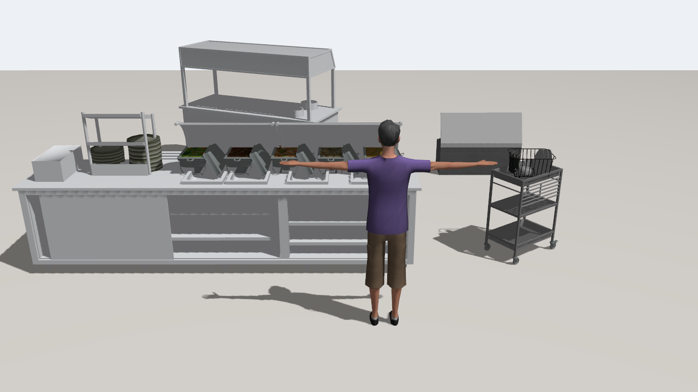

# 식당 시연 3D 에셋 목록 (7주차, 민지 → 지수)

> 식당(뷔페) 월드의 겉모양용 메시 목록이다. **충돌체는 메시를 쓰지 않고 바닥까지 꽉 찬 박스로 둔다.** 메시는 `<visual>`에만 넣는다.



Gazebo Fortress(헤드리스 ogre2)에서 찍었다. 앞은 손님(`dynamic_worker` 메시, 키 1.75 m), 왼쪽부터 배식대, 뒤쪽 배식 카트, 오른쪽 반납대.

## 1. 바로 쓸 수 있는 모델 (`amr_gazebo/models`)

`<include><uri>model://<이름></uri></include>`로 넣는다. 원점은 바닥 중심이고, 길이 방향이 x축이다.

| 모델 | 용도 | 크기 x·y·z (m) | 충돌 박스 (m) | 면 수 | 구성 |
| --- | --- | --- | --- | --- | --- |
| `restaurant_buffet_station` | 배식대 | 3.73 × 1.14 × 1.53 | 3.73 × 1.14 × 0.9 | 약 17,000 | 스테인리스 배식 라인(상판 0.89 m) 위에 음식 담긴 보온 용기 5개 + 접시 더미 |
| `restaurant_dish_return` | 빈 그릇 반납대 | 0.79 × 0.73 × 1.1 | 0.79 × 0.73 × 0.9 | 약 27,600 | 스테인리스 3단 카트 맨 위에 식기 건조대 |
| `restaurant_buffet_cart` | 배식 카트 (보조) | 2.22 × 1.58 × 1.71 | 2.22 × 1.58 × 0.9 | 1,451 | 덮개 달린 이동식 배식대 |

- 원본 glTF(Y-up)를 OBJ(Z-up, m)로 바꿨다. Fortress(ign-common4)는 glTF를 못 읽는다.
- 크기: 배식 라인은 상판을 0.9 m로 맞춘 축척(0.265), 보온 용기는 상판 길이에 맞춘 축척(0.53)이다. 카트·건조대는 원본이 실제 크기다.
- 텍스처는 기본색만 남기고 1024 px JPEG로 줄였다. 배식 라인은 원본에 색 정보가 없어 스테인리스 회색을 넣었다.
- 충돌 박스 높이는 0.9 m로 통일했다. 로봇이 몸으로 카운터 아래·카트 선반 사이에 들어가지 않게 하려는 것이다. 경로 계획은 식당 정답 지도(충돌 박스를 그대로 칠함)가 막는다.
- 라이다는 충돌체를 보지 않는다. Gazebo `gpu_lidar`는 visual 메시를 렌더링해 거리를 재므로 스캔 높이(0.38 m)에서는 다리·선반만 보인다(배식대는 앞뒤 1.14 m 중 0.79 m). 주행 중 장애물 회피는 이 스캔을 쓴다 (지수 확인, #295).
- 배식대 방향: 모델 +y가 손님 쪽이다. 상판 높이(0.85~0.95 m)에서만 +y로 0.57 m까지 튀어나온 부분이 쟁반 받침이다.
- 반납대는 약 27,600면이라 CPU 렌더링에서 무겁다. 면을 줄이면 텍스처 좌표가 사라져서 지금은 그대로 두고, 식당 월드 5대 실행에서 RTF가 떨어지면 줄인다.

## 2. Fuel에서 그대로 쓰는 모델

Fuel 메시 URL을 월드에서 바로 쓰면 텍스처를 못 찾아 회색으로 나온다. 저장소 모델(`amr_gazebo/models`)로 옮겨서 쓴다 (지수 확인, #295).

| 용도 | 모델 | 라이선스 | 형식 | 면 수 | 비고 |
| --- | --- | --- | --- | --- | --- |
| 테이블 | [Cafe table](https://app.gazebosim.org/OpenRobotics/fuel/models/Cafe%20table) | CC0 | DAE | 68 | |
| 의자 | [Dining Chair](https://app.gazebosim.org/OpenRobotics/fuel/models/Dining%20Chair) | CC-BY 4.0 | DAE | 724 | 파일 5 MB. 무거우면 [WoodenChair](https://app.gazebosim.org/OpenRobotics/fuel/models/WoodenChair)(CC0, 면 177) |
| 손님 | Male visitor | CC0 | DAE | 1,470 | 이미 `dynamic_worker`가 쓴다 |
| 손님 (다양하게) | [FemaleVisitor](https://app.gazebosim.org/OpenRobotics/fuel/models/FemaleVisitor) | CC-BY 4.0 | OBJ | 1,880 | |

## 3. 원본 출처

| 원본 | 작성자 | 라이선스 | 쓰인 모델 |
| --- | --- | --- | --- |
| [Buffet](https://sketchfab.com/3d-models/55a5f4ddffc04e609e44bd8bb4bdd450) | nicolas saude | CC-BY 4.0 | `restaurant_buffet_station`, `restaurant_buffet_cart` |
| [Buffets (food warmer), Foods, and Plates](https://sketchfab.com/3d-models/aa3a0d1b9baf4006a7ecf9e9f905ee9d) | sakigakefuruzawa | CC-BY 4.0 | `restaurant_buffet_station` |
| [IKEA KUNGSFORS kitchen trolley](https://sketchfab.com/3d-models/5272c4bafd3044bcad2cea031a57a141) | W1NT3R | CC-BY 4.0 | `restaurant_dish_return` |
| [Dish Rack with Dishes](https://sketchfab.com/3d-models/ce69014964624fbb808a028e5c55d88b) | HippoStance | CC-BY 4.0 | `restaurant_dish_return` |

모두 상업 이용 가능하다. NonCommercial·NoDerivatives 라이선스는 고르지 않았다. 유리 가드 보온대([cafeteria food warmer](https://sketchfab.com/3d-models/c321d257a044422096318def8d1352b2))도 받아 봤지만 Gazebo에서 유리가 불투명한 회색 상자로 보여 넣지 않았다.

## 4. 출처 표기 (CC-BY, 영상 끝·PPT에 넣는다)

```
3D models (CC BY 4.0):
"Buffet" by nicolas saude, "Buffets (food warmer), Foods, and Plates" by sakigakefuruzawa,
"IKEA KUNGSFORS kitchen trolley" by W1NT3R, "Dish Rack with Dishes" by HippoStance (Sketchfab);
"Dining Chair", "FemaleVisitor" by OpenRobotics (Gazebo Fuel)
```

WoodenChair로 바꾸거나 FemaleVisitor를 안 쓰면 이 목록에서 뺀다.

## 5. 할 일

| 할 일 | 담당 | 상태 |
| --- | --- | --- |
| Sketchfab 원본 내려받기, OBJ 변환, Gazebo에서 확인 | 민지 | 완료 |
| 식당 월드에 배치 (배식대 1줄, 반납대 1~2개, 테이블·의자) | 지수 | |
| 배치 뒤 5대 실행에서 RTF 확인 | 하연 | |
