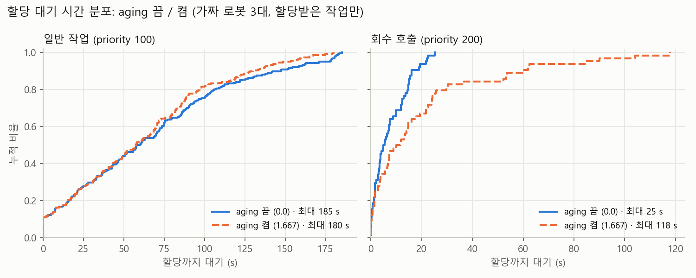

# 식당 시연 2 리허설: 회수 호출 + 우선순위 aging 켬/끔 (가짜 로봇)

회수 호출(`Task.TYPE_COLLECT`, priority 200)이 일반 작업(priority 100) 사이에 섞여 들어올 때, 서버의 우선순위 aging
(`assignment.aging_rate`, amr_fleet_core README '우선순위 aging')을 켜고 끈 차이를 잰다. 시뮬레이터 없이 가짜 로봇으로 돈다.

결론: **aging을 켜면 회수 호출은 기대보다 훨씬 늦어지고(최대 25 → 118 s), 일반 작업의 최대 대기는 조금만 준다(185 → 180 s).**
처리량·미할당은 같다. 이 부하(처리량의 약 1.4배)에서는 일반 작업 대기가 금방 60 s를 넘어, 새 회수 호출이 그보다 먼저 들어온
일반 작업들 뒤로 밀리기 때문이다(아래 "읽기").

## 조건

| 항목 | 값 |
| --- | --- |
| 스택 | fleet_manager + 가짜 로봇 3대(3 m/s, 싣기·내리기 1 s) + 작업 생성기, 장애 주입기 없음. 하네스 `tools/harness/scenarios/fleet_collect_aging.yaml` |
| 할당 | `nearest`, 스테이션 예약 끔(`station_clearance_m` 0, `fleet_fake`와 같음) |
| 작업 | `amr_fleet_manager/config/scenarios/collect_aging.yaml`: 60건, poisson 평균 6 s 간격(약 365 s 동안), 일반 80 % / 회수 20 %. 근거는 파일 주석(일반만으로 처리량의 약 1.1배, 전체 약 1.4배) |
| 회수 호출 자리 | 식당 정차 위치가 없어 물류센터 C열 선반 → `dock_b`를 테이블 → 반납 카트로 쓴다 |
| 비교 | 끔: `aging_rate` 0.0 (`fleet_manager.yaml`) / 켬: 1.667 (`fleet_manager_restaurant.yaml`, 일반 작업이 60 s 기다리면 새 회수 호출과 같아짐) |
| 반복 | 조건마다 seed 1~5 (같은 seed = 같은 작업 일정). 실행마다 480 s 관측 |
| 시간 | 실제 시간. 가짜 로봇은 odom(시뮬레이션 시계)이 없어 서버·작업 생성기·지표가 모두 실제 시간이다(#285: odom이 없으면 실제 시간 그대로) |
| 실행 | 11/5, 노트북 Docker(Intel Core Ultra 7 355, 8코어). 코드는 `feat/fleet-collect-aging-eval` 브랜치(부모 `0e173dd`) - `meta.json` `git_sha`는 컨테이너 안 git 권한 문제로 `unknown` |

```bash
# 컨테이너에서 (워크스페이스 빌드 후)
python3 tools/harness/run.py fleet_collect_aging -n 5 --set aging=off --label aging_off
python3 tools/harness/run.py fleet_collect_aging -n 5 --set aging=on  --label aging_on
# 결과 폴더(task_outcomes.csv, tasks.json, meta.json)를 raw/aging_off/, raw/aging_on/ 아래로 옮긴 뒤
python3 experiments/fleet_collect_aging/analyze.py experiments/fleet_collect_aging/raw \
  --out experiments/fleet_collect_aging --font-file /tmp/malgun.ttf   # 한글 글꼴이 없는 컨테이너면 글꼴 파일을 준다
python3 -m pytest experiments/fleet_collect_aging                       # 지표 계산 테스트
```

## 지표

- **할당까지 대기**: 서버 첫 할당 시각 − 요청 시각 (`task_outcomes.csv` `first_assign_time − request_time`). 평균은 할당받은 작업 전체,
  최대는 5회 중 가장 긴 1건
- **끝까지 미할당**: 관측 마감(`meta.json` `observation_cutoff`)까지 할당이 없던 작업 수, 실행 평균. 대기 평균·최대에는 안 들어간다
- **처리량**: 마감까지 완료 수 / (마감 − 첫 요청) × 60

## 결과

| 조건 | 실행 | 회수 호출 대기 평균 / 최대 (s) | 일반 작업 대기 평균 / 최대 (s) | 끝까지 미할당 (회수 + 일반, 실행 평균) | 처리량 (건/분) |
|---|---|---|---|---|---|
| aging 끔 (0.0) | 5 | 7.4 / 25.3 | 65.8 / 185.3 | 1.8 (0.0 + 1.8) | 6.90 |
| aging 켬 (1.667) | 5 | 20.2 / 117.7 | 61.3 / 180.2 | 1.8 (0.0 + 1.8) | 6.91 |

| 보조 지표 | 끔 | 켬 |
| --- | --- | --- |
| 회수 호출 대기 p90 | 16.0 s | 53.7 s |
| 60 s 넘게 기다린 회수 호출 | 0 / 64 | 6 / 64 |
| 일반 작업 대기 p90 | 142.1 s | 128.1 s |
| 60 s 넘게 기다린 일반 작업 | 113 / 227 | 110 / 227 |

같은 seed끼리 (켬 − 끔): 일반 작업 최대 −8.7, +5.4, −5.1, −3.8, −12.3 s (4회 줄고 1회 늘음), 회수 호출 최대 +12 ~ +93 s (5회 모두 늘음).



## 읽기

- **기대와 같은 방향이지만 크기가 다르다.** 기대는 "일반 작업 최대 대기가 줄고 회수 호출은 조금 늦어진다"였다. 실제로는 일반
  작업 최대가 평균 5 s만 줄었고(seed 2는 오히려 5 s 늘음), 회수 호출은 평균 2.7배, 최대 4.7배로 늦어졌다.
- **이유: 과부하에서는 일반 작업 대기가 금방 60 s를 넘는다.** 켬 값은 "60 s 넘게 먼저 들어온 일반 작업은 새 회수 호출보다 앞선다"이다.
  이 부하에서는 일반 작업의 절반(113/227)이 60 s 넘게 기다리므로, 큐가 쌓인 뒤 들어온 회수 호출은 그 일반 작업들이 다 나갈
  때까지 기다린다(대기 ≈ 일반 작업 대기 − 60 s). seed 3(일반 대기가 가장 긴 실행)에서 회수 호출 최대가 118 s로 가장 길었다.
- **일반 작업이 별로 안 좋아진 이유:** 일반 작업 대기는 큐가 쌓이는 속도(처리량 부족)가 정한다. aging은 순서만 바꾸고 처리량을
  늘리지 않는다. 회수 호출이 20 %라 끔일 때 끼어드는 몫도 크지 않아, 그 끼어들기를 막아 얻는 몫도 작다.
- **처리량·미할당은 같다.** 미할당은 두 조건 모두 9건(실행 평균 1.8)이고 전부 일반 작업이다. 모두 일정 끝 무렵(그 실행의 마지막
  요청 전 약 45 s 안)에 들어와 마감까지 큐에서 기다리던 것이다. 어느 seed에 1건이 남았는지만 다르다(끔 seed 1, 켬 seed 2).
  할당 순서만 달라지고 일의 양은 같다.
- 5회라 최대값(1건)은 흔들린다. 평균·p90·분포 그림이 더 믿을 만하다.

## 시연 전에 정할 것 (제안, 결정 아님)

- 시연 부하가 처리량보다 낮으면(큐가 짧으면) 일반 작업이 60 s를 넘길 일이 드물어 회수 호출이 늦어지지 않는다. 이 리허설은
  일부러 과부하를 걸어 aging이 크게 개입하는 쪽을 본 것이다.
- 과부하에서도 회수 호출이 빨라야 하면 `aging_rate`를 낮춰 따라잡는 시간을 늘리거나(예: 0.833 = 120 s), 유효 우선순위에
  상한을 두는 방법이 있다. 둘 다 일반 작업의 최대 대기가 다시 길어지는 쪽이라 시연 목적에 맞춰 고른다.

## 파일

| 파일 | 내용 |
| --- | --- |
| `results.md` | 위 결과 표 (`analyze.py`가 씀) |
| `summary.csv` | 실행 1개마다 지표 |
| `tasks.csv` | 작업 1건마다 종류·우선순위·요청 시각(실행 첫 요청 기준)·할당 대기·할당·완료 |
| `wait_cdf.png` | 조건별 할당 대기 누적 분포 |
| `collect_aging.py` · `analyze.py` · `test_collect_aging.py` | 지표 계산 · 표·그림 · 테스트 |
| `raw/` | 하네스 결과 원본 (git 무시) |
