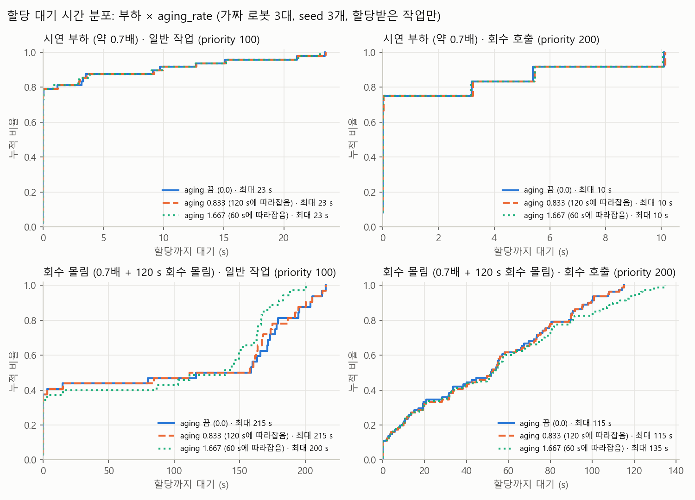

# 식당 시연 2 리허설: 회수 호출 + 우선순위 aging (가짜 로봇)

회수 호출(`Task.TYPE_COLLECT`, priority 200)이 일반 작업(priority 100) 사이에 섞여 들어올 때, 서버의 우선순위 aging
(`assignment.aging_rate`, amr_fleet_core README '우선순위 aging')이 대기 시간을 어떻게 바꾸는지 잰다. 시뮬레이터 없이 가짜 로봇으로 돈다.

측정은 두 번 했다.

1. **과부하 조건** (첫 측정): 회수 호출이 20 %뿐인 과부하에서 aging 끔/켬을 비교했다.
2. **부하 × aging_rate** (두 번째 측정): 시연 부하와 회수 몰림, 두 부하에서 rate 세 값을 비교했다. 첫 측정의 과부하는 aging이 막으려는 기아가 생기지 않는 조건이었다.

결론:
- **시연 부하(처리량의 약 0.7배)에서는 rate가 아무것도 바꾸지 않는다.** 큐가 쌓이지 않아 대기가 최대 23 s이고, 세 rate의 결과가 같다.
- **회수 몰림에서는 1.667만 효과가 있다.** 기아 시간이 평균 194 → 134 s, 최대 215 → 161 s로 준다. 대신 회수 호출 최대 대기는 115 → 135 s로 는다.
- **0.833은 0.0과 사실상 같다.** 120 s 동안 몰리는 동안에는 일반 작업이 회수 호출을 따라잡지 못한다.

## 부하 × aging_rate (두 번째 측정)

### 조건

| 항목 | 값 |
| --- | --- |
| 스택·할당·시간 | 과부하 조건과 같다(아래) |
| 부하 | `collect_aging.yaml` `loads:`. 작업 생성기 `load` 인자로 고른다. 근거는 파일 주석(처리량 6.9 건/분 ≈ 0.115 건/s 기준) |
| ├ normal (시연 부하) | 20건, poisson 평균 12.5 s 간격(일반 + 회수 ≈ 처리량의 0.7배), 회수 20 % |
| └ collect_burst (회수 몰림) | normal과 같고, 일정 60~180 s(120 s) 동안 회수 호출만 평균 6 s 간격으로 더 들어온다. 회수만으로 처리량의 약 1.45배이고, 그동안 전체는 약 2.1배다 |
| aging_rate | 0.0 (`fleet_manager.yaml`) / 0.833 (120 s에 따라잡음, 식당 설정 파일은 그대로 두고 `--set aging_rate=0.833`으로 준다) / 1.667 (`fleet_manager_restaurant.yaml`, 60 s) |
| 반복 | 조건마다 seed 1~3. 실행마다 330 s를 관측한다(마지막 일반 일정 뒤 약 1.5분). 로봇·작업 수는 그대로 두고 관측 시간만 줄였다 |
| 실행 | 11/5, 노트북 Docker. 실행마다 `fleet_manager.log` 시작 줄의 `aging_rate`가 조건 값인지 확인했다 |

```bash
for load in normal collect_burst; do
  python3 tools/harness/run.py fleet_collect_aging -n 3 --set load=$load --set aging=off --label ${load}_r0
  python3 tools/harness/run.py fleet_collect_aging -n 3 --set load=$load --set aging=off --set aging_rate=0.833 --label ${load}_r0833
  python3 tools/harness/run.py fleet_collect_aging -n 3 --set load=$load --set aging=on --label ${load}_r1667
done
# 결과 폴더를 raw/<라벨>/ 아래로 옮긴 뒤 analyze.py (아래 과부하 조건과 같다)
```

### 지표

과부하 조건의 지표(할당 대기, 끝까지 미할당, 처리량)에 하나를 더한다.

- **기아 시간**: 일반 작업이 기다리고 있는데 일반 작업이 하나도 할당되지 않은 가장 긴 구간(s)이다(`collect_aging.starvation`).
  - 회수 몰림 구간과 겹치는 구간만 센다. 끝은 몰림 구간에서 자르지 않는다. 몰림이 끝난 뒤 밀린 회수 호출을 처리하는 동안도 기아로 본다.
  - 관측 마감까지 할당이 없으면 마감에서 끝낸다.
  - 몰림 구간(일정 시각)은 요청 시각 − 일정 시각의 중앙값을 더해 요청 시각으로 옮긴다.
  - 몰림이 없는 부하는 `-`로 적는다.

### 결과

| 부하 | aging_rate | 실행 | 회수 호출 대기 평균 / 최대 (s) | 일반 작업 대기 평균 / 최대 (s) | 끝까지 미할당 (회수 + 일반, 실행 평균) | 처리량 (건/분) | 기아 시간 평균 / 최대 (s) |
|---|---|---|---|---|---|---|---|
| 시연 부하 (약 0.7배) | 0 | 3 | 1.6 / 10.1 | 2.1 / 23.4 | 0.0 (0.0 + 0.0) | 3.60 | - |
| 시연 부하 (약 0.7배) | 0.833 | 3 | 1.6 / 10.1 | 2.1 / 23.5 | 0.0 (0.0 + 0.0) | 3.60 | - |
| 시연 부하 (약 0.7배) | 1.667 | 3 | 1.6 / 10.1 | 2.1 / 23.0 | 0.0 (0.0 + 0.0) | 3.60 | - |
| 회수 몰림 (0.7배 + 120 s 회수 몰림) | 0 | 3 | 48.5 / 115.2 | 98.1 / 215.4 | 5.3 (0.0 + 5.3) | 6.23 | 194.2 / 215.4 |
| 회수 몰림 (0.7배 + 120 s 회수 몰림) | 0.833 | 3 | 49.1 / 115.2 | 97.2 / 215.4 | 5.3 (0.0 + 5.3) | 6.25 | 192.0 / 215.4 |
| 회수 몰림 (0.7배 + 120 s 회수 몰림) | 1.667 | 3 | 52.2 / 134.9 | 93.6 / 200.2 | 4.7 (0.3 + 4.3) | 6.36 | 134.2 / 160.7 |

seed별 기아 시간 (s):

| aging_rate | seed 1 | seed 2 | seed 3 |
| --- | --- | --- | --- |
| 0 | 163.4 | 215.4* | 204.0* |
| 0.833 | 160.4 | 215.4* | 200.3* |
| 1.667 | 139.0 | 103.0 | 160.7 |

\* 관측 마감까지 이어졌다. 실제 기아는 이보다 길다.

| 회수 몰림 보조 지표 | 0 | 0.833 | 1.667 |
| --- | --- | --- | --- |
| 회수 호출 대기 p90 | 97.9 s | 98.2 s | 110.0 s |
| 60 s 넘게 기다린 회수 호출 | 31 / 81 | 31 / 81 | 32 / 80 |
| 일반 작업 대기 p90 | 195.6 s | 194.6 s | 172.9 s |



### 읽기

- **시연 부하: aging이 할 일이 없다.**
  - 일반 작업 대기는 최대 23 s로, 60 s(1.667)나 120 s(0.833)에 닿지 않는다. 그래서 할당 순서가 rate와 상관없이 같다.
  - 세 rate의 대기·처리량이 같고, 다른 것은 실행마다의 소수점 흔들림뿐이다.
  - 회수 호출도 늦어지지 않는다(최대 10 s).
- **회수 몰림: 기대한 기아가 생긴다.**
  - 끔(0.0)이면 몰림 동안과 그 뒤 밀린 회수 호출을 다 처리할 때까지 일반 작업이 하나도 할당되지 않는다(평균 194 s).
  - 3회 중 2회는 관측 마감까지 이어졌다(일반 작업 6~7건 미할당).
- **1.667은 기아를 줄이지만 없애지는 못한다.**
  - 60 s 넘게 기다린 일반 작업이 새 회수 호출보다 앞서므로, 몰림 중에도 오래 기다린 일반 작업이 끼어 할당된다.
  - 기아 평균은 31 % 준다(194 → 134 s). 3회 모두 마감 전에 끝났다.
  - 일반 작업 p90은 196 → 173 s, 처리량은 6.23 → 6.36 건/분이다.
  - 그 대가로 회수 호출이 밀린다(최대 115 → 135 s, p90 98 → 110 s).
- **0.833은 0.0과 같다.**
  - 일반 작업이 회수 호출을 앞서려면 그 회수 호출보다 120 s 먼저 들어왔어야 한다.
  - 몰림 구간이 120 s이므로, 몰림 직전에 온 일반 작업도 몰림 끝 무렵 회수 호출을 겨우 따라잡는다. 그때는 이미 밀린 회수 호출이 큐를 채우고 있다.
  - 기아 시간·대기가 0.0과 1~4 s 안에서 같다.
- **기대와 다른 점:**
  - 1.667에서도 기아는 100 s 넘게 남는다. 회수 몰림만으로 처리량을 넘어서, aging이 순서를 바꿔도 일반 작업 몫을 만들 처리량 자체가 모자라다.
  - 일반 작업 최대 대기도 15 s밖에 줄지 않았다(215 → 200 s).
- 3회라 최대값과 seed별 값은 흔들린다. 기아 시간은 3회 모두 1.667이 가장 짧았다.

## 과부하 조건 (첫 측정)

결론: **aging을 켜면 회수 호출이 기대보다 훨씬 늦어지고(최대 25 → 118 s), 일반 작업의 최대 대기는 조금만 준다(185 → 180 s).**
처리량·미할당은 같다. 이 부하(처리량의 약 1.4배)에서는 일반 작업 대기가 금방 60 s를 넘어, 새 회수 호출이 그보다 먼저 들어온
일반 작업들 뒤로 밀리기 때문이다(아래 "읽기"). 회수 호출이 20 %뿐이라 회수 호출이 일반 작업을 굶기는 상황은 이 조건에서 생기지 않는다.

### 조건

| 항목 | 값 |
| --- | --- |
| 스택 | fleet_manager + 가짜 로봇 3대(3 m/s, 싣기·내리기 1 s) + 작업 생성기. 장애 주입기는 없다. 하네스 `tools/harness/scenarios/fleet_collect_aging.yaml` |
| 할당 | `nearest`, 스테이션 예약 끔(`station_clearance_m` 0, `fleet_fake`와 같음) |
| 작업 | `amr_fleet_manager/config/scenarios/collect_aging.yaml` 최상위 값(`load` overload): 60건, poisson 평균 6 s 간격(약 365 s 동안), 일반 80 % / 회수 20 %. 근거는 파일 주석(일반만으로 처리량의 약 1.1배, 전체 약 1.4배) |
| 회수 호출 자리 | 식당 정차 위치가 없어 물류센터 C열 선반 → `dock_b`를 테이블 → 반납 카트로 쓴다 |
| 비교 | 끔: `aging_rate` 0.0 (`fleet_manager.yaml`) / 켬: 1.667 (`fleet_manager_restaurant.yaml`, 일반 작업이 60 s 기다리면 새 회수 호출과 같아짐) |
| 반복 | 조건마다 seed 1~5 (같은 seed = 같은 작업 일정). 실행마다 480 s 관측 |
| 시간 | 실제 시간. 가짜 로봇은 odom(시뮬레이션 시계)이 없어 서버·작업 생성기·지표가 모두 실제 시간이다(#285: odom이 없으면 실제 시간 그대로) |
| 실행 | 11/5, 노트북 Docker(Intel Core Ultra 7 355, 8코어). 코드는 `feat/fleet-collect-aging-eval` 브랜치(부모 `0e173dd`). `meta.json` `git_sha`는 컨테이너 안 git 권한 문제로 `unknown`이다 |

```bash
# 컨테이너에서 (워크스페이스 빌드 후)
python3 tools/harness/run.py fleet_collect_aging -n 5 --set aging=off --label aging_off
python3 tools/harness/run.py fleet_collect_aging -n 5 --set aging=on  --label aging_on
# 결과 폴더(task_outcomes.csv, tasks.json, meta.json)를 raw/<라벨>/ 아래로 옮긴 뒤
python3 experiments/fleet_collect_aging/analyze.py experiments/fleet_collect_aging/raw \
  --out experiments/fleet_collect_aging --font-file /tmp/malgun.ttf   # 한글 글꼴이 없는 컨테이너면 글꼴 파일을 준다
python3 -m pytest experiments/fleet_collect_aging                       # 지표 계산 테스트
```

### 지표

- **할당까지 대기**: 서버 첫 할당 시각 − 요청 시각 (`task_outcomes.csv` `first_assign_time − request_time`).
  - 평균은 할당받은 작업 전체로 낸다.
  - 최대는 그 조건의 실행들 중 가장 긴 1건이다.
- **끝까지 미할당**: 관측 마감(`meta.json` `observation_cutoff`)까지 할당이 없던 작업 수의 실행 평균. 대기 평균·최대에는 안 들어간다.
- **처리량**: 마감까지 완료 수 / (마감 − 첫 요청) × 60

### 결과

| 조건 | 실행 | 회수 호출 대기 평균 / 최대 (s) | 일반 작업 대기 평균 / 최대 (s) | 끝까지 미할당 (회수 + 일반, 실행 평균) | 처리량 (건/분) |
|---|---|---|---|---|---|
| aging 끔 (0.0) | 5 | 7.4 / 25.3 | 65.8 / 185.3 | 1.8 (0.0 + 1.8) | 6.90 |
| aging 켬 (1.667) | 5 | 20.2 / 117.7 | 61.3 / 180.2 | 1.8 (0.0 + 1.8) | 6.91 |

| 보조 지표 | 끔 | 켬 |
| --- | --- | --- |
| 회수 호출 대기 p90 | 16.0 s | 53.7 s |
| 60 s 넘게 기다린 회수 호출 | 0 / 64 | 6 / 64 |
| 일반 작업 대기 p90 | 142.1 s | 128.1 s |
| 60 s 넘게 기다린 일반 작업 | 113 / 227 | 110 / 227 |

같은 seed끼리 (켬 − 끔):
- 일반 작업 최대: −8.7, +5.4, −5.1, −3.8, −12.3 s (4회 줄고 1회 늘었다)
- 회수 호출 최대: +12 ~ +93 s (5회 모두 늘었다)


### 읽기

- **기대와 같은 방향이지만 크기가 다르다.**
  - 기대는 "일반 작업 최대 대기가 줄고 회수 호출은 조금 늦어진다"였다.
  - 실제로는 일반 작업 최대가 평균 5 s만 줄었다(seed 2는 오히려 5 s 늘었다).
  - 회수 호출은 평균 2.7배, 최대 4.7배로 늦어졌다.
- **이유: 과부하에서는 일반 작업 대기가 금방 60 s를 넘는다.**
  - 켬 값은 "60 s 넘게 먼저 들어온 일반 작업은 새 회수 호출보다 앞선다"이다.
  - 이 부하에서는 일반 작업의 절반(113/227)이 60 s 넘게 기다린다. 그래서 큐가 쌓인 뒤 들어온 회수 호출은 그 일반 작업들이 다 나갈 때까지 기다린다(대기 ≈ 일반 작업 대기 − 60 s).
  - seed 3(일반 대기가 가장 긴 실행)에서 회수 호출 최대가 118 s로 가장 길었다.
- **일반 작업이 별로 안 좋아진 이유:**
  - 일반 작업 대기는 큐가 쌓이는 속도(처리량 부족)가 정한다. aging은 순서만 바꾸고 처리량을 늘리지 않는다.
  - 회수 호출이 20 %라 끔일 때 끼어드는 몫이 크지 않다. 그 끼어들기를 막아 얻는 몫도 작다.
- **처리량·미할당은 같다.**
  - 미할당은 두 조건 모두 9건(실행 평균 1.8)이고 전부 일반 작업이다.
  - 모두 일정 끝 무렵(그 실행의 마지막 요청 전 약 45 s 안)에 들어와 마감까지 큐에서 기다리던 것이다.
  - 어느 seed에 1건이 남았는지만 다르다(끔 seed 1, 켬 seed 2). 할당 순서만 달라지고 일의 양은 같다.
- 5회라 최대값(1건)은 흔들린다. 평균·p90·분포 그림이 더 믿을 만하다.

## 시연 전에 정할 것 (제안, 결정 아님)

- **시연 부하에서는 어떤 rate든 결과가 같다.** 그래서 rate는 회수가 몰릴 때를 보고 고른다.
- **회수가 몰릴 수 있으면 1.667(현재 식당 설정값)을 권한다.**
  - 측정한 rate 중 기아를 줄인 것은 1.667뿐이다(194 → 134 s).
  - 대가는 몰림 때 회수 호출 최대 대기가 +20 s(115 → 135 s) 느는 것이다.
  - 과부하에서는 회수 호출이 더 늦어진다(최대 25 → 118 s). 시연 부하를 처리량 아래로 두면 그 상황은 생기지 않는다.
- **0.833은 끔과 차이가 없어 쓸 이유가 없다.**
- 몰림이 처리량을 크게 넘으면 aging만으로는 기아가 남는다(1.667에서도 100 s 넘게). 그런 몰림이 예상되면 로봇 수나 회수 호출 비율 쪽을 조정한다.

## 파일

| 파일 | 내용 |
| --- | --- |
| `results.md` | 부하 × aging_rate 결과 표 (`analyze.py`가 쓴다) |
| `summary.csv` | 실행 1개마다 지표 (기아 시간 포함) |
| `tasks.csv` | 작업 1건마다 부하·rate·종류·우선순위·요청 시각(실행 첫 요청 기준)·할당 대기·할당·완료 |
| `wait_cdf.png` | 과부하 조건 aging 끔/켬 할당 대기 누적 분포 |
| `wait_cdf_loads.png` | 시연 부하·회수 몰림의 rate별 할당 대기 누적 분포 |
| `collect_aging.py` · `analyze.py` · `test_collect_aging.py` | 지표 계산 · 표·그림 · 테스트 |
| `raw/` | 하네스 결과 원본 (git이 무시한다) |
