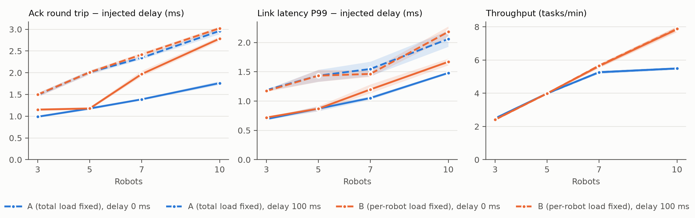

# 연구 1 규모 곡선 (로봇 대수 × 지연)

[통계 설계](statistical_design.md) 4절 단계 C(대수)를 P2보다 먼저 가짜 로봇으로 돌린다. 담당: 민지(실행·분석), 하연(가짜 로봇 10대 #159, 서버).

> 상태: 본 실험 끝, 결과는 8절 (10/16 18:38 ~ 10/17 08:08, 140실행 모두 completed). 10/16 하연 결정: **A안·B안 둘 다** 돌린다(3절). GCP `c2d-standard-8` 슬롯 b3·b4에서만 잰다, 응답 시간은 Ack 수신까지.

## 1. 무엇을 보나

로봇이 늘면 중앙 서버가 처리할 메시지(heartbeat·RobotState·할당·Ack)가 늘어난다. 대수에 따라 Fleet 계층(레이어 2) 지연·손실·Ack 왕복시간이 어떻게 변하는지, 지연 100 ms(스펙 조건)에서 그 변화가 더 커지는지 본다.

- **범위: Fleet 계층만.** 가짜 로봇(`fake_robots`)은 시뮬레이터·Nav2 없이 메시지만 주고받는다. 로봇 내부 지연(레이어 1), CPU, 실제 주행 응답 시간은 이 실험에서 재지 않는다 (실제 스택은 `fleet_stack`, #171)
- 시간은 실제 시간(`use_sim_time: false`)이다

## 2. 조건

| 요인 | 값 |
| --- | --- |
| 로봇 대수 N | 3, 5, 7, 10 |
| 지연 | 0 ms, 100 ms (손실 0%) |
| 반복 | seed 1~10 (본 실험). 같은 N·작업 부하면 seed가 같은 작업 일정을 만든다 |
| 실행 시간 | 약 11분 (작업 600초 + 기동·정리) |

A·B 각 8조건인데 5대는 두 안이 같아(3절) 14조건 × 10회 = 140실행이다. 슬롯 2개(b3·b4)에 조건 하나씩 동시에 넣어 약 7라운드 × 2시간 = 14시간이다. 조건 목록은 `tools/harness/gcp_batch.py`로 차례로 넣는다.

- **모든 조건을 같은 기종(`c2d-standard-8`)에서 돌린다.** 기종이 다르면 지연 측정값 자체가 달라진다. 10/16 낮에 `n2d-standard-16`으로 끝낸 A안 3·5·7대·지연 0 ms 3조건은 참고로만 남기고 c2d에서 다시 잰다. 이어서 들어간 10대·지연 0 ms는 c2d로 옮기기로 해 바로 취소했다(슬롯 a VM도 지워 vCPU 한도 32 안에서 b3·b4를 띄움)
- **실행 순서는 무작위가 아니다.** 지연 0 ms 7조건(A·B 번갈아)을 먼저, 100 ms 7조건을 뒤에 돌린다. 통계 설계 4절은 조건을 섞어 돌리라고 하지만, 조건마다 VM을 새로 띄우므로 시간대 차이가 섞일 여지는 작다고 보고 그대로 둔다. 결과에 한계로 적는다
- 라벨: `scale_a_n{N}_d{지연}`, `scale_b_n{N}_d{지연}` (N=5는 `scale_a_n5_*` 하나를 두 안에 같이 쓴다)

```bash
tools/harness/gcp_run.sh fleet_fake -n 10 --set num_robots=7 --set delay_ms=100 --label scale_a_n7_d100  # A안
tools/harness/gcp_run.sh fleet_fake -n 10 --set num_robots=7 --set delay_ms=100 \
    --set task_count=84 --set task_interval_s=7.143 --label scale_b_n7_d100                              # B안
```

## 3. 작업 부하 규칙 (회의 결정)

| 안 | 규칙 | N=3 | N=5 | N=7 | N=10 | 무엇이 섞이나 |
| --- | --- | --- | --- | --- | --- | --- |
| A 총 부하 고정 | 60건, 10초 간격 | 60 / 10 s | 60 / 10 s | 60 / 10 s | 60 / 10 s | 대수가 늘면 로봇마다 일이 줄어 놀게 된다. 할당·Ack 메시지 수는 같고 heartbeat·RobotState만 늘어난다 |
| B 로봇당 부하 고정 | 12 × N건, 50 / N초 간격 | 36 / 16.7 s | 60 / 10 s | 84 / 7.14 s | 120 / 5 s | 대수와 함께 할당 메시지도 늘어 서버 부하를 함께 본다. 로봇마다 일의 양은 같다 |

- **결정: A·B 둘 다** (10/16 하연). 처음에는 A로 정했지만(같은 날 오전), A만으로는 대수가 늘어도 할당·Ack 수가 같아 곡선이 평평하게 나올 가능성이 커서 논문에 쓸 결과가 약하다. B는 아래 문제가 있지만 서버 부하를 대수와 함께 키우므로 분석적으로 쓸 수 있다
- 논문에서 두 안의 역할: **A는 "상태 메시지만 늘 때"의 대조**, **B는 "대수와 함께 할당까지 늘 때"의 본 곡선**. 두 곡선의 차이가 할당 메시지 증가의 몫이다
- A의 위협: 대수가 늘면 로봇당 일이 줄어 지연이 낮아 보일 수 있다. 결과에 적는다
- B의 위협: 대수가 늘면 실행 끝에 못 끝낸 작업도 는다(예비 실행 80/120). 그래서 B의 완료율은 대수 간 비교에 쓰지 않고, 지연·Ack 지표와 처리량(`fleet.throughput_per_min`, 마지막 완료까지)으로 본다. 실행 시간을 늘릴지는 실행 길이 결정(300초 후보, 10/19)과 같이 정한다
- 5대는 두 안이 같다 (Before 데이터 #130과 같은 조건)
- 하네스: `--set task_count=… --set task_interval_s=…` (`fleet_fake.yaml` `config_patch`가 작업 생성기 `basic.yaml`을 실행 동안 바꿔 끼운다. `meta.json` `config_overrides`에 해시가 남는다)

## 4. 지표 (실행마다 하나 → 실행 단위 부트스트랩 CI)

| 지표 | 파일 | 비고 |
| --- | --- | --- |
| Fleet 링크 지연 평균·P95·P99 | `fleet_latency.csv` | 주기 메시지(heartbeat 5 Hz·작업표 1 Hz)라 실행마다 P99가 안정 (통계 설계 3절) |
| 손실률 | `fleet_latency.csv` `delivered` | 손실 0%라 0이 기대값. 0이 아니면 서버·DDS 과부하 |
| Ack 왕복시간 평균·P95, 재전송 수 | `response_time.csv` | 할당 수는 실행당 36~120건이라 P99는 내지 않는다 |
| 작업 완료율·평균 완료 시간·처리량 | `task_outcomes.csv` | 완료율은 같은 N·seed끼리만. B안의 대수 효과는 평균 완료 시간·처리량으로 |

곡선: 가로 N, 세로 지표, 안(A·B) × 지연(0·100 ms) 네 선과 CI 띠. 대수 효과는 N=5 대비 비율(같은 seed 짝)로도 낸다.

## 5. 한계

- 6~10번 로봇 시작 자리가 동쪽 한 줄(x 12~20, y 2)이라(#159), 대수가 늘면 로봇 배치 모양도 바뀐다. 최소 거리 할당(`nearest`) 결과가 대수 효과와 섞인다. 할당 지표는 이 점을 적고 보고한다
- 실행 순서가 지연 0 ms → 100 ms로 고정이라(2절) 시간대 차이가 지연 효과와 섞일 수 있다. 조건마다 VM을 새로 띄워 영향은 작다고 본다
- 가짜 로봇은 실제 주행·CPU 경쟁이 없다. 실제 스택의 대수 한계(RTF ≥ 0.95)는 `fleet_stack`으로 따로 본다 (통계 설계 4절)

## 6. 할 일

- [x] A/B 결정 → A·B 둘 다 (10/16 하연, 오전의 A 결정을 바꿈)
- [x] 예비 1회 (N=10, B안, 지연 0, seed 1001, 로컬 Mac, 10/15): 아래 7절
- [x] 러너 기종 확정 → `c2d-standard-8` 슬롯 b3·b4 (10/16 하연)
- [x] GCP 본 실험 14조건 × 10회 (라벨 `scale_a_*`·`scale_b_*`, 10/16 18:38 ~ 10/17 08:08)
- [x] 분석: 8절, `scale_curve/` (`analyze.py`·`plot.py`·`summary.csv`·그림)
- [ ] 10/19 회의: 기본 작업 부하가 5대에서 이미 포화(8-3)인 것이 지연 스윕 지표에 주는 영향

## 7. 예비 실행 (10/15, N=10, B안, 지연 0, seed 1001, 로컬)

- 가짜 로봇 10대·작업 120건(5초 간격)이 끝까지 돌았다. 실행 시간 658초 (실제 시간). `config_overrides`에 바꿔 끼운 `basic.yaml` 해시가 남았다
- 링크 지연 평균 0.64 ms, P95 1.22, P99 1.82, 최대 10.5 ms. 손실 0. Ack 왕복 평균 1.98 ms, P95 3.34 ms, 재전송 0
- 같은 조건의 5대 Before 데이터(#130, 지연 0: 평균 0.36 ms, Ack 1.36 ms)보다 이미 크다 (1회라 비교는 본 실험 CI로)
- **작업 완료 80/120**: 할당 88건. 실행 끝 무렵에 요청된 작업은 실행 안에 끝나지 못한다(가짜 로봇 이동 시간). 완료율은 같은 N·seed끼리만 비교하고, 대수 간 비교에는 쓰지 않는다. 대수가 늘면 꼬리 작업도 늘어나니(B안 120건) `duration_s`를 늘릴지 회의에서 같이 정한다

## 8. 결과 (10/17, c2d-standard-8, 14조건 × 10회)



- 실행 140회 모두 `completed`, 기종 `c2d-standard-8`, RTF 1.0. 원자료 위치는 `scale_curve/runs.txt`(라벨, Actions run id → `gs://amr-fleet-results/runs/fleet_fake-<라벨>/<날짜>_<run id>/`)
- 표 전체(지표 17개 × 16조건, 평균·CI·N=5 대비 비율)는 `scale_curve/summary.csv`. 다시 만들기: `analyze.py <data>` → `plot.py <data>/summary.csv <그림>` (각 파일 맨 위 설명)
- CI는 실행 단위 부트스트랩 95%, 비율은 같은 seed끼리의 N=5 대비 비율의 평균과 그 CI다

### 8-1. Fleet 계층은 10대까지 버틴다

손실 0, 재전송 0, Ack 100%가 16조건 모두 같다. 대수가 늘며 늘어나는 지연은 1 ms 단위다.

| 지연 0 ms | 3대 | 5대 | 7대 | 10대 | 10대 / 5대 |
| --- | --- | --- | --- | --- | --- |
| Ack 왕복 평균, A (ms) | 0.99 | 1.18 | 1.39 | 1.76 | 1.50 [1.45, 1.56] |
| Ack 왕복 평균, B (ms) | 1.15 | 1.18 | 1.97 | 2.79 | 2.37 [2.28, 2.45] |
| 링크 지연 P99, A (ms) | 0.69 | 0.87 | 1.05 | 1.48 | 1.71 [1.62, 1.79] |
| 링크 지연 P99, B (ms) | 0.72 | 0.87 | 1.20 | 1.67 | 1.93 [1.82, 2.05] |

- **A와 B의 차이가 할당 메시지 증가의 몫이다** (3절). Ack 왕복이 7대에서 0.58 ms, 10대에서 1.02 ms 더 크다. A는 상태 메시지(heartbeat·RobotState)만 늘어 완만하다
- 5대 값(링크 평균 0.32 ms, Ack 1.18 ms)은 Before 데이터(#130, `n2d-standard-16`, 0.36·1.36 ms)와 다르다. 기종이 바뀌면 지연 측정값이 달라진다는 같은 기종 규칙(2절)의 근거다

### 8-2. 지연 100 ms에서는 대수 효과가 주입 지연에 묻힌다

- 지연 100 ms면 Ack 왕복 평균이 5대 102.0 ms, 10대 103.0 ms다. N=5 대비 비율은 모든 대수·두 안에서 1.00~1.01이고, A와 B의 차이도 사라진다(10대 A 102.96, B 103.02 ms)
- 주입 지연을 뺀 나머지(그림 왼쪽 점선)는 5대 2.0 ms → 10대 3.0 ms로, 지연 0 ms일 때(1.2 → 1.8 ms)보다 약 0.8 ms 크다. 장애 주입기 중계를 한 번 더 거치는 몫으로 보이는데 따로 확인하지 않았다
- **작업 지표는 지연 0 ms와 100 ms가 같다.** 같은 조건에서 평균 완료 시간 차이는 0.5초 아래, 처리량·완료율도 CI가 겹친다. 할당 재전송(1초 × 5회)이 있는 중앙집중은 지연 100 ms에서 무너지지 않는다. 임계점은 이보다 큰 지연·손실·끊김에서 찾아야 한다(스프린트 확장 조건)

### 8-3. 기본 작업 부하는 5대에서 이미 포화다

| 지연 0 ms | 3대 | 5대 | 7대 | 10대 |
| --- | --- | --- | --- | --- |
| A 처리량 (건/분) | 2.49 | 3.99 | 5.27 | 5.50 |
| A 평균 완료 시간 (s) | 210 | 133 | 76 | 67 |
| A 완료율 | 0.42 | 0.67 | 0.89 | 0.92 |
| B 처리량 (건/분) | 2.42 | 3.99 | 5.63 | 7.85 |
| B 평균 완료 시간 (s) | 136 | 133 | 132 | 136 |
| B 완료율 | 0.67 | 0.67 | 0.68 | 0.67 |

- 기본 시나리오는 10초마다 1건(6건/분)을 넣는데, 5대는 약 4건/분밖에 못 끝낸다. 작업이 대기열에 쌓여 평균 완료 시간 133초의 대부분이 대기다. A에서 7대 이상이면 포화가 풀려 완료 시간이 76·67초로 줄어든다
- B는 로봇당 투입량이 같아 모든 대수에서 같은 정도로 포화된다(완료율 0.67, 완료 시간 약 133초). 처리량만 대수에 비례해 는다
- **통계 설계 5절의 가정과 다르다.** 거기서는 "로봇이 따라가는 한 처리량은 투입 속도에 묶인다"고 봤지만, 기본 시나리오 5대는 따라가지 못한다. 평균 완료 시간이 대기 시간에 지배되면 지연이 만드는 차이가 그 안에 묻힐 수 있다. 지연 스윕·임계점 판정의 주 지표(평균 완료 시간)를 그대로 쓸지, 투입을 줄인 비포화 시나리오를 둘지 10/19 회의에서 정한다
- 완료율은 실행 끝(600초)에 남은 작업 때문에 1이 될 수 없다(3절). 대수 간 비교는 처리량·완료 시간으로 한다

### 8-4. 논문에 쓸 문장 (초안)

- 로봇 3대에서 10대로 늘려도 Fleet 계층의 손실·재전송은 없었고, 지연 0 ms에서 Ack 왕복 평균은 할당 수 고정(A) 1.50배, 로봇당 할당 고정(B) 2.37배로 늘었지만 절대값은 3 ms 아래였다
- 스펙 조건의 지연 100 ms에서는 대수에 따른 증가(10대에서 +1%)가 주입 지연에 묻혔고, 작업 완료 시간·처리량은 지연 0 ms와 차이가 없었다
- 한계: 가짜 로봇이라 로봇 내부 처리·CPU 경쟁이 없다(5절), 실행 순서가 지연 순으로 고정됐다(2절), 기본 작업 부하가 5대에서 포화다(8-3)
