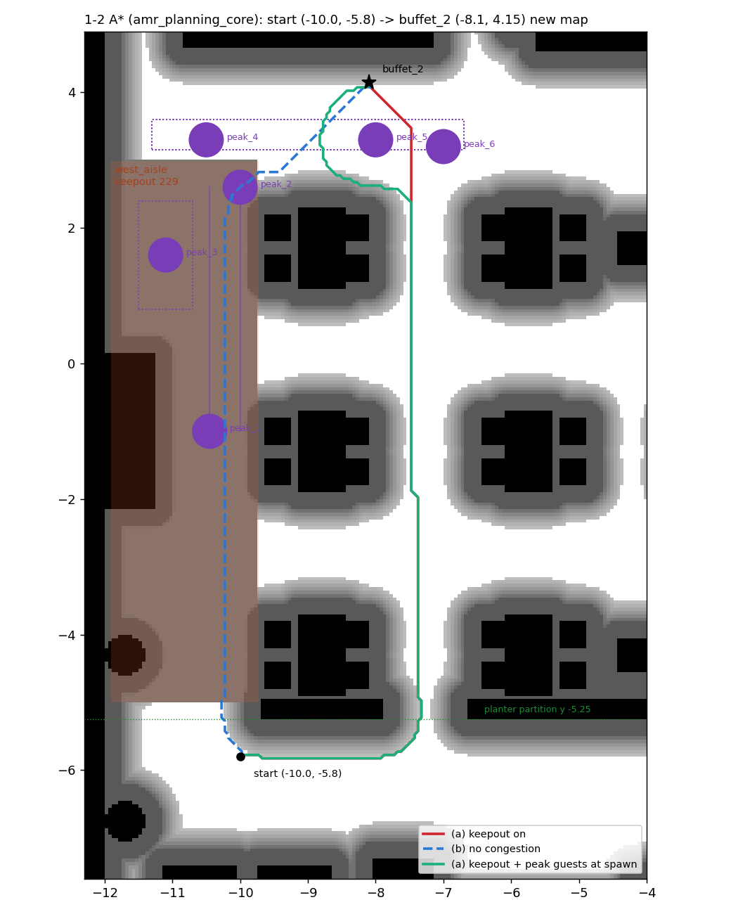

# scene_plan: 식당 시연 장면 설계 계산 (Gazebo 없이)

장면 파일(tools/harness/tasks/demo_*.yaml)의 시작 자리·시작 작업을 고를 때 쓴 계산이다.
restaurant_gt 지도 + 식당 프로필 전역 costmap(서빙 로봇 0.565 x 0.537 m, footprint_padding 0.01, inflation 0.55 / 3.0)에
amr_planning_core A*(nav2_params.yaml AStar 블록과 같은 octile, lethal 253, cost_weight 4.0, 모서리 자르기 막음)를 돌린다.
경로 길이는 8방향 격자 경로 그대로라(평활화 전) 실제 주행보다 조금 길다.

```bash
# 컨테이너 (amr_planning_core가 빌드된 /ros2_ws)
D=experiments/restaurant_demo/scene_plan
g++ -O2 -std=c++17 -I/ros2_ws/install/amr_planning_core/include $D/astar_cli.cpp \
    /ros2_ws/install/amr_planning_core/lib/libamr_planning_core.a -o /tmp/astar_cli
python3 $D/plan_tools.py trips --ws /ros2_ws/src --astar /tmp/astar_cli --out /tmp/plan   # 로봇 → 픽업 → 하역 길이
python3 $D/plan_tools.py start --ws /ros2_ws/src --astar /tmp/astar_cli --out /tmp/plan   # 1-2 1호 출발 자리 후보
python3 $D/pairs.py /ros2_ws/src /tmp/astar_cli /tmp/plan                          # 정차 자리 쌍 길이 → pairs.json
python3 $D/search_act1.py /tmp/plan/pairs.json src/fleet/amr_fleet_manager/config/stations_restaurant.yaml
python3 $D/search_act2.py /tmp/plan/pairs.json src/fleet/amr_fleet_manager/config/stations_restaurant.yaml
python3 $D/detour.py --map ... --zones ... --stations ... --astar /tmp/astar_cli --out /tmp/plan --start -10.0 -5.8  # 그림
```

- `detour.py`: costmap 만들기(정적 + inflation, 선택으로 손님 시작 자리), keepout(west_aisle 혼잡도 1.0 → 마스크 90 → 비용 229),
  출발 → buffet_2 경로 (a) keepout / (b) 혼잡 없음과 그림
- `plan_tools.py trips`: 대기 줄 5대(robots_restaurant.yaml) × 픽업 6곳 × 하역(테이블·부스·6인석·2인석) A* 길이
- `plan_tools.py start`: 1-2 출발 자리 후보마다 (a)·(b) 경로와 손님 경로(피크·1-2 피크·직원 파일)까지 거리

## 장면 2 시작 작업 (tasks/demo_s2a.yaml·demo_s2b.yaml `path_m`)

11/8 #341(지도 재생성)·#338(식당 속도 0.8 m/s) 뒤 다시 계산했다. 배정: 로봇이 동쪽 벽(x 11.2) 한 줄, 픽업이 모두 북쪽(y 4.15)이라
최소거리 배정은 낸 순서대로 amr_05, 04, 03, 02, 01이다. 길이는 A* (m). 픽업·하역 머무름 2 s씩.

| 막 | 로봇 | 1바퀴 (시작 → 픽업 → 하역) | 길이 | 비고 |
| --- | --- | --- | --- | --- |
| 1막 | amr_05 | stall_3 → t06 | 27.6 | |
| 1막 | amr_04 | stall_1 → t08 | 27.6 | |
| 1막 | amr_03 | buffet_1 → t01 | 27.9 | |
| 1막 | **amr_02** | stall_4 → L01 | **16.6** | 가장 짧다. 다음 로봇과 11.0 m. 0.8 m/s로도 25 s (0초 = 시작 뒤 약 8 s) |
| 1막 | amr_01 | stall_2 → t13 | 27.9 | |
| 2막 | amr_05 | buffet_2 → b01 | 42.6 | |
| 2막 | **amr_04** | stall_4 → t13 | **25.9** | 가장 짧다. 다음 로봇과 15.8 m |
| 2막 | amr_03 | buffet_1 → t10 | 41.8 | |
| 2막 | amr_02 | buffet_1 → t15 | 44.3 | |
| 2막 | amr_01 | buffet_2 → L03 | 44.1 | |

2막은 시작 작업을 두 바퀴 준다. 0.8 m/s에서는 한 작업으로 0초(시작 뒤 약 66 s)까지 5대를 붙잡을 수 없다(가장 긴 작업 약 55 m ≈ 70 s).
2바퀴 5건(stall_2 → b02, buffet_1 → b01, stall_1 → b03, buffet_1 → t05, buffet_2 → L04)을 2인석 배달보다 먼저 넣어 두면, 같은 우선순위에서
먼저 들어온 작업이 앞서므로 1바퀴를 마친 로봇이 차례로 가져가고 2인석 배달은 계속 대기한다.

| 2막 조건 | 값 |
| --- | --- |
| 4호 1바퀴가 가장 짧다 (먼저 끝나 2바퀴 첫 작업 stall_2 → b02를 가져간다) | 25.9 m, 다른 로봇 최소 41.8 m (차이 15.8 m) |
| 4호 두 바퀴 합 | 54.4 m → 0.8 m/s로도 54.4 / 0.8 + 8 = 76 s, 0초(66 s)보다 10 s 늦다 |
| 4호 두 바퀴가 다른 로봇 1바퀴보다 길다 (2바퀴 나머지 넷은 다른 로봇이 가져간다) | 54.4 m ≥ 44.3 + 10.1 m |
| 다른 로봇 두 바퀴 합 (2바퀴 어느 작업을 받아도) | 71.6 m 이상 = 4호 + 17.2 m |

→ 0초 뒤 처음 일을 마치는 로봇은 4호이고, 그때 남은 대기 작업은 2인석 배달과 회수 호출뿐이다(켬: 배달, 끔: 회수).

고른 기준: 핵심 요청 자리(1막 t03·return_1과 대기 배달 하역 t09·t15·t04·t02, 2막 회수 5곳·return_1·2·c01과 c01 픽업 stall_3)와
1 m 안을 쓰지 않는다. 한 바퀴 안에서 한 픽업은 둘까지, 4호 픽업은 혼자. 1막은 픽업이 모두 다르고 다음 로봇과 10 m 넘는 것 중
합이 가장 짧은 것. 2막은 위 표 여유를 크게 하는 조합을 무작위 탐색(150만 번)으로 골랐다.

## 1-2 1호 출발 자리 (robots_restaurant_s12.yaml)

조건: (a) 혼잡 없으면 서쪽 통로가 가장 짧다 (b) 서쪽 통로 비용 229면 x -7.275 우회 통로로 간다 (c) 손님 경로(직선·곡선 경로,
무작위 범위, 스폰)가 1 m 밖 (d) 동쪽을 본다(yaw 0). 우회 경로가 예전 자리보다 짧은 것 중 고른다.
11/8 #341 새 restaurant_gt로 다시 계산했다. 길이는 출발 → buffet_2 A* (m). 여유 = (b) − (a): 작으면 혼잡 없이도 손님(장애물) 몇 명에
우회로를 골라 끔/켬 차이가 사라진다. 손님 거리는 피크·1-2 피크·직원 파일 중 가장 가까운 것 (1-2가 쓰는 1-2 피크 파일만이면 괄호).

| 출발 자리 | (a) 혼잡 없음 | (b) keepout | 여유 | 가장 가까운 손님 경로 | 정적 여유 | 판정 |
| --- | --- | --- | --- | --- | --- | --- |
| (-10.5, -5.6) 예전 | 11.01 서쪽 | 13.33 우회 | 2.32 | 1.00 (2.5) | 0.87 | 기준 |
| (-10.8, -5.8) | 11.35 서쪽 | 13.60 우회 | 2.25 | 1.25 | 1.03 | 우회가 더 길다 |
| (-10.5, -5.8) | 11.21 서쪽 | 13.25 우회 | 2.04 | 1.20 | 0.97 | 줄어든 게 0.08 m |
| (-10.2, -5.8) | 11.17 서쪽 | 12.95 우회 | 1.78 | 1.22 | 0.74 | 가능 |
| **(-10.0, -5.8)** | **11.25 서쪽** | **12.75 우회** | **1.50** | **1.20 (2.0)** | **0.63** | **고름** |
| (-9.9, -5.8) | 11.27 서쪽 | 12.70 우회 | 1.43 | 1.20 | 0.60 | 가능 |
| (-9.8, -5.8) | 11.37 서쪽 | 12.60 우회 | 1.23 | 1.22 | 0.57 | 가능 |
| (-9.5, -5.7) | 11.81 서쪽 | 12.30 우회 | 0.49 | 1.21 | 0.50 | 여유 작음 |
| (-9.3, -5.7) | 11.96 서쪽 | 12.15 우회 | 0.19 | 1.30 | 0.50 | 여유 없음 |
| (-9.0, -5.7) | 11.80 우회 | 11.80 우회 | 0 | 1.00 | 0.50 | (a) 실패: 혼잡 없이도 우회 |
| (-8.8, -5.7) | 11.65 우회 | 11.65 우회 | 0 | 0.80 | 0.50 | (a)·(c) 실패 |

(-10.0, -5.8)을 고른 이유: 우회 경로가 0.58 m 줄고, 서쪽 통로가 우회보다 1.50 m 짧아 혼잡 없는 쪽은 서쪽 통로로 가며, 정적 여유
0.63 m(외접 반경 0.40 m보다 넓다)로 동쪽을 본 채 바로 출발한다. 더 동쪽은 우회가 더 짧아지지만 두 길 차이가 1 m 밑으로 줄고
남쪽 통로 손님(customer_6 무작위 범위 x -8.0부터)에 가까워진다. 남쪽 통로는 칸막이(y -5.25) 남쪽이라 출발 자리를 북쪽으로
옮길 수는 없다(칸막이 북쪽은 서쪽 통로 구역 안이거나 테이블 열이다).



빨강 (a) keepout 12.75 m, 파랑 (b) 혼잡 없음 11.25 m, 초록 (a)에 1-2 피크 손님을 시작 자리에 세운 것 (13.92 m, 여전히 우회).
칸막이(y -5.25)는 x -7.32 틈으로 지난다 (여유 0.55 m, 로봇 외접 반경 0.40 m).
