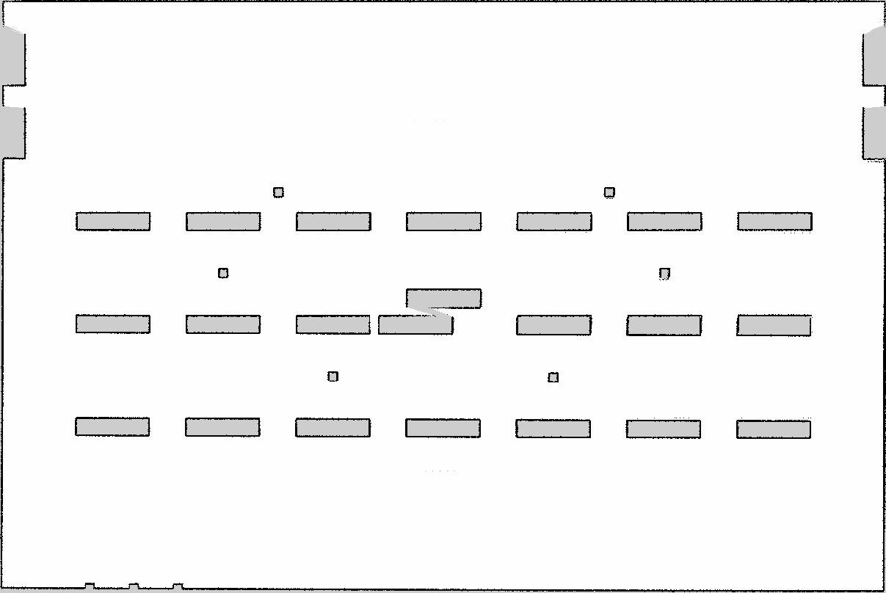

# amr_mapping

- 담당: 지수
- 빌드 타입: ament_python
- 책임: slam_toolbox 설정, 지도 저장(map.pgm/map.yaml), 맵 품질 평가. 저장한 지도는 `amr_localization`(민지)이 사용하며, 인계 조건은 [명세서 8-2절](../../../docs/project-spec.md#8-2-매핑위치추정-분업-지수--민지)을 따른다

## 제공 인터페이스

`mapping.launch.py` (slam_toolbox `async_slam_toolbox_node`) 기준. `<ns>` = 지도를 만드는 로봇 (기본 `amr_01`).

| 종류 | 이름 | 타입 | 설명 |
| --- | --- | --- | --- |
| Publish | `/map` | `nav_msgs/msg/OccupancyGrid` | 만들고 있는 지도, 2 s마다 갱신 |
| Publish | `/tf` | `tf2_msgs/msg/TFMessage` | `map` → `<ns>/odom` (매핑 중에만. 위치 추정 단계에서는 D4에 따라 `ekf_global`) |
| Subscribe | `/<ns>/scan` | `sensor_msgs/msg/LaserScan` | 필터 적용 스캔 (`amr_odometry`). `scan_topic:=scan_raw`로 원본도 가능 |
| Subscribe | `/tf` | `tf2_msgs/msg/TFMessage` | `<ns>/odom` → `<ns>/base_footprint` (지금은 Gazebo DiffDrive) |
| Service | `/slam_toolbox/save_map` 등 | `slam_toolbox/srv/*` | slam_toolbox 기본 서비스 |

전체 API 명세는 [docs/api.md](../../../docs/api.md)에 반영한다.

## 파라미터

`config/slam_toolbox_mapping.yaml`. slam_toolbox 기본 설정(`mapper_params_online_async.yaml`)을 먼저 읽고 아래 값만 덮어쓴다.
프레임 접두어와 scan 토픽은 launch가 `namespace`로 채운다.

| 이름 | 값 | 기본값 | 이유 |
| --- | --- | --- | --- |
| `resolution` | 0.05 m | 0.05 | 인계 계약: 0.05 m 이하 |
| `max_laser_range` | 20 m | 20 | LiDAR 최대 25 m 중 먼 곳은 비스듬히 맞아 노이즈가 커서 20 m까지만 |
| `min_laser_range` | 0.12 m | 0 | LiDAR 사양과 맞춤 (0이면 경고) |
| `minimum_travel_distance`, `minimum_travel_heading` | 0.3 m, 0.3 rad | 0.5, 0.5 | 통로 회전에서 스캔이 드물지 않게 |
| `map_update_interval` | 2 s | 5 | 진행 상황을 자주 보되 CPU 부담이 크지 않게 |
| `do_loop_closing` | true | true | 명세 3-1: Loop Closure |

launch 인자 (`mapping.launch.py`): `namespace`(기본 `amr_01`), `scan_topic`(기본 `scan`), `use_sim_time`(기본 `true`)

## 실행

```bash
# 1. sim + 센서 필터 (scan_raw → scan)
ros2 launch amr_gazebo sim.launch.py
ros2 launch amr_odometry sensor_filters.launch.py

# 2. 매핑 시작
ros2 launch amr_mapping mapping.launch.py

# 3. 로봇을 몰아 창고를 돈다 (teleop, 또는 cmd_vel). RViz에 Map(/map) 표시를 추가하면 그려지는 게 보인다

# 4. 지도 저장 (map.pgm + map.yaml)
ros2 run nav2_map_server map_saver_cli -f ~/maps/warehouse --ros-args -p use_sim_time:=true
```

- **지도를 인계할 때 매핑 시작 자세(world 기준 x, y, yaw)를 같이 기록한다** (amr_gazebo README "GT 사용 시 주의"). slam_toolbox는 시작 자세를 `map` 원점으로 잡는다.
- `slam_toolbox`·`nav2_map_server`를 새 의존성으로 넣었다. 이미지를 다시 빌드해야 한다: `docker compose build`

## 지도 v0 (`maps/warehouse_v0.*`, 작업 7 매핑 시도)

| 항목 | 값 |
| --- | --- |
| 월드 | 월드 v0 (`warehouse.sdf`), 동적 장애물 없음 |
| 매핑 시작 자세 (world) | x 0.0, y 1.5, yaw 0.0 → **world = map + (0.0, 1.5)** |
| 주행 | 통로를 한 바퀴 (A–B 통로 → 메인 통로 → 서쪽 끝 → C열 남쪽 → B–C 통로 → 출발점), 261 m, 최대 1 m/s |
| 입력 | `/amr_01/scan` (필터 적용), odom = Gazebo DiffDrive (바퀴 접촉 수정 #36 반영) |
| 크기 · 해상도 | 1207 × 808 셀 (60.4 × 40.4 m), 0.05 m |



(`warehouse_v0.png`는 README 표시용으로 `.pgm`을 그대로 바꾼 것)

**품질 (월드 SDF 실제 위치와 비교)**

| 항목 | 결과 |
| --- | --- |
| 랙·기둥 28개 | 28개 모두 지도에 있음 |
| 랙·기둥 테두리 위치 오차 | 물체별 중앙값 2.5 cm (최대 12.5 cm, `rack_c7`·`rack_c6`) |
| 바깥 벽 안쪽 면 | 동 −7.5 cm, 서 +12.5 cm, 북 −2.5 cm, 남 +7.5 cm (도크·충전기 구간 제외) |
| 벽 겹침·접힘 | 없음 (육안) |

- 방법: 점유 셀을 world 좌표로 옮긴 뒤(+ (0, 1.5)), 각 물체 근처 점유 셀과 실제 사각형 테두리 사이 거리를 잰다.
- 0.05 m 셀 하나가 5 cm라 중앙값 2.5 cm는 반 칸 수준이다. 오차가 가장 큰 곳은 출발점에서 가장 먼 남동쪽(C열 동쪽 끝)이다.
- 이 지도는 `min_laser_range` 0(기본값)으로 만들었다. 0.12로 바꾼 설정은 근거리(0.12 m 미만) 점만 빼는 차이라 결과에 영향이 거의 없다.
- 아직 안 한 것: 동적 장애물이 있는 상태, 루프 클로저가 실제로 동작했는지 확인(이번 로그에서는 루프 클로저 메시지를 찾지 못함), 맵 품질 지표 정의(명세 3-1).

## 테스트

```bash
colcon test --packages-select amr_mapping
```
