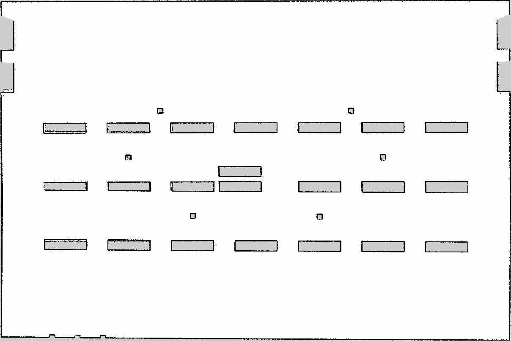
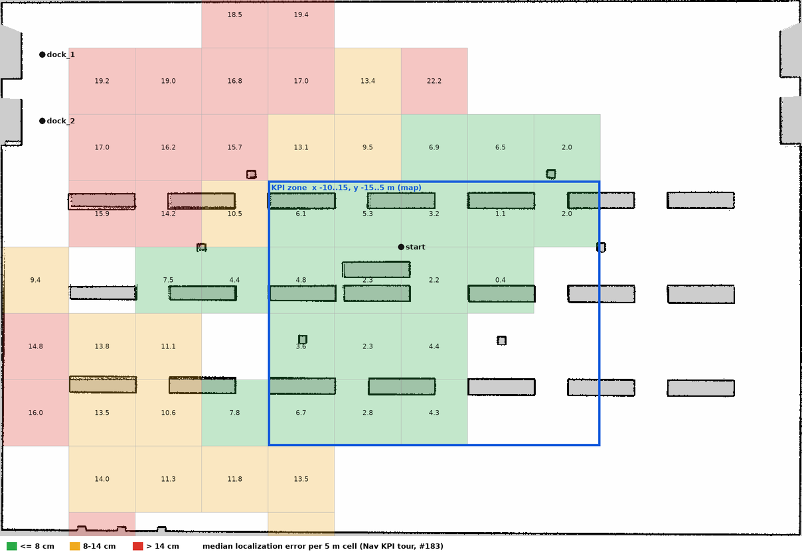

# amr_mapping

- 담당: 지수
- 빌드 타입: ament_python
- 책임: slam_toolbox 설정, 지도 저장(map.pgm/map.yaml), 맵 품질 평가. 저장한 지도는 `amr_localization`(민지)이 사용하며, 인계 조건은 [명세서 8-2절](../../../docs/project-spec.md#8-2-매핑위치추정-분업-지수--민지)을 따른다

## 제공 인터페이스

`mapping.launch.py` (slam_toolbox `async_slam_toolbox_node`) 기준. `<ns>` = 지도를 만드는 로봇 (기본 `amr_01`).

| 종류 | 이름 | 타입 | 설명 |
| --- | --- | --- | --- |
| Publish | `/map` | `nav_msgs/msg/OccupancyGrid` | 만들고 있는 지도, 2 s마다 갱신 |
| Publish | `/tf` | `tf2_msgs/msg/TFMessage` | `map` → `<ns>/odom` (매핑 중에만. 위치 추정 단계에서는 D4에 따라 `ekf_global`) |
| Subscribe | `/<ns>/scan` | `sensor_msgs/msg/LaserScan` | 필터 적용 스캔 (`amr_odometry`). `scan_topic:=scan_raw`로 원본도 가능 |
| Subscribe | `/tf` | `tf2_msgs/msg/TFMessage` | `<ns>/odom` → `<ns>/base_footprint` (지금은 Gazebo DiffDrive) |
| Service | `/slam_toolbox/save_map` 등 | `slam_toolbox/srv/*` | slam_toolbox 기본 서비스 |

전체 API 명세는 [docs/api.md](../../../docs/api.md)에 반영한다.

## 파라미터

`config/slam_toolbox_mapping.yaml`. slam_toolbox 기본 설정(`mapper_params_online_async.yaml`)을 먼저 읽고 아래 값만 덮어쓴다.
프레임 접두어와 scan 토픽은 launch가 `namespace`로 채운다.

| 이름 | 값 | 기본값 | 이유 |
| --- | --- | --- | --- |
| `resolution` | 0.05 m | 0.05 | 인계 계약: 0.05 m 이하 |
| `max_laser_range` | 20 m | 20 | LiDAR 최대 25 m 중 먼 곳은 비스듬히 맞아 노이즈가 커서 20 m까지만 |
| `min_laser_range` | 0.12 m | 0 | LiDAR 사양과 맞춤 (0이면 경고) |
| `minimum_travel_distance`, `minimum_travel_heading` | 0.3 m, 0.3 rad | 0.5, 0.5 | 통로 회전에서 스캔이 드물지 않게 |
| `map_update_interval` | 2 s | 5 | 진행 상황을 자주 보되 CPU 부담이 크지 않게 |
| `do_loop_closing` | true | true | 명세 3-1: Loop Closure |

launch 인자 (`mapping.launch.py`): `namespace`(기본 `amr_01`), `scan_topic`(기본 `scan`), `use_sim_time`(기본 `true`)

## 실행

```bash
# 1. sim + 센서 필터 (scan_raw → scan)
ros2 launch amr_gazebo sim.launch.py
ros2 launch amr_odometry sensor_filters.launch.py

# 2. 매핑 시작
ros2 launch amr_mapping mapping.launch.py

# 3. 로봇을 몰아 창고를 돈다. 지도 v1과 같은 경로로 자동 주행하려면 (GT로 길만 따라감, 0.6 m/s):
ros2 run amr_mapping map_route_driver
#    RViz에 Map(/map) 표시를 추가하면 그려지는 게 보인다

# 4. 지도 저장 (map.pgm + map.yaml)
ros2 run nav2_map_server map_saver_cli -f ~/maps/warehouse --ros-args -p use_sim_time:=true

# 5. 품질 평가 (월드 SDF 실제 위치와 비교, #81 기준 판정. 기준 미달이면 종료 코드 1)
ros2 run amr_mapping map_quality ~/maps/warehouse.yaml \
  $(ros2 pkg prefix amr_gazebo)/share/amr_gazebo/worlds/warehouse.sdf --start 0 1.5 0 --png ~/maps/warehouse.png
```

같은 주행으로 설정만 바꿔 비교하려면 2~3을 rosbag 녹화로 바꾸고, 녹화를 재생하며 slam_toolbox만 돌린다 (지도 v1 방법).

- **지도를 인계할 때 매핑 시작 자세(world 기준 x, y, yaw)를 같이 기록한다** (amr_gazebo README "GT 사용 시 주의"). slam_toolbox는 시작 자세를 `map` 원점으로 잡는다.
- `slam_toolbox`·`nav2_map_server`를 새 의존성으로 넣었다. 이미지를 다시 빌드해야 한다: `docker compose build`

## 지도 v1 (`maps/warehouse_v1.*`, 3주차 작업 2 인계)

**0.05 m(`warehouse_v1`)와 0.025 m(`warehouse_v1_0025`) 두 장을 같은 주행으로 만들어 넘긴다.** 위치 오차 KPI는 아래 정렬 보정값을 원점으로 쓰고(B안, 10/12 회의), 위치추정 기본 지도는 0.025 m로 정했다 (10/13, #157).

- 처음 하네스 10회(시작 자세를 그대로 원점으로)에서는 두 해상도 정지 오차가 6.0 cm로 같았다. 지도 밀림(약 6 cm, 아래 "지도 정렬")에 가려진 결과였다
- 정렬 보정값을 원점으로 쓰면 정지 오차 0.05 m 3.3 cm, **0.025 m 2.9 cm** (#98 민지 리뷰). AMCL 칸 양자화 편향(최대 반 칸)이 0.025 m에서 작아서다

| 항목 | 값 |
| --- | --- |
| 월드 | 월드 v0 + #65 (좁은 통로 ② 분리 랙 x −1.9), 동적 장애물 없음 |
| **매핑 시작 자세 (world)** | **x 0.0, y 1.5, yaw 0.0 → world = map + (0.0, 1.5)** (두 지도 같음, v0과도 같음) |
| 주행 | `map_route_driver`: 북쪽 루프(A–B 통로 → 동쪽 끝 → 메인 통로 → 서쪽 끝 → 출발 구간) → **좁은 통로 ②·① 직접 통과** → 남쪽 루프(B–C 통로 → 동쪽 끝 → C열 남쪽 → 서쪽 끝 → 출발 구간) → 출발점. **285.0 m, sim 552 s, 최대 0.6 m/s (좁은 통로 0.25 m/s)** |
| 좁은 통로 통과 | 선에서 벗어난 최대 거리 0.8 cm (통로 ②·①), 입구 정렬 구간 6.3 cm. 여유 10 cm (통로 0.6 m − 로봇 폭 0.4 m) |
| 입력 | `/amr_01/scan` (필터 적용), odom TF = Gazebo DiffDrive |
| 방법 | 주행을 rosbag으로 녹화한 뒤, 재생하며 slam_toolbox를 해상도만 바꿔 두 번 돌렸다 (같은 주행이라 해상도 효과만 비교된다) |
| 크기 | 0.05 m: 1208 × 808 칸 (약 1 MB) / 0.025 m: 2417 × 1616 칸 (약 4 MB) |



**위치 KPI 측정 구역** (10/16 팀 합의, #183): map x −10–15 m, y −15–5 m. 구역 안 위치 오차 중앙값 3.5 cm, 밖 13.3 cm. 서쪽·북쪽 끝은 지도 휨으로 14–22 cm라 재매핑(5주차)으로 고친다. 칸별 표와 근거는 [localization.md 3-1절](../../../docs/algorithms/localization.md)



**지도 정렬** (`map_quality`: 점유 칸 전체를 월드 물체 테두리에 강체 정합, 출발점 기준 회전)

| 지도 | dx | dy | dθ | `map_origin_in_world` 보정값 |
| --- | --- | --- | --- | --- |
| **v1 0.05 m** | **−5.7 cm** | **+1.7 cm** | +0.008° | **[−0.0571, 1.5167, 0.00013]** |
| **v1 0.025 m** | **−5.6 cm** | **+3.2 cm** | +0.005° | **[−0.0562, 1.5317, 0.00009]** |
| v0 (참고) | −1.6 cm | +2.5 cm | +0.094° | [−0.0157, 1.5254, 0.00164] |

- SLAM 지도가 월드보다 약 6 cm 밀려 그려졌다. 시작 자세 (0, 1.5, 0)를 그대로 쓰면 이만큼이 위치추정 오차에 섞인다 (민지 하네스: 측정 구역 평균 밀림 x +3.6, y −3.0 cm)
- 원인은 SLAM이다. 녹화한 원본 스캔을 정답 자세로 월드에 찍으면 랙·벽과 0.0 cm 차이라 LiDAR·TF는 정상이다
- 출발점 근처(x −6\~6, y −2\~5)만 쓴 정렬: 0.05 m dx −5.7, dy +0.8 cm, dθ −0.164° / 0.025 m dx −4.6, dy +2.5 cm, dθ −0.136° (`--region`). 전체 정렬과 x 0~1 cm 차이다
- 보정값은 지도와 월드 SDF만으로 구한다 (위치추정 결과를 보지 않는다). 이 값으로 KPI를 잴지는 회의에서 정한다 (민지 제안 B안: 한 번 정한 고정값)

**품질** (`map_quality`, 정렬한 뒤 월드 SDF 실제 위치와 비교)

| 항목 | v0 | **v1 0.05 m** | **v1 0.025 m** | 기준 (#81, #96에서 변경) |
| --- | --- | --- | --- | --- |
| 랙·기둥 28개 · 도크·충전기 7개 · 외벽 4면 | 모두 있음 | 모두 있음 | 모두 있음 | |
| 좁은 통로 ① / ② 안 미관측 | 0% / 26% | **0% / 0%** | 0% / 1% | |
| 유령·이중 벽 (물체에서 0.3 m 넘게 떨어진 점유 칸) | 256칸 (#65 전 랙 자리) | **0칸** | 0칸 | 0칸 |
| 구조 정확도: 물체별 밀림 중앙값 / 최대 | 3.6 / 14.1 cm | **4.1 / 15.1 cm** (`dock_1`) | 3.9 / 16.0 cm (`dock_1`) | ≤ 5 / ≤ 15 cm |
| (참고) 테두리 \|거리\| 중앙값 / 최대 | 4.2 / 8.5 cm | 5.7 / 13.4 cm | 4.4 / 14.5 cm | — |
| (참고) 부호 있는 거리 중앙값 / 최대 | 1.5 / 6.5 cm | 1.6 / 13.4 cm | 1.9 / 14.5 cm | — |
| 창고 안 빈 바닥 중 미관측 칸 | 0.10% | 0.00% | 0.01% | — |

- **구조 정확도**: 정렬한 뒤 물체마다 평행이동을 맞춰 몇 cm 밀렸는지 잰다. 양쪽 면을 같이 보므로 벽 띠 두께와 무관하고, 지도 일부가 접히거나 휜 것을 잡는다
  - 처음 합의한 "부호 있는 거리 중앙값"은 물체를 통째로 옮기면 양쪽 면이 +·−로 상쇄돼 밀림을 못 잡아서 바꿨다 (`test_signed_median_misses_translation_but_shift_catches_it`)
  - 테두리 \|거리\|는 같은 벽을 여러 번 지날수록 띠가 두꺼워져 커진다 (0.05 m에서 2.5 ↔ 7.5 cm로 뛴다). 참고값으로만 둔다
- **최대가 기준을 넘는다 (0.05 m 15.1 cm, 0.025 m 16.0 cm, 둘 다 `dock_1`).** 지도 양 끝에 SLAM 누적 오차가 남아 있다. 민지와 "조건부 합격"으로 기록하기로 했다 (#98 리뷰)
  - 서쪽 입고 도크 `dock_1`·`dock_2`: 창고 쪽 면이 둘 다 13.3~13.4 cm 서쪽으로 그려졌다 (매핑 경로에서 비스듬히만 보이는 곳)
  - 남동쪽 끝 `rack_c7`: 긴 두 면이 함께 남쪽으로 약 13 cm (v0도 이 랙이 최대)
  - 출발점에서 27~30 m 떨어진 곳이다. 하네스 측정 구역(출발점 근처) 물체는 모두 기준 안이다
- slam_toolbox `occupancy_threshold`를 0.1 → 0.3으로 바꿔도 띠 두께·밀림이 그대로라 기본값 0.1을 쓴다. 1배속·2배속 재생으로 만든 지도는 칸 단위까지 같다
- 0.025 m는 지도 자체의 밀림·구조 정확도가 0.05 m와 거의 같다 (같은 주행이라 SLAM 누적 오차가 같다). 차이는 위치추정의 칸 양자화 편향에서 난다 (위 해상도 결정)

**루프 클로저 확인** (재생 중 slam_toolbox `map → amr_01/odom` 보정을 0.1 s마다 기록, 0.05 m 실행)

| 보정이 크게 바뀐 곳 | 크기 | 해석 |
| --- | --- | --- |
| 통로 끝 모서리의 제자리 회전 (예: (26.9, 3.3), (26.8, 11.9), (−26.9, 11.8), (−26.9, 3.1)) | 회전 1.4\~1.6°, 이동 60\~73 cm | 회전 중 odom 회전량 오차를 스캔 매칭이 바로잡음. 이동이 큰 건 map 원점에서 약 27 m 떨어진 곳의 회전 보정이라서다 |
| **출발 구간 재방문**: 북쪽 루프 복귀 (−5.4\~2.6, 3.0), 남쪽 루프 복귀 (−4.4, −4.0)·(2.8, 0.0) | 북쪽 2\~4.5 cm, **남쪽 18.2·8.8 cm**, 회전 0.1° 미만 | 지나간 곳에 돌아와 이전 스캔과 맞추며 누적 위치 오차만 바로잡음 → **루프 클로저로 본다** |

- slam_toolbox는 루프 클로저를 로그로 따로 남기지 않아 위 보정과 이중 벽 0칸(같은 곳을 두 번 지나도 한 겹)을 근거로 삼는다.
- 끝날 때 누적 보정 map → odom ≈ (−1.57 m, −0.21 m, −5.4°): 285 m 동안 DiffDrive odom이 틀어진 양이다.

**rosbag** (`warehouse_v1_mapping`, 320 MB, 레포에 넣지 않음. 민지 루프 클로저 디버깅·연우 #49용으로 따로 공유)

| 토픽 | 용도 |
| --- | --- |
| `/amr_01/scan`, `/amr_01/scan_raw` | 필터 적용·원본 스캔 (각 5586개, 10 Hz) |
| `/tf`, `/tf_static`, `/clock` | odom → base_footprint (DiffDrive), 로봇 TF, sim 시간 |
| `/amr_01/imu/data`, `/amr_01/imu/data_raw`, `/amr_01/joint_states`, `/amr_01/diff_drive/odom` | EKF·오도메트리 재현 |
| `/amr_01/ground_truth/odom` | 정답 (평가 전용) |

재생해서 지도 만들기: `RATE=1.0 bash tools/run_slam_offline.sh 0.05 warehouse_v1` (bag 재생 + slam_toolbox, `use_sim_time:=true`, 녹화된 `/clock` 사용).
`--clock`은 붙이지 않는다 (bag에 `/clock`이 있어 시계가 두 개가 된다).

## 지도 v0 (`maps/warehouse_v0.*`, 작업 7 매핑 시도, #65 전 월드라 지금 월드와 다름)

| 항목 | 값 |
| --- | --- |
| 월드 | 월드 v0 (`warehouse.sdf`), 동적 장애물 없음 |
| 매핑 시작 자세 (world) | x 0.0, y 1.5, yaw 0.0 → **world = map + (0.0, 1.5)** |
| 주행 | 통로를 한 바퀴 (A–B 통로 → 메인 통로 → 서쪽 끝 → C열 남쪽 → B–C 통로 → 출발점), 261 m, 최대 1 m/s |
| 입력 | `/amr_01/scan` (필터 적용), odom = Gazebo DiffDrive (바퀴 접촉 수정 #36 반영) |
| 크기 · 해상도 | 1207 × 808 셀 (60.4 × 40.4 m), 0.05 m |


(`warehouse_v0.png`는 README 표시용으로 `.pgm`을 그대로 바꾼 것)

**품질 (월드 SDF 실제 위치와 비교)**

| 항목 | 결과 |
| --- | --- |
| 랙·기둥 28개 | 28개 모두 지도에 있음 |
| 랙·기둥 테두리 위치 오차 | 물체별 중앙값 2.5 cm (최대 12.5 cm, `rack_c7`·`rack_c6`) |
| 바깥 벽 안쪽 면 | 동 −7.5 cm, 서 +12.5 cm, 북 −2.5 cm, 남 +7.5 cm (도크·충전기 구간 제외) |
| 벽 겹침·접힘 | 없음 (육안) |

- 방법: 점유 셀을 world 좌표로 옮긴 뒤(+ (0, 1.5)), 각 물체 근처 점유 셀과 실제 사각형 테두리 사이 거리를 잰다.
- 0.05 m 셀 하나가 5 cm라 중앙값 2.5 cm는 반 칸 수준이다. 오차가 가장 큰 곳은 출발점에서 가장 먼 남동쪽(C열 동쪽 끝)이다.
- 이 지도는 `min_laser_range` 0(기본값)으로 만들었다. 0.12로 바꾼 설정은 근거리(0.12 m 미만) 점만 빼는 차이라 결과에 영향이 거의 없다.
- 아직 안 한 것: 동적 장애물이 있는 상태, 루프 클로저가 실제로 동작했는지 확인(이번 로그에서는 루프 클로저 메시지를 찾지 못함), 맵 품질 지표 정의(명세 3-1).

## 테스트

```bash
colcon test --packages-select amr_mapping
```

`test_map_quality.py`: 테두리 거리(회전 사각형 포함), 완벽한 지도 합격, 시작 자세 변환·유령 칸, 20 cm 어긋난 지도 불합격, 띠 두께와 위치 어긋남 분리, 빈 바닥 미관측 비율, SDF 읽기, pgm·png.
